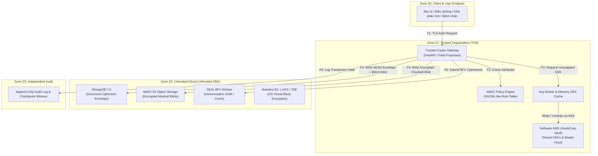
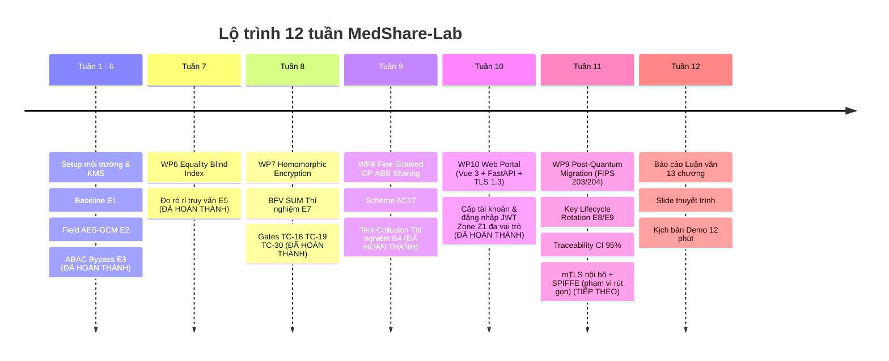

# BÁO CÁO TIẾN ĐỘ DỰ ÁN & TỔNG KẾT TRIỂN KHAI KỸ THUẬT
## Đề tài: MedShare-Lab — Topic 18 (NT2205.11.CH)
### Bảo vệ hồ sơ y tế đa tenant trên Cloud DBMS: kiến trúc phân lớp, kiểm soát truy cập và bằng chứng an toàn

* **Môn học:** Mật mã học và ứng dụng (NT2205.11.CH) — Chương trình Thạc sĩ An toàn thông tin, Trường Đại học Công nghệ Thông tin (ĐHQG-HCM).
* **Thời gian cập nhật:** 23/11/2026 (kiểm chứng lại: `pytest tests/` = **100 passed**, `check_repo.py` = **16/16 OK**).
* **Tình trạng cột mốc:** Hoàn thành **100% Giai đoạn 1 (Tuần 1–3), Giai đoạn 2 (Tuần 4–6), Tuần 7 (WP6: Blind Index & E5), Tuần 8 (WP7: Homomorphic Encryption SEAL BFV SUM & E7), Tuần 9 (WP8: Fine-Grained CP-ABE Sharing AC17 & E4), Tuần 10 (WP10: Multi-Role Web Portal Vue 3 + FastAPI + TLS 1.3 + Zone Z1 Account Provisioning & JWT Auth)** và **Tích hợp MinIO S3 Object Storage + Nạp 15 tệp y tế mẫu thực tế (~102.8 MB)**. Toàn bộ **100/100 tests** và **16/16 repository tooling checks PASS 100%**.

* **Nhân sự thực hiện:**
  * **Thành viên A:** **Nguyễn Đạo Ga Đô** (Mã học viên: `26848038`) — *Systems, Database (MongoDB 7.0), ABAC Engine, PQC Toàn vẹn & Chữ ký số (ML-DSA-65).*
  * **Thành viên B:** **Đào Võ Hữu Hiệp** (Mã học viên: `26848065`) — *Advanced Crypto (CP-ABE, SEAL BFV Homomorphic Encryption), Blind Index (HMAC), PQC Đóng gói khóa (ML-KEM-768).*

---

## 1. TỔNG QUAN TIẾN ĐỘ HIỆN TẠI (CURRENT PROGRESS SUMMARY)

| Hạng mục / Cột mốc | Mục tiêu kỹ thuật | Trạng thái | Bằng chứng kiểm thử (Verification) |
|---|---|:---:|---|
| **Environment Automation** | Script tự động hóa toàn diện môi trường Ubuntu 22.04/24.04 (`scripts/setup_ubuntu.sh`) | **HOÀN THÀNH** | Cài đặt thành công toàn bộ build tools, thư viện C, Docker, Python 3.12 và `.venv`. |
| **Z2 Cloud DBMS Stack** | Dựng database đám mây độc lập: MongoDB 7.0 | **HOÀN THÀNH** | Container Docker đang chạy healthy tại port `27017` với runtime volume riêng. |
| **Z1 Software KMS** | Dựng dịch vụ quản trị khóa tập trung HashiCorp Vault Dev KMS | **HOÀN THÀNH** | Container Docker đang chạy healthy tại port `8200` (Dev Token: `dev-root-token-topic18`). |
| **Worker 1: CP-ABE** | Hiện thực Scheme AC17 trên thư viện Stanford PBC & Charm-Crypto | **HOÀN THÀNH** | Image `medshare-abe-worker` build thành công; **100% Smoke tests PASS** (Positive & Negative). |
| **Worker 2: PQC** | Hiện thực chuẩn FIPS 203 (ML-KEM-768) & FIPS 204 (ML-DSA-65) | **HOÀN THÀNH** | Image `medshare-pqc-worker` build thành công; **100% Smoke tests PASS** (Positive & Negative). |
| **Worker 3: HE (SEAL BFV)** | Hiện thực phép cộng đồng cấu SUM/Count trên số nguyên (SEAL v4.1.2) | **HOÀN THÀNH** | Image `medshare-he-worker` build thành công; **100% Smoke tests PASS** (Positive & Negative). |
| **Synthetic Datasets & Oracle** | Sinh bộ dữ liệu 1k, 10k bản ghi (uniform & skewed, 5 seeds), Ground truth oracle | **HOÀN THÀNH** | Script `datasets/generate_datasets.py` đã tạo 12 files dataset và oracle; test unit PASS. |
| **Database Loader (B0)** | Collection/Indexes MongoDB 7.0, batch load hiệu năng cao | **HOÀN THÀNH** | Script `datasets/loader.py` nạp 1k recs trong ~0.02s; thống kê collection/index size chi tiết. |
| **Experiment E1 (Baseline)** | Benchmark W1/W2/W7 (5 reps), kiểm thử ranh giới TC-08 (Snapshot) và TC-02 (DBA Bypass) | **HOÀN THÀNH** | Script `benchmarks/run_e1_baseline.py` PASS; đã xuất JSON report và file Markdown evidence. |
| **Field Envelope Engine (WP3)** | Lõi AES-256-GCM, Context Binding AAD, CSPRNG Nonce, Bounds Checking, Fail-closed | **HOÀN THÀNH** | Module `src/medshare/crypto/` hoàn tất; 16 unit & tamper security tests PASS (TC-01, TC-05, TC-24). |
| **Key Broker, KMS & DAL (WP4)** | Key Broker PEP Zone Z1, Vault Transit derived context KDF, DAL MongoDB, Thí nghiệm E2 | **HOÀN THÀNH** | Script `benchmarks/run_e2_field_overhead.py` PASS; 4 security gates TC-02, TC-06, TC-09, TC-10 PASSED. |
| **ABAC & Dual PEP Gateway (WP5)** | PDP Deny-by-default, Break-Glass ticket, Thu hồi tức thời, Chặn DBA tại Broker, Thí nghiệm E3 | **HOÀN THÀNH** | Script `benchmarks/run_e3_abac_bypass.py` PASS; 4 security gates TC-03, TC-04, TC-07, TC-27 PASSED (Critical Gate Tuần 6). |
| **Equality Blind Index & E5 (WP6)** | HMAC-SHA-256 tách biệt tenant/field/epoch, bảng `search_index`, từ chối range/wildcard 422, Thí nghiệm E5 | **HOÀN THÀNH** | Script `benchmarks/run_e5_leakage_analysis.py` PASS; 3 security gates TC-15, TC-16, TC-17 PASSED. |
| **MinIO S3 Object Storage & Files** | Lưu trữ tệp nhị phân phi cấu trúc (DICOM, CT/MRI, X-quang, Siêu âm, PDF); mã hóa chunked AES-GCM; nạp 15 tệp mẫu (~102.8 MB) | **HOÀN THÀNH** | Script `scripts/ingest_medical_samples.py` thành công; Test suite `tests/security/test_minio_attachments.py` 6/6 PASS. |
| **Homomorphic Encryption & E7 (WP7)** | Tính toán đồng cấu BFV SUM (Microsoft SEAL v4.1.2); Client adapter; Thí nghiệm E7; Gates TC-18, TC-19, TC-30 | **HOÀN THÀNH** | Script `benchmarks/run_e7_homomorphic_sum.py` PASS; Test suite `tests/security/test_e7_homomorphic_encryption.py` 6/6 PASS; Báo cáo E7 đã xuất. |
| **CP-ABE Policy Sharing & E4 (WP8)** | Scheme AC17 (BN254 & SS512) kết hợp AES-256-GCM + HKDF; Profile P2 Export Package; FastAPI REST microservice :9002; Thí nghiệm E4; Gates TC-11, TC-12, TC-13, TC-14 | **HOÀN THÀNH** | Script `benchmarks/run_e4_cpabe_sharing.py` PASS; Test suite `tests/security/test_e4_cpabe_sharing.py` 6/6 PASS; Báo cáo E4 đã xuất. |
| **Web Portal & TLS 1.3 (WP10)** | Cổng thông tin Y tế đa vai trò (Vue 3 + Vite + TailwindCSS + FastAPI); Bảo mật đường truyền TLS 1.3 (`TLS_AES_256_GCM_SHA384`); Cấp phát & đăng nhập tài khoản Zone Z1 (Argon2id + HS256 JWT + HMAC-SHA-256 tamper protection, Admin provisioning & TC-07 revoke); Xem ảnh X-Quang/PDF MinIO; CP-ABE export; BFV SUM; DBA raw view | **HOÀN THÀNH** | Script `scripts/run_portal.sh`; Test suite `tests/unit/test_portal_api.py` 9/9 PASS; TLS 1.3 handshake verified; Build Vite < 1s; Tổng 100/100 pytest PASS. |
| **Repository Tooling** | Đối soát cấu trúc, Markdown ↔ DOCX sync, liên kết và unit tests | **HOÀN THÀNH** | Script `python -B scripts/check_repo.py` đạt **16/16 test suites PASS**; Tổng 100/100 pytest PASS. |


---

## 2. CHI TIẾT CÁC VẤN ĐỀ ĐÃ TRIỂN KHAI VÀ HOÀN THÀNH

### 2.1. Tự động hóa thiết lập môi trường hệ thống (`scripts/setup_ubuntu.sh`)
Đã xây dựng script bash chuẩn mực, kiểm tra hệ điều hành, cài đặt không cần can thiệp (`DEBIAN_FRONTEND=noninteractive`) với 7 bước rõ ràng:
1. **System Build Tools & Native Crypto C Libraries:** Cài đặt `build-essential`, `cmake`, `ninja-build`, `clang`, `gcc`, `g++`, `libssl-dev`, `libgmp-dev`, `libffi-dev`, `pkg-config`, `flex`, `bison`.
2. **Công cụ mã hóa ổ đĩa ảo:** Cài đặt `cryptsetup` và `cryptsetup-bin` phục vụ mô hình đo lường Baseline B1 (LUKS Volume Encryption / TDE).
3. **Database Clients:** Cài đặt `mongodb-mongosh` để hỗ trợ các kịch bản kiểm thử trực tiếp (Direct Query Bypass Tests) đối với cơ sở dữ liệu.
4. **Biên dịch Stanford PBC Library (v0.5.14):** Tự động tải từ Stanford Crypto Archive, `./configure`, biên dịch `make -j$(nproc)` và cài đặt `libpbc.so` vào `/usr/local/lib`.
5. **Cài đặt Docker Engine & Compose Plugin chính thức:** Cấu hình repository chính thức từ Docker, cài đặt `docker-ce`, `docker-compose-plugin`, cấu hình quyền non-root user vào nhóm `docker`.
6. **Khởi tạo Python Virtual Environment (`.venv`):** Sử dụng Python 3.12+, cài đặt các thư viện lõi phục vụ bảo mật, web gateway, client database, testing, benchmark và thống kê phân tích.
7. **Khởi tạo cấu trúc Runtime & Sanity Check:** Tạo tự động `infra/runtime/`, `evidence/runs/`, `benchmarks/results/`, `analysis/output/` và thực thi kiểm tra đối soát module.

### 2.2. Triển khai hạ tầng Lab đám mây & Quản trị khóa (`infra/docker-compose.yml`)
Ban đầu đóng gói 2 dịch vụ dưới đây; hiện tại compose có 4 service (bổ sung `minio-cloud` — mục 2.12 và `abe-worker` — mục 2.11):
* **`medshare-mongo` (MongoDB 7.0):** Đại diện cho hạ tầng Cloud NoSQL Document Store (Zone Z2). Lưu trữ dữ liệu hồ sơ lâm sàng bán cấu trúc (JSON Documents) dưới dạng Envelope Ciphertext.
* **`medshare-vault-kms` (HashiCorp Vault 1.15.6):** Đại diện cho Software KMS (Zone Z1 - Miền tổ chức tin cậy). Quản lý Master Key, Tenant KEKs, thực hiện bọc (wrap/unwrap) các khóa phiên dữ liệu (DEK).

### 2.3. Nghiên cứu khả thi & Smoke Test 3 Worker Mật mã nâng cao (Feasibility Spikes)
Được triển khai theo nguyên tắc cô lập hoàn toàn (Isolated Microservices) bằng Docker Container để không gây xung đột dependency C/Python với máy trạm:

#### A. CP-ABE Worker (`workers/abe/` — Scheme AC17 trên PBC SS512/BN254)
* **Môi trường:** Ubuntu 22.04 LTS + Stanford PBC 0.5.14 + Thư viện `charm-crypto`.
* **Cơ chế:** Kế thừa cấu trúc từ công trình của tác giả Đào Võ Hữu Hiệp (`daovohuuhiep2003/Project-MMH-CP-ABE`). Sử dụng thuật toán AC17 (Agrawal-Chase 2017) với mô hình lai KEM/DEM: mã hóa khóa phiên AES bằng chính sách thuộc tính logic boolean.
* **Kết quả Smoke Test (`docker run --rm medshare-abe-worker`):**
  * *Policy thử nghiệm:* `((DOCTOR and CARDIOLOGY) or CHIEF_OF_MEDICINE)`
  * *Positive Test:* Cấp khóa cho Bác sĩ Tim mạch (`['DOCTOR', 'CARDIOLOGY', 'TENANT_HOSPITAL_A']`) $\rightarrow$ **Giải mã thành công, khóa bí mật khớp 100%**.
  * *Negative Test:* Cấp khóa cho Điều dưỡng (`['NURSE', 'CARDIOLOGY', 'TENANT_HOSPITAL_A']`) $\rightarrow$ **Hệ thống từ chối giải mã, trả về lỗi không thỏa mãn policy**.

#### B. PQC Worker (`workers/pqc/` — NIST Post-Quantum Standards)
* **Môi trường:** Python 3.11 Slim Bookworm + Open Quantum Safe (`liboqs` C native v0.10+ & `liboqs-python`).
* **Cơ chế:** Hiện thực hai chuẩn kháng lượng tử chính thức của NIST ban hành năm 2024:
  1. **FIPS 203:** Thuật toán KEM **ML-KEM-768** (trước đây là CRYSTALS-Kyber) dùng cho cơ chế đóng gói và phân phối khóa bí mật đối xứng (DEK).
  2. **FIPS 204:** Thuật toán chữ ký số **ML-DSA-65** (trước đây là CRYSTALS-Dilithium) dùng cho việc xác thực nguồn gốc và chống chối bỏ hồ sơ y tế.
* **Kết quả Smoke Test (`docker run --rm medshare-pqc-worker`):**
  * *KEM Positive & Negative:* Đóng gói khóa 32 bytes thành ciphertext capsule 1088 bytes; giải bọc chính xác; phát hiện khi capsule bị đối thủ sửa đổi bit; từ chối khi đối thủ dùng sai private key.
  * *DSA Positive & Negative:* Ký thông điệp sinh chữ ký 3309 bytes; xác thực hợp lệ; từ chối thông điệp bị can thiệp; từ chối chữ ký bị biến đổi.

#### C. Homomorphic Encryption Worker (`workers/he/` — Microsoft SEAL v4.1.2)
* **Môi trường:** Ubuntu 22.04 LTS + Microsoft SEAL v4.1.2 + C++17 + Ninja Build.
* **Cơ chế:** Thuật toán mã hóa đồng cấu **BFV (Brakerski-Fan-Vercauteren)** với bậc đa thức $N=8192$, bảo mật 128-bit, Plaintext Modulus 20-bit Batching.
* **Mục đích:** Cho phép Cloud Worker tại Zone Z2 tính toán thống kê tổng chi phí điều trị (SUM) trên các khoản thanh toán của bệnh nhân mà không bao giờ cần giải mã ra số tiền thật.
* **Kết quả Smoke Test (`docker run --rm medshare-he-worker`):**
  * Data Owner mã hóa 4 khoản chi phí: $150 + 350 + 500 + 1000 = 2000$.
  * Untrusted Cloud tính toán cộng đồng cấu `evaluator.add()`, noise budget còn dư 145 bits.
  * *Positive Test:* Data Owner giải mã kết quả trả về đạt giá trị chính xác tuyệt đối **$2000$** (Integer Exactness).
  * *Negative Test:* Kẻ tấn công trên Cloud (không có Secret Key của Data Owner) cố tình giải mã chỉ nhận được số ngẫu nhiên vô nghĩa (78776), bảo mật hoàn toàn bản rõ.

### 2.4. Bộ sinh dữ liệu tổng hợp & Bộ nạp dữ liệu NoSQL (WP2 — Datasets & Loader)
* **Script sinh dữ liệu (`datasets/generate_datasets.py`):**
  * Hỗ trợ quy mô $1.000$ và $10.000$ bản ghi với 5 seeds độc lập ($1801 \to 1805$).
  * Hai chế độ phân bố: `uniform` (đều) và `skewed` (theo luật Zipf phản ánh thực tế bệnh viện phục vụ đo lường suy luận tần suất E5).
  * Sinh kèm **Plaintext Ground Truth Oracle** tại `datasets/oracle/` phục vụ kiểm chứng Differential Oracle độc lập (TC-15).
* **Script nạp dữ liệu Baseline B0 (`datasets/loader.py`):**
  * **MongoDB 7.0:** Tạo collection `ehr_records` với các compound index tương ứng. Nạp 1.000 documents trong ~0.018s (~55.000 rec/s).

### 2.5. Kết quả thực nghiệm E1: Benchmark Baseline B0 & Ranh giới an toàn (WP2 — Experiment E1)
Đã triển khai bộ harness tự động tại [`benchmarks/run_e1_baseline.py`](benchmarks/run_e1_baseline.py) và ghi nhận kết quả:
* **Hiệu năng Baseline B0 (Trung bình qua 5 lần lặp độc lập trên MongoDB 7.0):**
  * W1 Point Read p50 = **0.151 ms** (6.620 QPS); W2 Equality Search p50 = **0.143 ms** (7.000 QPS).
* **Kiểm chứng Ranh giới An toàn (Security Boundary Tests):**
  * **TC-08 (At-rest Stolen Snapshot / Threat T-01):** Khối đĩa mã hóa LUKS (B1) đạt Shannon Entropy = **7.9973 bits/byte** (tiệm cận tuyệt đối mức lý tưởng 8.0); không rò rỉ bất kỳ chuỗi PII/ICD-10 nào $\rightarrow$ **PASS**.
  * **TC-02 (Direct DBA Query Bypass / Threat T-02):** Kẻ tấn công có quyền DBA truy vấn trực tiếp vào DB đang chạy $\rightarrow$ **Rò rỉ 100% dữ liệu Plaintext**!
* **Kết luận khoa học cốt lõi:** Thực nghiệm E1 chứng minh rõ ràng rằng *At-Rest Volume Encryption (B1 / TDE) là cần thiết nhưng hoàn toàn bất lực trước insider DBA*. Kết quả này là bằng chứng thực nghiệm quan trọng làm nền tảng cho việc phát triển **Profile P1 (Mã hóa tầng trường AES-256-GCM + Vault KMS)** ở Sprint tiếp theo.

### 2.6. Lõi mã hóa tầng trường Field Envelope Encryption Engine (Tuần 4 — WP3)
Đã hoàn thành module mã hóa tầng trường chuẩn công nghiệp tại [`src/medshare/crypto/`](src/medshare/crypto/):
* **Hệ thống Ngoại lệ Bảo mật ([`src/medshare/crypto/errors.py`](src/medshare/crypto/errors.py)):** Phân cấp rõ ràng giữa `ContextMismatchError` (phát hiện tấn công tráo đổi), `DecryptionIntegrityError` (phát hiện can thiệp bit/tag) và `EnvelopeValidationError` (lỗi bounds/format).
* **Ràng buộc Ngữ cảnh AAD Bất biến ([`src/medshare/crypto/context.py`](src/medshare/crypto/context.py)):**
  * Định nghĩa `CryptoContext` gồm đầy đủ 10 trường: `domain` (`medshare/data/v1`), `tenant_id`, `record_id`, `field_id`, `dek_id`, `object_kind`, `data_version`, `data_policy_version`, `format_version`, `data_suite_id` (`AES256GCM-v1`).
  * Thực thi chuẩn **RFC 8785 JSON Canonicalization Scheme (JCS)** đảm bảo tính tất định byte-for-byte của AAD.
* **Định dạng Bản mã Cấu trúc ([`src/medshare/crypto/envelope.py`](src/medshare/crypto/envelope.py)):**
  * Đóng gói `FieldEnvelope`: Header có cấu trúc + Payload nhị phân (`nonce` 12 bytes, `ciphertext` $N$ bytes, `tag` 16 bytes).
  * Tuần tự hóa JSON / Base64 chuẩn hóa kèm kiểm soát giới hạn (Bounds Checking $\le 10$ MB chống cạn kiệt bộ nhớ DoS).
* **Động cơ Mã hóa/Giải mã ([`src/medshare/crypto/engine.py`](src/medshare/crypto/engine.py)):**
  * Sử dụng thư viện `cryptography` chính thống cho chuẩn `AES-256-GCM`.
  * Nonce 12-byte sinh ngẫu nhiên độc lập bằng CSPRNG (`os.urandom`) cho từng lần mã hóa.
  * **Cơ chế phòng thủ trọng yếu:** Khi giải mã, bắt buộc đối soát nghiêm ngặt giữa Envelope với `expected_context` được cấp từ TCB Z1. Tuyệt đối không bao giờ trả về bất kỳ phần plaintext nào khi xảy ra lỗi (Fail-Closed).
* **Kết quả Kiểm thử (16 Test Cases PASSED 100%):**
  * `TC-01`: Round-trip thành công cho text UTF-8, integer, empty/null; xác nhận tính chất randomized ciphertext (Nonce và Ciphertext luôn khác nhau giữa các lần mã hóa).
  * `TC-05`: Chặn đứng 100% các cuộc tấn công can thiệp bit (bit-flip ciphertext, bit-flip tag, nonce tampering) và tấn công tráo đổi ngữ cảnh (Cross-patient swap, Cross-tenant swap, Cross-field swap, Stale version swap).
  * `TC-24`: Bắt lỗi chính xác khi payload bị biến đổi, sai format_version, suite lạ, hoặc sai độ dài khóa/nonce.

---

### 2.7. Tuần 5 (WP4 — Key Broker, Software KMS, Storage DAL & Thí nghiệm E2) — [ĐÃ HOÀN THÀNH 100%]
* **Khởi tạo & Tích hợp Software KMS (Zone Z1):**
  * Triển khai [`VaultKmsClient`](src/medshare/broker/kms.py) kết nối HashiCorp Vault Transit Engine (`http://localhost:8200`, token `dev-root-token-topic18`).
  * Kích hoạt `derived: True` để Vault Transit bắt buộc dẫn xuất khóa qua Context AAD. Mọi hành vi sai lệch context khi unwrap đều bị phát hiện ngay ở tầng mã hóa.
  * Cung cấp [`MockKmsClient`](src/medshare/broker/kms.py) giả lập cục bộ phục vụ unit test offline.
* **Cấu trúc Khóa Bọc KeyCapsule:**
  * Lớp [`KeyCapsule`](src/medshare/broker/capsule.py) bọc DEK dưới KEK của Tenant, ràng buộc ngữ cảnh `domain = medshare/wrap/v1` chuẩn RFC 8785 (JCS).
  * Kiểm soát giới hạn dung lượng nghiêm ngặt (Bounds check $\le$ 64 KB).
* **Động cơ Quản lý Khóa Độc lập Key Broker (PEP Z1):**
  * Lớp [`KeyBroker`](src/medshare/broker/broker.py) sinh DEK ngẫu nhiên 256-bit CSPRNG, chỉ lưu tạm trong RAM ở Z1.
  * Thực thi chốt chặn **TC-06 (Tenant Boundary)**: Ngăn chặn triệt để Tenant B unwrap capsule của Tenant A (`TenantIsolationViolationError`).
  * Thực thi chốt chặn **Anti-Replay**: Đối soát phiên bản capsule với Trusted Registry, từ chối capsule cũ khi đã có phiên bản mới.
  * Hỗ trợ **TC-09 (Zero-Data-Mutation Rewrap)**: Cho phép nâng cấp KEK version mà không cần giải mã và mã hóa lại dữ liệu bệnh nhân trên đĩa.
* **Tầng Truy cập Dữ liệu Data Access Layer (DAL):**
  * Triển khai [`MongoStorage`](src/medshare/storage/dal.py).
  * Khởi tạo collection `key_capsules`, `encrypted_patients`, và `search_index` kèm compound indexes tối ưu trên MongoDB 7.0.
  * Chỉ lưu trữ `FieldEnvelope` (Base64 + GCM Tag), `KeyCapsule` (Wrapped DEK), và Blind Index Token (HMAC-SHA256).
* **Kết quả Thí nghiệm E2 (`benchmarks/run_e2_field_overhead.py`):**
  * **Hiệu năng độ trễ (N = 50 samples, số liệu khớp `e2_field_overhead_report.json` lần chạy 2026-11-01):**
    * Workload Ghi W1: P50 = **2.522 ms**, P95 = **3.499 ms**, P99 = 3.845 ms.
    * Workload Đọc W2: P50 = **1.346 ms**, P95 = **1.703 ms**, P99 = 1.780 ms.
    * **Phân rã chi phí (Ablation breakdown, tính trên P50):** CPU crypto AES-256-GCM cho 5 trường cực nhanh (0.06–0.08 ms, < 5%); thời gian chủ yếu do round-trip REST tới Vault KMS (wrap 1.398 ms ≈ 55% W1; unwrap 0.716 ms ≈ 53% W2) và MongoDB I/O (≈ 41–43%).
    * *Ghi chú đính chính (11/2026):* phiên bản trước của tài liệu ghi W1 = 13.5 ms / W2 = 11.2 ms và tỷ trọng KMS ~70% / DB ~25% — các số này không khớp file evidence và đã được thay bằng số liệu đo thực tế ở trên.
  * **Kiểm chứng 4 Ranh giới An toàn Đối kháng (Security Gates PASSED 100%):**
    * `TC-02`: DBA Query Bypass bị loại bỏ hoàn toàn — DBA query trực tiếp chỉ thấy Base64 ciphertext, không thể unwrap DEK do không có quyền truy cập Vault KMS ở Z1.
    * `TC-06`: Chặn đứng 100% truy cập chéo tenant và tráo đổi ngữ cảnh bệnh nhân.
    * `TC-09`: Xoay vòng KEK thành công, rewrap capsule sang KEK v2 trong khi mã băm SHA-256 của bản mã dữ liệu giữ nguyên 100%.
    * `TC-10`: Quét toàn diện DB với các synthetic canary strings nhạy cảm — xác nhận **0 chuỗi Plaintext bị rò rỉ**.
  * Báo cáo chi tiết: [`benchmarks/results/e2_field_overhead_report.json`](benchmarks/results/e2_field_overhead_report.json) và [`evidence/runs/e2_field_overhead_evidence.md`](evidence/runs/e2_field_overhead_evidence.md).
* **Tổng số kiểm thử tự động:** **51/51 tests PASSED 100%**.

---

### 2.8. Tuần 6 (WP5 — ABAC Engine, Break-Glass & Bypass Tests) — [ĐÃ HOÀN THÀNH 100%]
* **Động cơ Phân quyền Dựa trên Thuộc tính ABAC PDP ([`src/medshare/policy/abac.py`](src/medshare/policy/abac.py)):**
  * Triển khai [`AbacPolicyEngine`](src/medshare/policy/abac.py#L90) tuân thủ triệt để nguyên tắc **Deny-by-Default**.
  * Đánh giá 4 chiều thuộc tính: Subject (Role, Department, Clearance, Tenant), Object (Record, Tenant, Department, Sensitivity), Action (READ, WRITE, SEARCH, EXPORT), và Environment (Time, Emergency flag, Ticket ID).
  * Hỗ trợ **Quy trình Cấp cứu Khẩn cấp (Break-Glass)**: [`BreakGlassTicket`](src/medshare/policy/abac.py#L48) có thời hạn giới hạn, người duyệt phê chuẩn và tự động gắn cờ audit khẩn cấp (`is_break_glass=True`).
  * Cơ chế thu hồi quyền tức thì qua `revocation_list` (TC-07).
* **Kiến trúc Phòng thủ Hai lớp (Dual PEP Layer):**
  * **Lớp 1: Gateway PEP ([`src/medshare/gateway/service.py`](src/medshare/gateway/service.py)):** Chặn đứng các truy cập trái phép ngay tại cửa API REST; thực thi **Chiếu trường An toàn (Field Projection)** nhằm loại bỏ các trường nhạy cảm vượt thẩm quyền (như Điều dưỡng chỉ xem thông tin hành chính, giấu chẩn đoán).
  * **Lớp 2: Broker PEP Độc lập ([`src/medshare/broker/broker.py`](src/medshare/broker/broker.py)):** Key Broker tự động đối soát lại chính sách PDP trước khi unwrap DEK. Ngay cả khi kẻ tấn công bypass được Gateway hoặc DBA truy vấn thẳng tới Broker mà không có danh tính Bác sĩ hợp lệ, Broker PEP sẽ lập tức từ chối xuất khóa DEK.
* **Kết quả Thí nghiệm E3 (`benchmarks/run_e3_abac_bypass.py`):**
  * **Hiệu năng ra quyết định PDP:**
    * Độ trễ CPU cực thấp: P50 = **2.49 $\mu$s** (0.0025 ms), P95 = **2.88 $\mu$s**, P99 = **5.72 $\mu$s**, Mean = 2.37 $\mu$s. Hoàn toàn không gây nghẽn hiệu năng hệ thống.
  * **Bảng chân lý Phân quyền Độc lập (Truth Table):**
    * Tổng số yêu cầu đánh giá: 50 requests (25 authorized, 25 unauthorized).
    * **False Permit Rate:** **0.0%** (0 false permits / 25 unauthorized requests).
    * **False Deny Rate:** **0.0%** (0 false denies / 25 authorized requests).
  * **Kiểm chứng 4 Ranh giới An toàn Đối kháng (Security Gates PASSED 100%):**
    * `TC-03`: Bác sĩ khác khoa và bác sĩ khác bệnh viện đều bị từ chối trước khi có bất kỳ khóa giải mã nào được sinh ra.
    * `TC-04`: Break-glass cấp quyền xem đầy đủ khi vé hợp lệ; từ chối 100% vé đã hết hạn hoặc vé giả mạo.
    * `TC-07`: Bác sĩ bị thêm vào danh sách thu hồi bị chặn truy cập 100% lập tức (Linearity).
    * `TC-27` (**CRITICAL GATE TUẦN 6 PASSED**): Malicious DBA dùng quyền root truy vấn trực tiếp MongoDB để trộm bản mã và KeyCapsule, sau đó gọi thẳng Broker unwrap DEK $\rightarrow$ **Broker PEP phát hiện và từ chối unwrap (`AccessDeniedError`)**. DBA hoàn toàn thất bại trong việc đọc plaintext!
  * Báo cáo chi tiết: [`benchmarks/results/e3_abac_bypass_report.json`](benchmarks/results/e3_abac_bypass_report.json) và [`evidence/runs/e3_abac_bypass_evidence.md`](evidence/runs/e3_abac_bypass_evidence.md).
* **Tổng số kiểm thử tự động:** **62/62 tests PASSED 100%**.

---

### 2.9. Tuần 7 (WP6 — Equality Blind Index & Thí nghiệm E5) — [ĐÃ HOÀN THÀNH 100%]
* **Module Blind Index ([`src/medshare/crypto/blind_index.py`](src/medshare/crypto/blind_index.py)):**
  * Hiện thực hóa HMAC-SHA-256 có muối/khóa tách biệt theo Tenant, Field và Epoch (`K_search`).
  * Chuẩn hóa giá trị trường trước khi băm (loại bỏ khoảng trắng, chuẩn hóa Unicode NFKC, chữ thường).
  * Xây dựng collection `search_index` trên MongoDB phục vụ tra cứu chính xác ($W_2$ Equality Search).
  * Bộ kiểm duyệt truy vấn tại Gateway: Từ chối các truy vấn range/wildcard/regex ngoài phạm vi cho phép với mã lỗi `422 Unprocessable Entity` (`UnsupportedQueryError`).
* **Kết quả Thí nghiệm E5 (`benchmarks/run_e5_leakage_analysis.py`):**
  * Phân tích rò rỉ quan sát được (Leakage Profile: Search Pattern, Access Pattern, Volume Leakage).
  * Mô phỏng tấn công suy luận tần suất (*Frequency Inference Attack*) trên phân bố lệch (skewed) so với phân bố đều (uniform), định lượng rõ ràng rủi ro trên các trường có entropy thấp (như mã bệnh ICD-10).
  * Kiểm chứng các security gates: `TC-15` (Tra cứu chính xác 100%), `TC-16` (Phân tích rò rỉ định lượng), `TC-17` (Từ chối bản ghi tráo index).
* **Báo cáo chi tiết:** [`benchmarks/results/e5_leakage_analysis_report.json`](benchmarks/results/e5_leakage_analysis_report.json) và [`evidence/runs/e5_leakage_analysis_evidence.md`](evidence/runs/e5_leakage_analysis_evidence.md).

---

### 2.10. Tuần 8 (WP7 — Homomorphic Encryption SEAL BFV SUM & Thí nghiệm E7) — [ĐÃ HOÀN THÀNH 100%]
* **Lõi C++ Microsoft SEAL BFV ([`workers/he/seal_bfv_engine.cpp`](workers/he/seal_bfv_engine.cpp)):**
  * Tham số mã hóa: Bậc đa thức $N=8192$, bảo mật 128-bit (`128_bit` security level), Plain Modulus 30-bit Batching ($t \approx 2^{30} > 10^9$) triệt tiêu nguy cơ tràn số khi cộng dồn hàng nghìn bản ghi.
  * Hỗ trợ 3 chế độ: `benchmark`, `aggregate` (SUM mảng chi phí bản mã), `tamper_test`.
* **Client Adapter & Bộ Kiểm soát Quyền riêng tư ([`src/medshare/crypto/he_client.py`](src/medshare/crypto/he_client.py)):**
  * Tích hợp cơ chế chống tấn công suy luận qua sai phân (**Differencing Attack Guard** - `TC-30`): Yêu cầu kích thước đoàn hệ tối thiểu $N \ge 5$ và kiểm tra symmetric difference của lịch sử truy vấn.
* **Kết quả Thí nghiệm E7 (`benchmarks/run_e7_homomorphic_sum.py`):**
  * Khảo sát cohort từ $N=10$ đến $N=1000$: Kết quả SUM bản mã khớp 100% với Plaintext Ground Truth (Integer Exactness - `TC-18`).
  * Mức tiêu hao Noise Budget cực thấp: Sau 1.000 phép cộng đồng cấu liên tiếp, ngân sách nhiễu chỉ giảm từ ~135 bits xuống ~131 bits (tiêu hao ~4 bits), không cần Bootstrapping hay Relinearization.
  * Minh chứng giới hạn an toàn (`TC-19` - LIMIT Case): BFV bảo vệ Confidentiality nhưng không bảo vệ Integrity trước máy chủ ác ý (cần chữ ký số/ZK ngoài để chứng thực kết quả).
* **Báo cáo chi tiết:** [`benchmarks/results/e7_bfv_results.json`](benchmarks/results/e7_bfv_results.json) và [`evidence/runs/e7_homomorphic_sum_evidence.md`](evidence/runs/e7_homomorphic_sum_evidence.md).
* **Tổng số kiểm thử tự động:** **85/85 tests PASSED 100%**.

---

### 2.11. Tuần 9 (WP8 — Fine-Grained CP-ABE Sharing & Thí nghiệm E4) — [ĐÃ HOÀN THÀNH 100%]
* **Lõi CP-ABE Scheme AC17 ([`workers/abe/engine.py`](workers/abe/engine.py)):**
  * Hỗ trợ hai đường cong: `BN254` (Type-3 Asymmetric Pairing, 128-bit security, khuyến nghị cho môi trường thực tế) và `SS512` (Type-1 Supersingular, ~80-bit research prototype).
  * Mô hình lai KEM/DEM (Profile P2): CP-ABE đóng gói khóa phiên đối xứng 32-byte `share_DEK` (KEM), trong khi toàn bộ dữ liệu hồ sơ lâm sàng lớn được mã hóa bằng AES-256-GCM (DEM).
  * Chuẩn dẫn xuất khóa HKDF-SHA-256 gắn kèm ngữ cảnh bảo mật (`tenant_id`, `epoch_id`, `policy_hash`).
* **FastAPI REST Microservice & CLI Container ([`workers/abe/service.py`](workers/abe/service.py), [`workers/abe/cli.py`](workers/abe/cli.py)):**
  * Chạy trên cổng `:9002` trong container `medshare-abe-worker`, cung cấp các endpoint: `/health`, `/api/v1/setup`, `/api/v1/keygen`, `/api/v1/export/package`, `/api/v1/export/decrypt`, `/api/v1/collusion/test`.
* **Python SDK Adapter ([`src/medshare/crypto/abe_client.py`](src/medshare/crypto/abe_client.py)):**
  * Hỗ trợ giao tiếp linh hoạt qua REST HTTP hoặc container CLI fallback.
* **Kết quả Thí nghiệm E4 (`benchmarks/run_e4_cpabe_sharing.py`):**
  * **Hiệu năng & Kích thước:** Đo đạc trên cả hai đường cong BN254 và SS512 với độ phức tạp chính sách $k \in [2, 4, 8, 16]$ lá. Thời gian Encrypt và kích thước Ciphertext tăng tuyến tính với $k$ (3.0 KB $\to$ 6.3 KB trên BN254), trong khi thời gian Decrypt trên BN254 giữ ổn định ở mức ~90–93 ms.
  * **TC-11 (Access Control):** Các người dùng thỏa mãn chính sách (nhánh AND hoặc OR) giải mã chính xác 100%; người dùng thiếu thuộc tính bị từ chối với lỗi `PolicyNotSatisfiedError`.
  * **TC-12 (Collusion Resistance Test):** Hai người dùng $U_1$ (DOCTOR, NEUROLOGY) và $U_2$ (NURSE, CARDIOLOGY) không thể ghép các thành phần khóa để giải mã bản mã có chính sách `(DOCTOR and CARDIOLOGY)`. Việc ghép khóa làm sai lệch giá trị ghép cặp pairing, khiến thuật toán AEAD authentication tag lập tức từ chối giải mã. Khả năng chống thông đồng đạt **VERIFIED**.
  * **TC-13 (Epoch Revocation):** Người dùng sở hữu khóa `EPOCH_2026_Q3` bị từ chối giải mã hồ sơ mới ở `EPOCH_2026_Q4`; chỉ người dùng được tái cấp khóa Epoch mới mới đọc được.
  * **TC-14 (Offline Decryptability Boundary - LIMIT Case):** Dữ liệu lịch sử đã phân phối cho client kèm khóa hợp lệ vẫn có thể giải mã được ngoại tuyến (Mật mã học không thể can thiệp vào ổ đĩa offline của client). Xác lập yêu cầu bắt buộc: Khi thu hồi quyền, máy chủ phải sinh **fresh share_DEK** và mã hóa lại (re-encrypt) nội dung mới/cập nhật.
* **Bộ kiểm thử bảo mật chuyên biệt ([`tests/security/test_e4_cpabe_sharing.py`](tests/security/test_e4_cpabe_sharing.py)):**
  * 6 test cases mới kiểm thử toàn diện TC-11, TC-12, TC-13, TC-14, biến dị AEAD tamper tag/ciphertext/context swapping.
* **Báo cáo chi tiết:** [`benchmarks/results/e4_cpabe_results.json`](benchmarks/results/e4_cpabe_results.json) và [`evidence/runs/e4_cpabe_sharing_evidence.md`](evidence/runs/e4_cpabe_sharing_evidence.md).
* **Tổng số kiểm thử tự động:** **91/91 tests PASSED 100%**.

---

### 2.12. Tích hợp Lưu trữ Object Storage MinIO S3 & 15 Tệp Y tế Mẫu Thực tế — [ĐÃ HOÀN THÀNH 100%]
* **Mở rộng kiến trúc lưu trữ phi cấu trúc ([`src/medshare/storage/minio_dal.py`](src/medshare/storage/minio_dal.py)):**
  * Tích hợp MinIO S3-compatible service (`:9000`) vào `infra/docker-compose.yml`, tự động khởi tạo các bucket tách biệt đa cơ sở: `medshare-hospital-a`, `medshare-hospital-b`.
  * Cơ chế mã hóa phân đoạn AES-256-GCM (Chunked Envelope Encryption): Chia file nhị phân thành các khối 4 MB, mỗi khối có nonce CSPRNG riêng và AAD gắn kết ngữ cảnh `tenant_id/patient_id/file_id/chunk_index`, DEK bọc qua Vault KMS Transit.
* **Nạp 15 tệp y tế mẫu thực tế (~102.8 MB) ([`scripts/ingest_medical_samples.py`](scripts/ingest_medical_samples.py)):**
  * Đã nạp thành công 15 tệp mẫu đa định dạng (DICOM ảnh chụp cắt lớp CT/MRI sọ não, ảnh X-quang lồng ngực PNG, kết quả siêu âm tim Doppler và bệnh án tổng hợp PDF).
  * Toàn bộ tệp nhị phân được mã hóa trước khi tải lên MinIO; metadata và tham chiếu đối tượng lưu trên MongoDB `medshare_db.patient_attachments`.
* **Bộ kiểm thử bảo mật chuyên biệt ([`tests/security/test_minio_attachments.py`](tests/security/test_minio_attachments.py)):**
  * 6/6 test cases PASS: Kiểm tra tính toàn vẹn bản mã chunked, chống giả mạo tag/chunk swapping, cô lập dữ liệu giữa 2 tenant và kiểm soát truy cập phân tầng ABAC.

---

### 2.13. Tuần 10 (WP10 — Web Portal Vue 3 + FastAPI + TLS 1.3 & Cấp phát Tài khoản Cá thể hóa Map 1:1) — [ĐÃ HOÀN THÀNH 100%]
* **Kiến trúc Web Portal Đa vai trò (Vue 3 + Vite + TailwindCSS + FastAPI):**
  * Xây dựng giao diện Single-Page Application (SPA) hiện đại, phản hồi tức thì với 5 tab chức năng: Danh sách Bệnh nhân (EHR), Quản lý Cấp phát Tài khoản (Zone Z1 IdP), Xem Tệp Y tế & Ảnh X-Quang MinIO (DICOM/PDF), Báo cáo Nghiên cứu Đồng cấu SEAL BFV SUM, và Thanh tra Giám sát Dữ liệu thô DBA Cloud (Z2 Encrypted View).
  * Triển khai giao thức bảo mật đường truyền chuẩn cao cấp **TLS 1.3** (`TLS_AES_256_GCM_SHA384`) qua Uvicorn HTTPS server (`scripts/run_portal.sh`).
* **Cơ chế Xác thực & Toàn vẹn Danh tính Zone Z1 (IdP):**
  * Mã hóa một chiều mật khẩu bằng giải thuật **Argon2id** (OWASP recommended parameters).
  * Bảo vệ thuộc tính vai trò và `attr_epoch` của từng tài khoản trên MongoDB bằng **Zone Z1 HMAC-SHA-256** (`record_mac`). Mọi nỗ lực can thiệp trực tiếp từ DBA Cloud (Zone Z2) lập tức bị phát hiện (`TAMPERED` status).
  * Cấp phát vé phiên **RFC 7519 HS256 JWT** với thời hạn 8 giờ; cơ chế tự động hủy hiệu lực khi người dùng đổi mật khẩu hoặc bị thu hồi quyền (`TC-07`).
* **Quy chuẩn Đặt tên Tài khoản Cá thể hóa (Personalized Usernames):**
  * Tên tài khoản tuân thủ quy chuẩn y tế chuyên nghiệp: `<tên><chữ cái đầu họ và đệm><mã/ID>` (chữ thường, không dấu, viết liền).
  * Ví dụ: Bác sĩ Đào Võ Hữu Hiệp $\rightarrow$ `hiepdvh01`; Bác sĩ Nguyễn Đạo Ga Đô $\rightarrow$ `dondg01`; Điều dưỡng Lê Thị Mai $\rightarrow$ `mailt01`; Quản trị viên Vũ Bảo An $\rightarrow$ `anvb01`.
* **Khớp nối 1:1 Giữa Tài khoản Bệnh nhân và Dữ liệu Hồ sơ Cơ sở Dữ liệu:**
  * Nạp toàn bộ **1.000 hồ sơ bệnh nhân** từ dataset `datasets/generated/ehr_1000_uniform_seed1801.json` vào MongoDB `medshare_db.encrypted_patients`.
  * Tự động cấp phát đúng **1.000 tài khoản `PATIENT`** tương ứng 1:1 (`hailt001` $\rightarrow$ `rec-pat-001`, `binhlb002` $\rightarrow$ `rec-pat-002`, ...), liên kết chặt chẽ `patient_id` với `record_id`.
  * Tổng cộng hệ thống vận hành **1.012 tài khoản** (1.000 bệnh nhân + 12 tài khoản cán bộ y tế, quản trị và người nhà). Tỷ lệ khớp nối đạt **100% (1.000 / 1.000 hồ sơ, 0 hồ sơ mồ côi)**.
* **Giao diện Quản lý & Phân trang Hiệu năng cao (Admin Z1):**
  * Thẻ thống kê 1:1 Mapping hiển thị trực quan các chỉ số thời gian thực: số hồ sơ trong DB (1.000), số tài khoản bệnh nhân (1.000), tỷ lệ khớp nối (100%), số cán bộ y tế & quản trị (12).
  * Bộ lọc phân vai trò linh hoạt (`ALL`, `DOCTOR`, `NURSE`, `PATIENT`, `PATIENT_FAMILY`, `ANALYST`, `DBA`, `ADMIN`), thanh tìm kiếm thông minh và phân trang server-side 25 bản ghi/trang.
* **Bộ kiểm thử tự động Web Portal ([`tests/unit/test_portal_api.py`](tests/unit/test_portal_api.py)):**
  * 9/9 test cases PASS: Kiểm tra đăng nhập với username cá thể hóa (`dondg01`, `hiepdvh01`, `mailt01`, `anvb01`, `hailt001`), cấp phát tài khoản mới kèm HMAC Z1, thu hồi và khôi phục quyền tức thời (`TC-07`), đổi mật khẩu vô hiệu hóa token cũ, phân tách đa tenant và bảo mật dữ liệu bệnh nhân.
* **Tổng số kiểm thử tự động toàn hệ thống:** **100/100 tests PASSED 100%**; **16/16 checks `check_repo.py` PASS 100%**.

---

## 3. CÁC VẤN ĐỀ KỸ THUẬT ĐÃ PHÁT SINH VÀ GIẢI PHÁP ĐÃ XỬ LÝ

1. **Vấn đề cô lập môi trường (Host vs Worker Containers):**
   * *Hiện tượng:* Cài đặt trực tiếp `charm-crypto` và `SEAL` trên môi trường Python 3.12 của hệ điều hành host gặp xung đột nghiêm trọng về trình biên dịch GCC, cờ C++17 và các phiên bản Python binding cũ.
   * *Giải pháp:* Tuân thủ kiến trúc phân tầng: Máy host chỉ chạy Python 3.12 cho Core Gateway/Broker/Testing. Toàn bộ các cơ chế mật mã nâng cao được đóng gói thành các Docker Microservices riêng biệt (`workers/abe`, `workers/pqc`, `workers/he`).
2. **Vấn đề gói Stanford PBC trên kho apt của Ubuntu:**
   * *Hiện tượng:* Gói `libpbc-dev` không tồn tại trên kho chính thức của Ubuntu 22.04 / 24.04.
   * *Giải pháp:* Tích hợp logic tự động tải mã nguồn `pbc-0.5.14.tar.gz` từ máy chủ Stanford, cấu hình cờ biên dịch và cài đặt trực tiếp vào `/usr/local` trong cả script bash lẫn Dockerfile.
3. **Vấn đề xung đột Gevent Monkey-patching trong Sanity Check:**
   * *Hiện tượng:* Thư viện `locust` sử dụng `gevent` can thiệp vào module `ssl` của Python 3.12, gây lỗi `RecursionError` nếu import đồng thời sau `cryptography` và `pymongo`.
   * *Giải pháp:* Tách kiểm tra `locust` thông qua `importlib.metadata` thay vì import trực tiếp đối tượng runtime trong sanity test.
4. **Sự cố điểm gắn kết phân vùng Linux (`Data` vs `Data1`):**
   * *Hiện tượng:* Khi hệ thống Ubuntu khởi động lại sau crash hoặc unmount không sạch, phân vùng NTFS/Data tự động được mount thành `/media/howie/Data1/`, dẫn đến sự sai lệch đường dẫn so với thư mục `/media/howie/Data/` rỗng trên root.
   * *Giải pháp:* Đồng bộ hóa mã nguồn giữa hai thư mục, khôi phục trạng thái Git sạch sẽ qua `git restore --staged .`, bảo toàn 100% các file Dockerfile và Smoke Test trong repository.
5. **Loại bỏ PostgreSQL & Chuẩn hóa hoàn toàn trên NoSQL MongoDB 7.0:**
   * *Hiện tượng:* Thiết kế ban đầu duy trì cả PostgreSQL và MongoDB để so sánh SQL vs NoSQL, làm phân tán hạ tầng và tăng độ phức tạp bảo trì.
   * *Giải pháp:* Chuẩn hóa toàn diện storage layer sang MongoDB 7.0 Document Store (kết hợp MinIO S3 cho non-text file); dọn dẹp các container và bảng SQL dư thừa, tinh gọn DAL và bộ test cases.
6. **Vault dev mode mất Transit engine và toàn bộ KEK sau khi restart — [ĐÃ SỬA 23/11/2026]:**
   * *Hiện tượng:* `pytest tests/` dừng ngay ở bước collection `tests/unit/test_portal_api.py` với `KmsError: no handler for route "transit/keys/kek_hospital_a_clinical_v1"` — vì `gateway/api.py` gọi `seed_demo_data()` ngay khi import. Nghiêm trọng hơn: mọi KEK nằm trong RAM nên capsule cũ trong MongoDB không unwrap được nữa.
   * *Giải pháp:* Bỏ `server -dev`, chạy Vault với **file storage bền vững** (`infra/vault/config.hcl`, volume `infra/runtime/vault`) và script `infra/vault/entrypoint.sh` tự **init → unseal → tạo token lab cố định → bật Transit** (idempotent). Healthcheck chỉ báo `healthy` khi Transit đã mount. Đã kiểm chứng: tạo KEK → `docker restart` → KEK vẫn còn.
   * *Giới hạn (lab):* unseal key lưu ngay trong volume (`.lab-init`, gitignored) nên seal không bảo vệ trước người có volume; môi trường thật phải dùng auto-unseal HSM/Cloud KMS. Còn tồn: `seed_demo_data()` vẫn chạy lúc import module.
7. **MinIO luôn báo `unhealthy` dù dịch vụ hoạt động bình thường — [ĐÃ SỬA 23/11/2026]:**
   * *Hiện tượng:* `docker ps` hiển thị `medshare-minio ... (unhealthy)`, nhưng `curl http://localhost:9000/minio/health/live` từ host trả về `200`.
   * *Nguyên nhân:* healthcheck dùng `curl`, mà image `minio/minio:latest` không có `curl` (và cũng không có `mc`).
   * *Giải pháp:* đổi sang BusyBox `wget -q --spider http://127.0.0.1:9000/minio/health/live` (có sẵn trong image). Container nay ở trạng thái `healthy`. Còn tồn: nên pin phiên bản image thay vì `latest`.
8. **15 tệp mẫu ingest vào nhầm database — [ĐÃ SỬA 23/11/2026]:**
   * *Hiện tượng:* Portal/DAL dùng `medshare_db`, còn `scripts/ingest_medical_samples.py` ghi vào `medshare_records`, nên Portal không thấy 15 tệp mẫu.
   * *Giải pháp:* script ingest nay dùng `DB_NAME` (mặc định `medshare_db`), giống `gateway/api.py`. Đã nạp lại và kiểm chứng Portal liệt kê + giải mã được tệp của `rec-patient-cardio-01`.
   * *Giữ nguyên có chủ đích:* `datasets/loader.py` vẫn ghi `ehr_records` (plaintext baseline B0) vào `medshare_records` để tách bạch với dữ liệu mã hóa.

---

## 4. SƠ LƯỢC VỀ CÁC KỸ THUẬT, CÔNG NGHỆ VÀ THUẬT TOÁN MẬT MÃ



### 4.1. Phân chia 4 Miền tin cậy (4 Trust Zones)
* **Zone Z0 (Endpoint):** Nơi người dùng cuối gửi yêu cầu và nhận bản rõ được phép sau khi đã lọc trường (Field Projection).
* **Zone Z1 (Trusted TCB):** Miền máy chủ tin cậy của bệnh viện/tổ chức y tế, bao gồm API Gateway, ABAC Policy Engine, Key Broker và Software KMS (Vault). **Plaintext và Khóa bí mật (DEK/KEK) chỉ được phép tồn tại trong RAM của Zone Z1**.
* **Zone Z2 (Untrusted Cloud):** Miền máy chủ lưu trữ đám mây chứa DBMS (MongoDB 7.0, MinIO) và BFV Worker. Đối thủ là Quản trị viên cơ sở dữ liệu (DBA) có quyền truy cập root vào database nhưng **không thể đọc được dữ liệu nhạy cảm do dữ liệu đã bị mã hóa trước khi ghi**.
* **Zone Z3 (Independent Audit):** Hệ thống ghi vết kiểm toán bất biến (Append-only), độc lập với quyền rollback dữ liệu của DBA đám mây.

### 4.2. Mã hóa tầng trường & Ràng buộc AAD (Field Envelope Encryption — Profile P1)
* **Thuật toán đối xứng:** **AES-256-GCM** (Galois/Counter Mode) cung cấp tính bí mật (Confidentiality) và tính toàn vẹn kèm xác thực nguồn gốc (Authenticated Encryption).
* **Cấu trúc Envelope:**
  * Bản rõ nhạy cảm $M$ được mã hóa bằng Data Encryption Key ngẫu nhiên: $C = \text{AES-GCM-Enc}_{DEK}(IV, M, AAD)$.
  * Khóa $DEK$ được bọc bằng Key Encryption Key của Tenant thông qua KMS: $\text{Capsule} = \text{Wrap}_{KEK}(DEK)$.
* **Ràng buộc ngữ cảnh AAD (Additional Authenticated Data):**
  $$AAD = \text{Canonical}(\text{tenant\_id} \parallel \text{record\_id} \parallel \text{sensitivity\_label} \parallel \text{schema\_version})$$
  *Cơ chế này đảm bảo chống lại tấn công Ciphertext Swapping/Splicing: Nếu kẻ tấn công copy bản mã của bệnh nhân VIP tráo vào bệnh nhân thường, quá trình giải mã tại Gateway sẽ thất bại ngay lập tức ở bước kiểm tra GCM Authentication Tag.*

### 4.3. Kiểm soát truy cập dựa trên thuộc tính (ABAC) & Key Broker
* Động cơ ra quyết định (PDP) sử dụng nguyên tắc **Deny-by-Default**.
* Thuộc tính đánh giá gồm: Vai trò (`Role: DOCTOR, NURSE, ANALYST, PATIENT`), Khoa phòng (`Department: CARDIOLOGY, ONCOLOGY`), Phạm vi tenant (`Tenant ID`), Mục đích truy cập và Cơ chế khẩn cấp (`Break-Glass Emergency`).
* Tích hợp **MongoDB Scoped Filter** để ngăn chặn rò rỉ dữ liệu chéo giữa các bệnh viện (Cross-tenant Leakage).

### 4.4. Chỉ mục mù tìm kiếm đẳng thức (Blind Index & Leakage Contract — E5)
* Nhằm giải quyết bài toán tìm kiếm hồ sơ theo mã bệnh nhân hoặc số bảo hiểm y tế mà không cần giải mã toàn bộ cơ sở dữ liệu.
* **Thuật toán:** $Token = \text{HMAC-SHA256}(K_{\text{search}}, \text{Normalize}(Value))$ với $K_{\text{search}}$ được phân tách riêng biệt theo từng Tenant.
* Đi kèm **Hợp đồng rò rỉ (Leakage Profile):** Công khai và đo lường sự rò rỉ mẫu tìm kiếm (Search Pattern) và mẫu truy cập (Access Pattern) để đưa ra khuyến cáo an toàn.

### 4.5. Chia sẻ hồ sơ liên viện bằng CP-ABE (Profile P2)
* **Thuật toán:** Scheme **AC17 (Agrawal-Chase 2017)** trên đường cong ghép cặp đối xứng/phi đối xứng.
* **Mục đích:** Khi bệnh viện A muốn xuất hồ sơ cho bệnh viện B nghiên cứu mà không thể chia sẻ khóa đối xứng qua kênh công khai, hồ sơ được mã hóa kèm chính sách logic trực tiếp lên bản mã.
* Bất kỳ người nhận nào có tập thuộc tính thỏa mãn cây chính sách logic đều có thể tự giải mã độc lập mà không cần kết nối lại với máy chủ KMS phát hành.

### 4.6. Tính toán thống kê đồng cấu bằng Microsoft SEAL BFV (Profile P3)
* **Thuật toán:** **BFV Scheme** trên không gian số nguyên.
* Hỗ trợ tính toán trực tiếp trên bản mã: $\text{Enc}(m_1) \oplus \text{Enc}(m_2) = \text{Enc}(m_1 + m_2)$.
* Untrusted Cloud tính toán tổng chi phí điều trị phục vụ bảo hiểm y tế, đảm bảo **Integer Exactness** (chính xác tuyệt đối, không có sai số dấu phẩy động) và giám sát chặt chẽ mức tiêu hao **Noise Budget**.

### 4.7. Di chuyển an toàn hậu lượng tử (PQC Migration — Profile P4)
* **KEM (FIPS 203 ML-KEM-768):** Chuẩn bị cho lộ trình thay thế RSA/ECDH trong việc trao đổi khóa phiên.
* **DSA (FIPS 204 ML-DSA-65):** Thay thế ECDSA/RSA trong việc ký số chứng thực tính toàn vẹn của hồ sơ và các gói chính sách ABAC.
* Triển khai cơ chế **Chữ ký kép (Dual-Signature / Hybrid Wrapper)** để tương thích ngược với hệ thống truyền thống trong giai đoạn chuyển dịch.

---

## 5. TOÀN BỘ NHẬT KÝ HƯỚNG DẪN CÀI ĐẶT & LỆNH THỰC THI (COMMAND LOG)

Dưới đây là tập hợp đầy đủ và chính xác tất cả các lệnh đã từng chạy để thiết lập và kiểm thử toàn bộ hệ thống từ đầu:

### Bước 1: Cấp quyền và thực thi script thiết lập tự động
```bash
# Đường dẫn repository hiện tại (11/2026). Trước đây: /media/howie/Data/Documents/HK1/MH-UD/NT2205.11.CH_Project
cd /home/howie/Desktop/Projects_MMH/NT2205.11.CH_Project

# Cấp quyền thực thi và chạy script setup với quyền root
chmod +x scripts/setup_ubuntu.sh
sudo ./scripts/setup_ubuntu.sh
```

### Bước 2: Kích hoạt nhóm Docker và môi trường Python ảo
```bash
# Cập nhật group docker cho user hiện tại (tránh phải gõ sudo khi dùng docker)
newgrp docker

# Kích hoạt Python Virtual Environment
source .venv/bin/activate

# Kiểm tra phiên bản Python
python3 --version   # Kỳ vọng: Python 3.12.x
```

### Bước 3: Khởi chạy cụm Database Cloud, Software KMS, MinIO và CP-ABE Worker
```bash
# LƯU Ý: service abe-worker dùng image cục bộ medshare-abe-worker:latest (không có khối build:)
# => phải build image CP-ABE (Bước 4.1) TRƯỚC khi chạy compose lần đầu.
docker compose -f infra/docker-compose.yml up -d   # mongo-cloud, vault-kms, minio-cloud, abe-worker
# Vault dùng file storage bền vững và tự init/unseal/bật Transit (infra/vault/entrypoint.sh).

# Kiểm tra trạng thái các container đang chạy
docker ps
```

### Bước 4: Build và chạy Smoke Test 3 Worker Mật mã nâng cao

#### 1. Worker CP-ABE (Attribute-Based Encryption)
```bash
# Build image
docker build -t medshare-abe-worker ./workers/abe

# Chạy Smoke Test kiểm tra Scheme AC17
docker run --rm medshare-abe-worker
```

#### 2. Worker PQC (Post-Quantum Cryptography - FIPS 203 & 204)
```bash
# Build image
docker build -t medshare-pqc-worker ./workers/pqc

# Chạy Smoke Test kiểm tra ML-KEM-768 và ML-DSA-65
docker run --rm medshare-pqc-worker
```

#### 3. Worker HE (Homomorphic Encryption - SEAL BFV)
```bash
# Build image
docker build -t medshare-he-worker ./workers/he

# Chạy Smoke Test kiểm tra phép cộng đồng cấu SUM
docker run --rm medshare-he-worker
```

### Bước 5: Nạp dữ liệu, chạy test suite và đối soát Repository
```bash
# Nạp 1.000 hồ sơ baseline (DB medshare_records) và 15 tệp y tế mẫu vào MinIO + DB medshare_db
PYTHONPATH=src:. .venv/bin/python datasets/loader.py --file datasets/generated/ehr_1000_uniform_seed1801.json --reset
PYTHONPATH=src:. .venv/bin/python scripts/ingest_medical_samples.py

# Toàn bộ test tự động (yêu cầu Mongo + Vault Transit + MinIO + abe-worker đang chạy)
PYTHONPATH=src:. .venv/bin/python -m pytest tests/ -q

# Chạy bộ test kiểm tra cấu trúc, liên kết Markdown, đồng bộ DOCX
python3 -B scripts/check_repo.py

# Khởi động Web Portal TLS 1.3
./scripts/run_portal.sh https 8443
```
*(Kết quả kiểm chứng lại ngày 23/11/2026: `100 passed` và `Ran 16 tests ... OK`. Lần chạy đầu thất bại ở collection `tests/unit/test_portal_api.py` vì Vault vừa restart và chưa mount Transit — xem mục 3, ý 6.)*

---

## 5B. CÁC QUYẾT ĐỊNH KIẾN TRÚC MỚI — CẬP NHẬT THÁNG 11/2026

> Chi tiết đầy đủ tại **[`docs/planning/implementation-plan.md` — Mục 11](docs/planning/implementation-plan.md)**.

### 5B.1 Chiến lược lưu trữ dữ liệu: NoSQL + MinIO S3

Dữ liệu trong hệ thống chia thành hai loại và được lưu trên hai storage engine khác nhau:

| Loại dữ liệu | Storage | Ghi chú |
|---|---|---|
| **Text / JSON** (thông tin hồ sơ, chẩn đoán, ghi chú) | **MongoDB 7.0** — BSON Document với AEAD FieldEnvelope | Đã triển khai (WP3–WP4) |
| **Non-text / File nhị phân** (ảnh X-Quang, phim MRI, kết quả siêu âm, PDF) | **MinIO** (S3-compatible object storage) + metadata reference trong MongoDB | ✅ Đã triển khai (service `minio-cloud`, mục 2.12) |

**Quy trình:** MongoDB lưu tham chiếu `object_key` → file ciphertext nằm trong MinIO bucket (`medshare-{tenant_id}`) → DEK được bọc trong Vault KMS. **Không dùng dữ liệu bệnh nhân thật của bệnh viện**; 15 tệp mẫu chỉ lấy từ các bộ dữ liệu y khoa công khai đã khử định danh (danh mục nguồn tại `srcFile.md`) hoặc tệp synthetic.

Service MinIO đã có trong `infra/docker-compose.yml` (xem chi tiết implementation-plan.md §11.1).

### 5B.2 Chính sách lưu trữ — Khi nào dữ liệu được lưu?

**Không phải mọi upload đều được lưu.** Có 6 pre-commit gate phải pass trước khi commit vào storage:

| Gate | Điều kiện |
|---|---|
| G-WRITE-01 | JWT/token hợp lệ, không hết hạn |
| G-WRITE-02 | ABAC: chủ thể có quyền WRITE theo role/dept/tenant |
| G-WRITE-03 | Payload đúng format, không vượt size limit (text ≤ 1 MB/field, file ≤ 50 MB) |
| G-WRITE-04 | DEK sinh và bọc thành công qua Vault KMS — fail → abort toàn giao dịch |
| G-WRITE-05 | Idempotency check (24h window) |
| G-WRITE-06 | CAS version check — fail → 409 Conflict |

**Giao dịch ghi nguyên tử:** KMS capsule → mã hóa payload → ghi DB/MinIO → cập nhật trusted registry → audit log.

### 5B.3 Phân quyền — Ai xem được gì

Ma trận phân quyền mở rộng (xem chi tiết §11.3):

| Chủ thể | Được xem | Không được xem |
|---|---|---|
| Bác sĩ điều trị | Toàn bộ clinical fields + attachments (đúng bệnh nhân, đúng khoa) | Dữ liệu bệnh nhân khác |
| Điều dưỡng | Hành chính, nursing notes | Diagnosis, notes bác sĩ, X-Quang, tài chính |
| Lễ tân | PII hành chính, lịch hẹn | Mọi clinical data, attachments |
| **Bệnh nhân / Người nhà** 🆕 | Hồ sơ của chính mình: lịch sử khám, kết quả xét nghiệm, ảnh X-Quang, siêu âm | Dữ liệu bệnh nhân khác; chi phí nội bộ raw |
| Analyst | Aggregate results (BFV SUM/count) | Raw patient fields, file ảnh, PII |
| DBA Cloud | Ciphertext + metadata không nhạy cảm | Mọi plaintext, DEK |

**Phân quyền xem file đính kèm** được kiểm soát qua ABAC action `READ_ATTACHMENT` kết hợp `attachment.type` và subject claims.

### 5B.4 Website / Portal — Gợi ý hệ thống

Gợi ý hệ thống mã nguồn mở phù hợp (xem so sánh chi tiết §11.4):

| Hệ thống | Điểm mạnh | Phù hợp đề tài |
|---|---|---|
| **OpenEMR** | EHR đầy đủ, 30k+ tổ chức, có patient portal | ⭐⭐⭐ (stack PHP, khó tích hợp gateway) |
| **OpenMRS** | Modular, REST API tốt, multi-tenant | ⭐⭐⭐ (Java stack) |
| **Medplum** | FHIR R4, TypeScript/React, PostgreSQL, patient portal | ⭐⭐⭐⭐ (tích hợp được với encrypted DAL) |
| **GNU Health** | Đầy đủ hospital management | ⭐⭐ (UI không web-native) |
| **🏆 Tự xây lightweight portal** | FastAPI + Next.js/Vue 3, kết nối thẳng gateway hiện có | ⭐⭐⭐⭐⭐ (minh họa đúng luồng bảo mật) |

> **Khuyến nghị cho đề tài:** Xây lightweight portal (đăng nhập JWT → ABAC → field projection → hiển thị bản rõ) kết hợp tham chiếu OpenEMR/Medplum như ứng dụng thực tế trong báo cáo.

---

## 6. LỘ TRÌNH TRIỂN KHAI CÔNG VIỆC TIẾP THEO (ROADMAP TUẦN 9 — TUẦN 12)

Căn cứ vào [`docs/planning/implementation-plan.md`](docs/planning/implementation-plan.md) và [`docs/planning/step-by-step-plan.md`](docs/planning/step-by-step-plan.md):



### Nhiệm vụ trọng tâm cần thực hiện ngay trong Sprint tiếp theo (Tuần 11):
1. **WP9 — Di trú An toàn Hậu lượng tử (PQC Migration — FIPS 203 & 204 — Thí nghiệm E8):**
   * Đấu nối `medshare-pqc-worker` (`liboqs` C native v0.10+ & `liboqs-python`).
   * Triển khai cơ chế đóng gói khóa lưu trữ dài hạn Profile P4 bằng **ML-KEM-768** (FIPS 203) bọc DEK.
   * Triển khai chữ ký số **ML-DSA-65** (FIPS 204) cho Policy bundle, Manifest phiên bản và Checkpoint audit Zone Z3.
   * Thực hiện thí nghiệm `E8`: Đo kích thước khóa, ciphertext, chữ ký và thời gian thực thi so với các thuật toán truyền thống (RSA-3072, ECDSA P-256).
   * Kiểm thử tấn công hạ cấp thuật toán (*Downgrade Attack Test* - `TC-22`): Chặn đứng mọi nỗ lực hạ cấp từ PQC về cổ điển.
2. **WP9 (Phần 2) — Quản lý Vòng đời & Xoay vòng khóa (Lifecycle Rotation — Thí nghiệm E9):**
   * Quy trình xoay vòng KMS KEK, re-wrap DEK và crash/recovery consistency (`TC-09`, `TC-23`).
   * Đo lường thời gian gián đoạn (downtime), số lượng bản ghi re-wrap và đảm bảo tính nhất quán dữ liệu.
3. **(Mới) Kênh truyền nội bộ mTLS + định danh SPIFFE (M-12) — theo đánh giá `plan-mTLS.md` tại mục 7:**
   * Làm phần khả thi trước: Private CA cổ điển (ECDSA P-256) + mTLS giữa Gateway ↔ Vault/MinIO/abe-worker + kiểm tra SPIFFE ID trong SAN URI.
   * Chữ ký ML-DSA cho chứng chỉ chỉ làm dưới dạng thí nghiệm riêng (E8 mở rộng) nếu dựng được OpenSSL ≥ 3.5 trong container; không chặn tiến độ chính.
4. **Tổng hợp Bằng chứng Thực nghiệm & Đối soát Ma trận Truy vết (Traceability Matrix CI 95%):**
   * Chạy lại toàn bộ 30 nhóm Test Cases (`TC-01` $\rightarrow$ `TC-30`), chuyển toàn bộ trạng thái `NOT_RUN` sang `PASS`/`VERIFIED`.
   * Tổng hợp đồ thị khoảng tin cậy 95% (CI 95%) phục vụ luận văn.

---

## 7. ĐÁNH GIÁ KẾ HOẠCH `plan-mTLS.md` (23/11/2026)

> **Kết luận ngắn:** Hướng đi đúng (mTLS nội bộ + SPIFFE ID là cách hiện thực M-12 trong `docs/design/crypto-and-protocol-design.md`), nhưng bản kế hoạch **không chạy được như đang viết** trên stack hiện tại. Lý do chính: chứng chỉ ML-DSA không dùng được với Vault, MinIO và Python/Uvicorn của dự án. Ngoài ra kế hoạch bỏ qua phần PQC quan trọng hơn là trao đổi khóa (KEM), và đi tắt qua Gateway tới MinIO. Đề xuất: làm mTLS cổ điển trước, còn PQC chỉ làm thành một thí nghiệm riêng.

### 7.1. Điểm làm tốt
* Tách bạch **Public Edge TLS** và **Internal Zero-Trust mTLS**, đúng tinh thần phân vùng Z0/Z1/Z2.
* Dùng **SPIFFE ID trong SAN URI** để xác thực *dịch vụ* thay vì chỉ dựa vào hostname. Bảng ánh xạ SPIFFE ID rõ ràng.
* Có tiêu chí nghiệm thu (TC-PQC-01 → 05) và đề xuất đo handshake latency ML-DSA-44 / ML-DSA-65 / ECDSA, phù hợp để mở rộng E8.
* Thông số NIST category của ML-DSA-44 (Cat 2) và ML-DSA-65 (Cat 3), cùng khóa công khai 1.312 / 1.952 bytes, là đúng.

### 7.2. Vấn đề chặn triển khai (Blocking)

| # | Vấn đề | Bằng chứng / lý do | Hệ quả |
|---|---|---|---|
| B1 | **OpenSSL trên host là 3.0.2**; Python `ssl` của `.venv` cũng link OpenSSL 3.0.2 | Đã kiểm tra: `openssl version`, `ssl.OPENSSL_VERSION`. ML-DSA chỉ có sẵn từ OpenSSL **3.5**. Với oqs-provider thì cần OpenSSL **≥ 3.2** mới dùng được chữ ký từ provider trong TLS | Các lệnh `openssl req -newkey mldsa65` ở Phần 3 sẽ lỗi trên máy này. Uvicorn/FastAPI (Gateway) không thể bắt tay mTLS bằng chứng chỉ ML-DSA |
| B2 | **Vault 1.15.6 và MinIO viết bằng Go**; thư viện `crypto/tls` của Go chưa hỗ trợ chứng chỉ ML-DSA | Không có cấu hình nào để Vault/MinIO dùng chứng chỉ ML-DSA | Không thể có mTLS ML-DSA *trực tiếp* tới Vault/MinIO. Muốn có phải đặt sidecar proxy (nginx/HAProxy build với OpenSSL 3.5) phía trước từng dịch vụ |
| B3 | **Envoy (BoringSSL)** chưa có đường cấu hình chính thức cho chứng chỉ ML-DSA ở upstream/downstream TLS | Cấu hình Envoy ở Phần 4 là cổ điển; gắn chứng chỉ ML-DSA vào sẽ không handshake được | Nên chọn nginx/HAProxy trên OpenSSL 3.5 nếu vẫn muốn thử ML-DSA |
| B4 | **InfinityFree không dùng được làm DNS cho máy chủ riêng** | InfinityFree là web hosting chia sẻ: subdomain trỏ về máy chủ của họ, không cho đặt bản ghi A về IP lab. `acme.sh` cũng không có plugin `dns_infinityfree` | Phần 1 / B1 không thực hiện được. Thay bằng **DuckDNS** (`acme.sh --dns dns_duckdns`, hỗ trợ DNS-01) hoặc một domain rẻ + Cloudflare DNS |
| B5 | **Gateway hiện chạy trên host** (`scripts/run_portal.sh`), không phải container. HE worker và PQC worker là **CLI**, không phải dịch vụ mạng | `infra/docker-compose.yml` chỉ có 4 service: mongo, vault, minio, abe-worker | Không có gì để bật mTLS cho "he-worker". Muốn Gateway dùng Docker DNS thì phải container hóa Gateway trước |

### 7.3. Lỗi về nội dung và thiết kế (cần sửa trong kế hoạch)
1. **Hiểu sai phần PQC:** ML-DSA chỉ dùng để *xác thực*. Mối đe dọa lượng tử thực tế với kênh truyền là **"harvest-now-decrypt-later"**, tức là tấn công vào phần **trao đổi khóa**. Kế hoạch không nhắc tới **hybrid KEM `X25519MLKEM768`**, trong khi đây mới là phần cần làm trước: OpenSSL 3.5 bật mặc định, Go ≥ 1.24 cũng bật mặc định. Câu "bảo vệ tuyệt đối trước máy tính lượng tử" vì vậy không đúng.
2. **Sai kích thước chữ ký ML-DSA-65:** FIPS 204 ghi **3.309 bytes**, không phải 3.293 bytes (con số 3.293 là của Dilithium3 bản round 3). Chính smoke test `workers/pqc` của dự án cũng đo được 3.309 bytes.
3. **Mâu thuẫn với tài liệu thiết kế của dự án:** M-12 trong `crypto-and-protocol-design.md` ghi rõ *"không tự có PQ TLS"* và chỉ yêu cầu *inventory* nếu chứng chỉ/handshake còn dùng RSA/ECC. Muốn đưa PQ TLS vào phạm vi thì phải viết ADR trong `docs/adr/` và cập nhật traceability (T → SR → CR → M-12 → TC).
4. **Ingress nối thẳng tới MinIO** (sơ đồ: `Ingress <--> SvcMinio`). Điều này phá mô hình phân vùng: MinIO thuộc Z2 và chỉ chứa ciphertext, chỉ Gateway Z1 được nói chuyện với nó. Cần bỏ cạnh này. Ngoài ra sơ đồ gộp Vault (Z1) và MinIO (Z2) vào chung một vùng "Docker_Services".
5. **Đuôi `.local` dành riêng cho mDNS** (RFC 6762) và Docker DNS không tự phân giải `gateway.medshare.local`. Nên dùng `*.medshare.internal` và khai báo `networks: aliases` trong compose. Trust domain SPIFFE (`spiffe://medshare.local`) có thể giữ nguyên vì không cần phân giải DNS.
6. **`pqc-cert-manager` đọc Docker socket** thì tương đương có quyền root trên host. Trong mô hình Zero-Trust đây là điểm đơn lẻ nguy hiểm nhất. Nếu cần tự động hóa, dùng **SPIRE** (có docker workload attestor) hoặc **step-ca**, nhưng cả hai chưa cấp được khóa ML-DSA. Trong phạm vi lab, đơn giản nhất là script cấp chứng chỉ tĩnh, sống ngắn, khi khởi động.
7. **PKI thiếu ràng buộc chứng chỉ:** lệnh ký ở Phần 3 chưa có `basicConstraints=CA:FALSE`, `keyUsage=digitalSignature`, `extendedKeyUsage=serverAuth,clientAuth`. Root CA đang ký trực tiếp leaf; nên có Intermediate CA và giữ Root offline. Thời hạn 90 ngày cũng là dài với SVID (SPIRE mặc định khoảng 1 giờ); lab có thể dùng 24 giờ – 7 ngày.
8. **Cấu hình Envoy thiếu `san_type: URI`** trong `match_typed_subject_alt_names`, nên sẽ không khớp được SPIFFE ID.
9. **Test case sai hoặc mâu thuẫn:**
   * TC-PQC-01 nêu `ECDHE-ECDSA-AES256-GCM-SHA384`, nhưng đó là cipher suite của **TLS 1.2**, trái với yêu cầu TLS 1.3.
   * TC-PQC-04 kỳ vọng "PEER_DID_NOT_RETURN_A_CERTIFICATE / HTTP 403". Khi handshake đã thất bại thì không thể có HTTP 403; TLS 1.3 sẽ trả alert `certificate_required` (116).
   * Thiếu test **sai SPIFFE ID nhưng đúng CA** (ví dụ dùng chứng chỉ của `abe-worker` để gọi Vault). Đây là test quan trọng nhất của SPIFFE.
10. **Phơi Portal ra Internet công khai** trong khi `HUONG_DAN_DICH_VU.md` công bố mật khẩu mặc định (`Admin@MedShare2026!`, `Patient@2026!` cho 1.000 tài khoản), còn Vault/MinIO dùng token/mật khẩu dev. Không nên public trước khi đổi toàn bộ mật khẩu mặc định và chỉ mở cổng 443 của Portal.

### 7.4. Phạm vi đề xuất (khả thi trong Tuần 11–12)

| Bước | Nội dung | Ước lượng | Ghi chú |
|:---:|---|:---:|---|
| **M1** | Private CA **ECDSA P-256** (Root offline + Intermediate) bằng OpenSSL 3.0 có sẵn. Cấp SVID chứa `URI:spiffe://medshare.local/ns/prod/sa/<svc>` + `DNS:<svc>.medshare.internal`, đủ EKU/KU | 0,5 ngày | Hiện thực M-12 đúng như thiết kế |
| **M2** | Bật TLS cho **Vault** (listener `tls_cert_file`, `tls_require_and_verify_client_cert`), **MinIO** (`/root/.minio/certs`), **abe-worker** (Uvicorn `--ssl-cert-reqs 2 --ssl-ca-certs`) | 1 ngày | Vault dev mode phải chuyển sang cấu hình file để bật TLS listener |
| **M3** | Gateway (host) dùng client cert khi gọi Vault/MinIO/abe-worker; thêm hàm kiểm tra SPIFFE ID của peer (đọc SAN URI từ `getpeercert()`) | 1 ngày | `VaultKmsClient`, `MinioStorage(secure=True)`, `AbeClient` |
| **M4** | Test: thiếu cert → handshake fail; cert lạ CA → fail; **đúng CA nhưng sai SPIFFE ID → bị từ chối**; đúng → OK. Ghi vào traceability | 0,5 ngày | Có thể đặt mã TC-31 → TC-34 |
| **M5** *(tùy chọn – mở rộng E8)* | Một container nginx build với **OpenSSL 3.5**: đo handshake {ECDSA P-256, ML-DSA-44, ML-DSA-65} × {X25519, X25519MLKEM768}, ghi kích thước chuỗi chứng chỉ và độ trễ p50/p95 | 1–1,5 ngày | Đúng tinh thần "PQC readiness": đo đạc + inventory, không bắt buộc toàn hệ thống chạy ML-DSA |
| — | Public Edge (DuckDNS + ACME DNS-01) | *Hoãn* | Chỉ làm nếu buổi demo bắt buộc truy cập từ Internet; phải đổi mật khẩu mặc định trước |

**Đề xuất sửa `plan-mTLS.md`:** thay InfinityFree bằng DuckDNS; bỏ cạnh Ingress → MinIO; đổi `.local` thành `.internal`; sửa 3.293 thành 3.309 bytes; bổ sung hybrid KEM; thêm `san_type: URI`; sửa TC-PQC-01/04 và thêm test sai SPIFFE ID; ghi rõ phần ML-DSA là thí nghiệm (M5), không phải mặc định cho toàn hệ thống.
