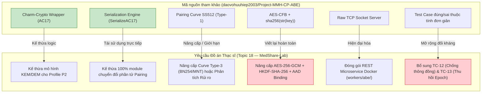

# Báo cáo Đánh giá và Tận dụng Mã nguồn CP-ABE
## Đồ án: MedShare-Lab — Topic 18 (NT2205.11.CH)

**Mã tài liệu:** `REPORT-EVAL-CPABE-01`  
**Ngày lập:** 28/09/2026  
**Người thực hiện:** Đào Võ Hữu Hiệp — 26848065 (Thành viên B)  
**Đối tượng đánh giá:** Repository mã nguồn [daovohuuhiep2003/Project-MMH-CP-ABE](https://github.com/daovohuuhiep2003/Project-MMH-CP-ABE)  
**Tài liệu liên quan trong đồ án:** [Crypto & Protocol Design](crypto-and-protocol-design.md), [Implementation Plan](../planning/implementation-plan.md), [Step-by-Step Plan](../planning/step-by-step-plan.md), [Experiments & Validation](../testing/experiments-and-validation.md), [Traceability Matrix](../testing/traceability-matrix.md).

---

## 1. Tóm tắt điều hành (Executive Summary)

Repository [Project-MMH-CP-ABE](https://github.com/daovohuuhiep2003/Project-MMH-CP-ABE) là công trình nghiên cứu trước đây của tác giả **Đào Võ Hữu Hiệp** (Thành viên B phụ trách mảng Advanced Crypto) về việc ứng dụng mật mã dựa trên thuộc tính (CP-ABE) để mã hóa và phân quyền hồ sơ sức khỏe bệnh viện (PHR).

Qua rà soát và đối chiếu với các yêu cầu kỹ thuật của **Topic 18 (Bậc Thạc sĩ)**, mã nguồn này **có giá trị kế thừa và phụ trợ rất cao**, đặc biệt là:
1. Đã giải quyết được bài toán khó nhất của thư viện `charm-crypto`: **Tuần tự hóa (Serialization/Deserialization)** các phần tử đại số nhóm pairing sang JSON/Base64 để lưu trữ và truyền tải.
2. Đã hiện thực hóa mô hình lai **KEM/DEM** (CP-ABE đóng gói khóa AES đối xứng), hoàn toàn trùng khớp với thiết kế Profile P2 (Fine-Grained Sharing) của đồ án MedShare-Lab.
3. Đã có kinh nghiệm thực tế trong việc cài đặt và biên dịch các thư viện C phụ thuộc (`libpbc`, `libgmp`, `openssl`).

Tuy nhiên, do đây là mã nguồn ở mức đồ án cơ sở, một số thành phần **chưa đáp ứng được chuẩn an toàn và yêu cầu kiểm thử cấp Thạc sĩ**: đường cong pairing đang dùng loại 1 (`SS512` an toàn thấp), chế độ mã hóa đối xứng chưa phải AEAD (`AES-CFB` thay vì `AES-256-GCM`), thiếu kiểm thử đối kháng chống thông đồng (*collusion resistance*) và thu hồi quyền theo thời gian (*epoch revocation*).

Báo cáo này phân tích chi tiết các thành phần có thể tái sử dụng ngay, các điểm kỹ thuật bắt buộc phải nâng cấp, và lộ trình tích hợp vào thư mục [`workers/abe/`](../../workers/abe/) cho mốc **Gate Tuần 2** và **Thực nghiệm E4 (Tuần 9)**.

---

## 2. Kiểm kê mã nguồn và Đối chiếu chức năng

### 2.1. Cấu trúc mã nguồn của repo tham khảo

| Đường dẫn / Tệp tin | Ngôn ngữ / Công nghệ | Vai trò trong repo cũ | Khả năng tận dụng cho Topic 18 |
| :--- | :--- | :--- | :--- |
| `CP-ABE/Include/CPABE.py` | Python 3, `charm-crypto`, `Crypto.Cipher` | Lớp wrapper khởi tạo sơ đồ CP-ABE, hàm mã hóa `ABEencryption` và giải mã `ABEdecryption`. | **Tái sử dụng 60%**: Giữ nguyên luồng KEM/DEM; refactor thuật toán mã hóa khối sang AEAD và HKDF. |
| `CP-ABE/Include/SerializeAC17.py` | Python 3, `charm.core.engine.util` | Hàm serialize/deserialize các phần tử nhóm $G_1, G_2, G_T, Z_R$ sang JSON và Base64. | **Tái sử dụng 90%**: Kế thừa trực tiếp để lưu trữ `key_capsules` và truyền khóa qua REST API. |
| `CP-ABE/CenterAutho.py` | Python Socket TLS | Máy chủ thẩm quyền trung tâm (Central Authority) quản lý Master Key, cấp phát Private Key theo thuộc tính. | **Tái sử dụng mô hình**: Thay thế socket raw bằng FastAPI service độc lập trong container Z1/Z0. |
| `CP-ABE/Include/DataOwner.py` & `user.py` | Python Socket | Client của chủ dữ liệu (mã hóa) và người nhận (giải mã). | **Tham khảo**: Đóng gói thành SDK Client và test fixtures phục vụ kiểm thử tự động. |
| `CP-ABE/TestCase/` | JSON / Text Fixtures | Dữ liệu mẫu hồ sơ bệnh viện (`PHR`) và các kịch bản test thuộc tính (`ID`, `Faculty`). | **Tham khảo**: Ánh xạ vào bộ sinh dữ liệu synthetic dataset (`datasets/`). |

---

## 3. Phân tích Giá trị Kế thừa & Khoảng cách Kỹ thuật



### 3.1. Các điểm mạnh kế thừa ngay (Ưu điểm lớn)

1. **Khung kiến trúc KEM/DEM (Key Encapsulation / Data Encapsulation):**
   * Trong `CP-ABE/Include/CPABE.py`, thuật toán sinh khóa ngẫu nhiên đối xứng `key = self.groupObj.random(GT)` trong nhóm đích $G_T$, bọc `key` bằng CP-ABE, rồi dùng khóa đối xứng mã hóa dữ liệu.
   * Đây chính là cơ chế chuẩn mà [crypto-and-protocol-design.md](crypto-and-protocol-design.md#L138-L148) quy định cho **Profile P2 (Encrypted Export Package)**: CP-ABE không mã hóa trực tiếp payload lớn (quá tốn kém tài nguyên tính toán), mà chỉ đóng vai trò KEM để bọc khóa chia sẻ `share_DEK`.
2. **Module `SerializeAC17.py` giải quyết điểm nghẽn kỹ thuật lớn nhất:**
   * Các đối tượng trong `charm-crypto` là C-extensions, không hỗ trợ hàm `pickle` hay `json.dumps` mặc định.
   * Tác giả đã tự viết hàm bóc tách cấu trúc cây khóa và ciphertext thành chuỗi byte định dạng, hỗ trợ Base64 và PEM. Việc tái sử dụng module này giúp nhóm **tiết kiệm từ 1 đến 2 tuần làm việc** chỉ riêng cho phần serialization.
3. **Tiết kiệm thời gian cấu hình môi trường (Feasibility Gate):**
   * Thư viện `charm-crypto` nổi tiếng là khó cài đặt trên các phiên bản Linux mới. Tác giả đã có sẵn script/kinh nghiệm cài đặt các gói C native (`libpbc`, `libgmp-dev`, `python3-setuptools`), giúp việc viết Dockerfile cho `workers/abe/` hoàn thành nhanh chóng.

---

### 3.2. Những điểm hạn chế kỹ thuật và Yêu cầu nâng cấp bắt buộc

Để đáp ứng các yêu cầu bảo mật cấp Thạc sĩ (`SR-05`, `SR-08`, `CR-01`, `CR-02`, `CR-06`), mã nguồn cũ **bắt buộc phải được tái cấu trúc** ở 4 khía cạnh trọng yếu:

#### A. Rủi ro mức an toàn của Đường cong Pairing (`SS512`)
* **Hiện trạng repo cũ:** Khởi tạo `self.groupObj = PairingGroup('SS512')`.
* **Phân tích rủi ro mật mã:** `SS512` là đường cong siêu dị loại 1 (Symmetric Type-1 Supersingular Curve). Do sự phát triển của các thuật toán tấn công trên trường hữu hạn (Discrete Logarithm problem), `SS512` hiện chỉ cung cấp mức an toàn khoảng **$\approx 80$-bit**, đã bị NIST và giới học thuật khuyến cáo loại bỏ khỏi các ứng dụng bảo mật cao.
* **Giải pháp cho Topic 18:**
  * *Tùy chọn 1 (Khuyên dùng):* Thử nghiệm chuyển sang đường cong bất đối xứng loại 3 (Type-3 pairing) như `BN254` (Barreto-Naehrig) hoặc `MNT224` có sẵn trong Charm.
  * *Tùy chọn 2 (Nếu Charm gặp lỗi tương thích với AC17 trên Type-3):* Tiếp tục sử dụng `SS512` cho mục đích đo đạc thực nghiệm, nhưng trong báo cáo đồ án **bắt buộc phải ghi rõ đây là Research Prototype Demonstration** và catalogue trung thực giới hạn an toàn 80-bit theo đúng khuyến cáo tại [crypto-and-protocol-design.md](crypto-and-protocol-design.md#L140-L148).

#### B. Nâng cấp chuẩn mã hóa đối xứng sang AEAD (AES-256-GCM + HKDF)
* **Hiện trạng repo cũ:**
  ```python
  # Mã nguồn cũ: Dẫn xuất thô và mã hóa CFB thiếu toàn vẹn
  aes_key = hashlib.sha256(str(key).encode()).digest()
  encryptor = AES.new(aes_key, AES.MODE_CFB, iv)
  encrypted_data = encryptor.encrypt(msg)
  ```
* **Lỗ hổng:**
  * `str(key)` phụ thuộc vào hàm biểu diễn chuỗi của đối tượng, không đảm bảo tính phân tán entropy chuẩn.
  * Chế độ `AES.MODE_CFB` chỉ bảo vệ tính bí mật (Confidentiality), **không có tính toàn vẹn (Integrity)**. Kẻ tấn công trên đường truyền có thể lật bit (bit-flipping attack) mà không bị phát hiện.
* **Giải pháp nâng cấp cho Topic 18:**
  * Sử dụng chuẩn **HKDF-SHA-256** (RFC 5869) để dẫn xuất `share_DEK` 256-bit từ phần tử nhóm $G_T$.
  * Chuyển sang **AES-256-GCM** (AEAD) với authentication tag 128-bit.
  * Đưa thêm **AAD (Additional Authenticated Data)** bao gồm: `tenant_id`, `record_id`, `epoch_id`, `policy_digest`. Nếu kẻ tấn công tráo đổi ciphertext giữa hai bệnh nhân hoặc tráo phiên bản chính sách, giải mã AEAD sẽ lập tức tung ngoại lệ từ chối (`SR-05`).

#### C. Bổ sung các bài kiểm thử đối kháng cấp Thạc sĩ (Adversarial Testing)
Repo cũ chỉ kiểm thử kịch bản thông thường: Có đủ quyền $\rightarrow$ Giải mã ra chữ; Thiếu quyền $\rightarrow$ Trả về `None`. Đồ án Topic 18 bắt buộc phải thực hiện 2 thí nghiệm an toàn chuyên sâu:
1. **Kiểm thử chống thông đồng (`TC-12` Collusion Resistance Test):**
   * *Kịch bản:* Chính sách yêu cầu `(KHOA_TIM_MACH AND TRUONG_KHOA)`. Bác sĩ 1 có thuộc tính `KHOA_TIM_MACH`, Bác sĩ 2 có thuộc tính `TRUONG_KHOA`. Hai người bắt tay chia sẻ khóa bí mật.
   * *Kiểm chứng:* Khi trộn các thành phần khóa của Bác sĩ 1 và Bác sĩ 2 vào cùng một phép giải mã, thuật toán phải thất bại. Điều này chứng minh tính chất toán học của CP-ABE: mỗi private key được gắn với một số ngẫu nhiên bí mật riêng của từng người dùng, ngăn chặn việc gộp khóa.
2. **Kiểm thử thu hồi quyền theo thời gian (`TC-13` / `TC-14` Epoch Revocation):**
   * Bổ sung thuộc tính thời hạn (ví dụ `EPOCH_2026_Q3`). Khi hệ thống bước sang `EPOCH_2026_Q4`, người dùng giữ khóa cũ bị từ chối giải mã gói dữ liệu mới mà không cần mã hóa lại dữ liệu lịch sử.

#### D. Chuẩn hóa giao tiếp dịch vụ (Service Interface)
* Thay thế toàn bộ raw TCP socket và script `listen_port` trong `CenterAutho.py` bằng **FastAPI REST API** chuẩn, đóng gói bên trong Docker container `medshare-abe-worker` chạy trên cổng `:9002`.

---

## 4. Bảng phân công & Kế hoạch tích hợp chi tiết

Theo [step-by-step-plan.md](../planning/step-by-step-plan.md), gói công việc CP-ABE do **Thành viên B (Đào Võ Hữu Hiệp)** chủ trì và **Thành viên A (Nguyễn Đạo Ga Đô)** phối hợp tích hợp:

| Giai đoạn | Tuần thực hiện | Nhiệm vụ cụ thể tận dụng từ repo cũ | Sản phẩm đầu ra định lượng |
| :--- | :--- | :--- | :--- |
| **GĐ 1: Spike** | **Tuần 2** | • Trích xuất cấu hình cài đặt `charm-crypto` để viết `workers/abe/Dockerfile`.<br>• Đưa `CPABE.py` và `SerializeAC17.py` vào `workers/abe/src/`.<br>• Viết smoke test 1 positive + 1 negative để vượt qua **Feasibility Gate Tuần 2**. | `workers/abe/Dockerfile` build thành công; container vượt qua smoke test. |
| **GĐ 2: Refactor** | **Tuần 4–5** | • Thay thế `AES.MODE_CFB` bằng `cryptography.hazmat.primitives.ciphers.aead.AESGCM`.<br>• Thay thế `hashlib.sha256(str(key))` bằng chuẩn `HKDF`.<br>• Đóng gói cấu trúc capsule: `(serialized_kem_bytes, nonce, ciphertext, tag, aad)`. | Module `workers/abe/engine.py` chuẩn AEAD. |
| **GĐ 3: Thí nghiệm E4** | **Tuần 9** | • Tích hợp API `POST /shares/encrypt` và `POST /shares/decrypt` vào Gateway.<br>• Viết test case `TC-11` (Chính sách phức tạp AND/OR/Threshold).<br>• Viết test case `TC-12` (Kiểm thử tấn công thông đồng ghép khóa).<br>• Viết test case `TC-13` (Thu hồi quyền theo epoch).<br>• Đo đạc thời gian tính toán và độ giãn nở kích thước ciphertext để ghi nhận vào bằng chứng `E4`. | Báo cáo thực nghiệm `E4`; Suite kiểm thử bảo mật `tests/security/test_cpabe.py` pass 100%. |

---

## 5. Kết luận và Kiến nghị

1. **Khẳng định giá trị:** Repository [daovohuuhiep2003/Project-MMH-CP-ABE](https://github.com/daovohuuhiep2003/Project-MMH-CP-ABE) là một tài sản tri thức có sẵn cực kỳ hữu ích cho đồ án Topic 18, giúp nhóm rút ngắn thời gian làm quen với thư viện mật mã ghép cặp (Pairing-Based Cryptography) và giải quyết trọn vẹn khâu tuần tự hóa dữ liệu khóa.
2. **Kế hoạch hành động:**
   * **Chấp thuận tái sử dụng:** Kế thừa module tuần tự hóa `SerializeAC17.py` và khung KEM/DEM của `CPABE.py`.
   * **Bắt buộc tái cấu trúc:** Thay thế tầng mã hóa đối xứng sang AES-256-GCM + HKDF + AAD context binding.
   * **Tập trung kiểm thử:** Đầu tư thời gian vào việc xây dựng hai bài kiểm thử đối kháng quan trọng (`TC-12` Collusion và `TC-13` Revocation) để đáp ứng trọn vẹn yêu cầu học thuật của bậc Thạc sĩ.
