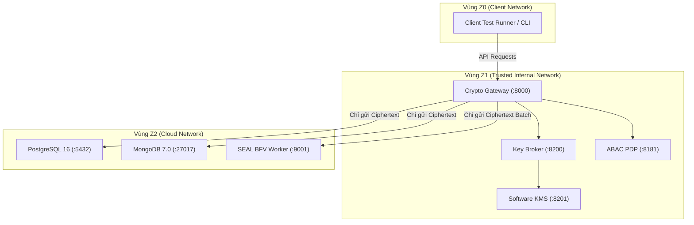

# Hướng dẫn Môi trường và Thư viện Cài đặt
## Đồ án: MedShare-Lab — Topic 18 (NT2205.11.CH)

**Đề tài:** Bảo vệ hồ sơ y tế đa tenant trên Cloud DBMS: kiến trúc phân lớp, kiểm soát truy cập và bằng chứng an toàn.  
**Tài liệu liên quan:** [Project Proposal](../proposal/project-proposal.md), [Implementation Plan](../planning/implementation-plan.md), [Step-by-Step Plan](../planning/step-by-step-plan.md), [Crypto & Protocol Design](../design/crypto-and-protocol-design.md).

---

## 1. Nguyên tắc thiết lập môi trường

> [!IMPORTANT]
> **Không cài chung toàn bộ thư viện vào một môi trường Python duy nhất trên máy host.**  
> Các thư viện mật mã nâng cao (CP-ABE, SEAL BFV, liboqs) phụ thuộc vào mã nguồn C/C++ native, trình biên dịch đặc thù và các phiên bản Python khác nhau. Vì vậy, hệ thống bắt buộc phân tách thành **môi trường Core trên máy host/WSL2** và **các Worker chuyên biệt chạy trong Docker Container độc lập** (`workers/abe/`, `workers/he/`, `workers/pqc/`).

Hệ thống được phân định thành 4 vùng tin cậy (Trust Zones):
* **Z0 (Endpoint / Client):** Nơi gửi truy vấn người dùng (Bác sĩ, Điều dưỡng, Nhà phân tích) và nhận kết quả plaintext được phép.
* **Z1 (Miền tổ chức tin cậy / TCB):** Chứa Trusted Crypto Gateway, ABAC Policy Engine (PDP), Key Broker và Software KMS (Vault). Nơi quản lý khóa và thực hiện mã hóa field.
* **Z2 (Miền Cloud / Untrusted):** Chứa DBMS (PostgreSQL 16, MongoDB 7.0), BFV Homomorphic Worker và ổ đĩa mã hóa LUKS (B1). Kẻ tấn công DBA/Cloud Operator có toàn quyền tại đây nhưng không có khóa tại Z1.
* **Z3 (Miền Kiểm toán / Audit):** Hệ thống ghi log bất biến (Append-only audit) độc lập với quyền rollback của DBA.

---

## 2. Yêu cầu cấu hình phần cứng (Hardware Specifications)

| Thành phần | Cấu hình tối thiểu (Functional Lab) | Cấu hình khuyến nghị (Benchmark & Demo) |
| :--- | :--- | :--- |
| **CPU** | 4 Cores (Logical CPUs) | **8 Cores** (phục vụ đa luồng BFV, ABE và concurrency benchmark) |
| **RAM** | 16 GB (chạy tuần tự các worker, dataset 1k–10k) | **32 GB** (chạy đồng thời toàn bộ cụm Docker Compose và DB cache) |
| **Ổ đĩa trống** | 30 GB SSD | **60 GB SSD** (chứa Docker images, volume mã hóa LUKS, synthetic dataset) |
| **Hệ điều hành** | Windows 11 với **WSL2 (Ubuntu 22.04 LTS)** | **Ubuntu Server 22.04 / 24.04 LTS** (trên máy vật lý hoặc VMware/VirtualBox) |

---

## 3. Danh mục thư viện cần cài đặt theo từng phân hệ

### 3.1. Phân hệ Core Gateway, Broker & ABAC (`src/medshare/`)
*Môi trường: Python 3.12+ (Virtualenv trên Host hoặc WSL2)*

| Tên thư viện | Phiên bản khuyến nghị | Mục đích sử dụng |
| :--- | :--- | :--- |
| **`cryptography`** | `>= 43.0.0` | Mã hóa đối xứng **AES-256-GCM** (Field Envelope Encryption), hàm dẫn xuất khóa **HKDF**, sinh số ngẫu nhiên CSPRNG. |
| **`fastapi`** | `>= 0.110.0` | Xây dựng REST API cho Trusted Crypto Gateway, Key Broker và các endpoint kiểm soát truy cập (F0–F4). |
| **`uvicorn`** | `>= 0.29.0` | ASGI Web Server hiệu năng cao chạy FastAPI. |
| **`pydantic`** | `>= 2.7.0` | Ràng buộc schema AAD context, versioning, validate request/response và chặn truy vấn không hợp lệ (F5 deny). |
| **`psycopg[binary]`** | `>= 3.1.0` | Driver kết nối CSDL **PostgreSQL 16+**, hỗ trợ Row-Level Security (RLS) và giao dịch CAS. |
| **`pymongo`** | `>= 4.7.0` | Driver kết nối CSDL NoSQL **MongoDB 7.0+**, quản lý tenant collections và key capsules. |
| **`hvac`** | `>= 2.2.0` | Client kết nối HashiCorp Vault (Transit Secrets Engine) cho Software KMS Z1. |
| **`requests`** / **`httpx`** | `>= 2.31.0` / `>= 0.27.0` | Giao tiếp HTTP nội bộ giữa Gateway, Broker và các Container Worker (ABE, HE, PQC). |

### 3.2. Bộ công cụ Kiểm thử, Đo lường & Phân tích bằng chứng (`tests/`, `benchmarks/`, `analysis/`)
*Môi trường: Python 3.12+ (chung Virtualenv với Core)*

| Tên thư viện | Phiên bản khuyến nghị | Mục đích sử dụng |
| :--- | :--- | :--- |
| **`pytest`** | `>= 8.0.0` | Framework chạy 30 nhóm Test Cases (`TC-01` → `TC-30`) và mutation tests (tamper tag, swap AAD). |
| **`pytest-asyncio`** | `>= 0.23.0` | Hỗ trợ kiểm thử bất đồng bộ cho FastAPI và Async DB drivers. |
| **`locust`** *(hoặc `k6`)* | `>= 2.24.0` | Sinh tải đa luồng đo đạc hiệu năng W1 (Lookup), W2 (Equality), W7 (Write) với concurrency 1, 8, 32. |
| **`pandas`** & **`numpy`** | `>= 2.2.0` / `>= 1.26.0` | Thu thập số liệu thô; tính độ trễ $p50, p95, p99$, Throughput (QPS), và **khoảng tin cậy CI 95%** sau 5 lần lặp. |
| **`matplotlib`** & **`seaborn`** | `>= 3.8.0` / `>= 0.13.0` | Vẽ đồ thị so sánh B0 vs B1 vs P1, đồ thị tiêu hao bộ nhớ BFV, biểu đồ dấu vết rò rỉ (*leakage trace*). |

### 3.3. Các Worker Mật mã nâng cao (`workers/`)
*Môi trường: Cô lập trong Linux Docker Container*

#### A. PQC Worker — Hậu lượng tử (`workers/pqc/`)
* **Thuật toán triển khai:**
  * **ML-KEM-768** (FIPS 203): Cơ chế đóng gói khóa bọc DEK cho profile lưu trữ dài hạn (P4).
  * **ML-DSA-65** (FIPS 204): Chữ ký số xác thực Policy bundle, Version Manifest và Checkpoint kiểm toán.
* **Thư viện chính:**
  * `liboqs` (C library chuẩn từ dự án Open Quantum Safe).
  * `oqs-python` (Python wrapper chính thức của `liboqs`).
* **Yêu cầu build:** `cmake >= 3.16`, `ninja-build`, `gcc/g++`, `libssl-dev`.

#### B. HE Worker — Mã hóa đồng cấu (`workers/he/`)
* **Thuật toán triển khai:** Sơ đồ **BFV (Brakerski-Fan-Vercauteren)** tính toán tổng SUM/count trên ciphertext mảng số nguyên `amount_units`.
* **Tham số mật mã:** Đa thức bậc $N=8192$, hệ số an toàn 128-bit, batching prime $t \approx 30 \text{ bit}$.
* **Thư viện chính:**
  * `Microsoft SEAL` (bản C++ 4.x).
  * Service wrapper microservice REST bằng C++ (Crow / cpp-httplib) hoặc `seal-python`.
* **Yêu cầu build:** `cmake >= 3.16`, `g++ >= 11` (hoặc `clang >= 12`).

#### C. ABE Worker — Mã hóa thuộc tính (`workers/abe/`)
* **Thuật toán triển khai:** **CP-ABE (Ciphertext-Policy Attribute-Based Encryption)** theo sơ đồ BSW07, bọc share DEK phục vụ xuất dữ liệu nhiều người nhận (P2).
* **Thư viện chính:**
  * `Charm-Crypto` (hỗ trợ pairing-based cryptography trên Python 3.9/3.10) hoặc `OpenABE` (C++).
* **Thư viện C nền tảng bắt buộc:**
  * `libgmp-dev` (GNU Multiple Precision Arithmetic Library).
  * `libpbc-dev` (Pairing-Based Cryptography Library).
  * `libssl-dev` (OpenSSL).

---

## 4. Hạ tầng máy chủ & Cơ sở dữ liệu (`infra/`)

* **PostgreSQL 16+**: CSDL quan hệ chính (bật `Row Level Security - RLS`, connection pool riêng theo tenant).
* **MongoDB 7.0+**: CSDL NoSQL đối chiếu (tenant-scoped collections).
* **HashiCorp Vault** (`hashicorp/vault:latest`): Vận hành Software KMS ở vùng tin cậy Z1 qua Transit Secrets Engine.
* **`cryptsetup`** (Linux command): Thiết lập volume mã hóa ảo `dm-crypt / LUKS` phục vụ baseline B1 (At-rest volume encryption).

---

## 5. Hướng dẫn thiết lập từng bước (Step-by-Step Setup Guide)

### Cách 1: Thiết lập tự động trên Ubuntu qua Script (Khuyên dùng)
Dự án đã chuẩn bị sẵn script tự động hóa toàn bộ quá trình cài đặt (hệ thống, build tools, Docker & Compose, cryptsetup, python venv và packages):
```bash
chmod +x scripts/setup_ubuntu.sh
./scripts/setup_ubuntu.sh
```

### Cách 2: Thiết lập thủ công từng bước

#### Bước 1: Khởi tạo Virtual Environment cho Core & Testing
Tại thư mục gốc dự án:
```bash
# Tạo môi trường ảo Python 3.12
python -m venv .venv

# Kích hoạt môi trường (trên Windows PowerShell):
.\.venv\Scripts\Activate.ps1
# (Hoặc trên Linux / WSL2):
# source .venv/bin/activate

# Nâng cấp pip và cài đặt dependencies cho Core & Test
pip install --upgrade pip
pip install cryptography>=43.0.0 fastapi>=0.110.0 uvicorn>=0.29.0 pydantic>=2.7.0 \
            "psycopg[binary]>=3.1.0" pymongo>=4.7.0 hvac>=2.2.0 requests>=2.31.0 httpx>=0.27.0 \
            pytest>=8.0.0 pytest-asyncio>=0.23.0 locust>=2.24.0 pandas>=2.2.0 numpy>=1.26.0 \
            matplotlib>=3.8.0 seaborn>=0.13.0
```

#### Bước 2: Khởi động Hạ tầng DB & KMS bằng Docker Compose
Tạo và chạy stack CSDL tại `infra/`:
```bash
cd infra
docker compose up -d postgres-cloud mongo-cloud software-kms
```

#### Bước 3: Tạo ổ đĩa ảo mã hóa Baseline B1 (dm-crypt/LUKS)
Trên Linux/WSL2 (chỉ thực hiện trên file ảo lab, không thao tác trên ổ cứng thật):
```bash
# Tạo file ảo 2GB
dd if=/dev/zero of=/var/lib/lab-disk.img bs=1M count=2048

# Gán loop device và format LUKS
sudo losetup /dev/loop10 /var/lib/lab-disk.img
sudo cryptsetup luksFormat /dev/loop10
sudo cryptsetup open /dev/loop10 lab_volume
sudo mkfs.ext4 /dev/mapper/lab_volume

# Mount để DB sử dụng
sudo mkdir -p /mnt/lab_b1
sudo mount /dev/mapper/lab_volume /mnt/lab_b1
```

#### Bước 4: Build và chạy các Worker nâng cao
Mỗi worker trong `workers/` có Dockerfile độc lập:
```bash
# Build PQC Worker
docker build -t medshare-pqc-worker ./workers/pqc

# Build HE Worker (Microsoft SEAL)
docker build -t medshare-he-worker ./workers/he

# Build ABE Worker (Charm-Crypto)
docker build -t medshare-abe-worker ./workers/abe
```

---

## 6. Mô hình triển khai và Danh mục Cổng mạng cho Buổi Demo

### Mô hình khuyến nghị: 1 Máy trạm duy nhất phân tách Subnet Docker
Toàn bộ hệ thống chạy trên 1 laptop/PC (16GB–32GB RAM) thông qua 3 Docker Bridge Networks:
* `net-z0-client`: Kết nối Client $\leftrightarrow$ Gateway.
* `net-z1-trusted`: Mạng nội bộ TCB (Gateway, Broker, OPA, KMS).
* `net-z2-cloud`: Mạng Cloud (PostgreSQL, MongoDB, BFV Worker).



### Bảng phân bổ Port dịch vụ phục vụ Demo:

| Zone | Dịch vụ | Port máy chủ | Ghi chú bảo mật |
| :--- | :--- | :--- | :--- |
| **Z1** | `crypto-gateway` | `8000` | Cổng tiếp nhận duy nhất cho người dùng và ứng dụng. |
| **Z1** | `abac-pdp` | `8181` | Chỉ truy cập được từ mạng nội bộ Z1. |
| **Z1** | `key-broker` | `8200` | Chỉ truy cập được từ Gateway Z1. |
| **Z1** | `software-kms` | `8201` | Vault Transit; chặn toàn bộ kết nối từ Z2 (Cloud). |
| **Z2** | `postgres-cloud` | `5432` | DBA có thể đăng nhập trực tiếp để kiểm tra (chỉ thấy ciphertext). |
| **Z2** | `mongo-cloud` | `27017` | DBA có thể query collections (chỉ thấy key capsules). |
| **Z2** | `he-worker` | `9001` | Worker tính tổng SUM trên ciphertext. |
| **Z0** | `abe-worker` | `9002` | Worker giải mã CP-ABE phía người nhận. |
| **Z0** | `pqc-worker` | `9003` | Worker đóng gói khóa ML-KEM và xác thực ML-DSA. |
