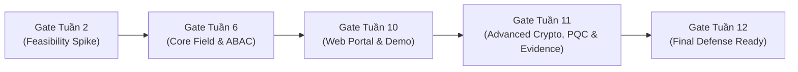

# Kế hoạch triển khai chi tiết Step-by-Step (12 Tuần)
## Đồ án: MedShare-Lab — Topic 18 (NT2205.11.CH)

**Đề tài:** Bảo vệ hồ sơ y tế đa tenant trên Cloud DBMS: kiến trúc phân lớp, kiểm soát truy cập và bằng chứng an toàn.  
**Môn học:** Mật mã học và ứng dụng (NT2205.11.CH) — Chương trình Thạc sĩ An toàn thông tin, Trường Đại học Công nghệ Thông tin (ĐHQG-HCM).  
**Tài liệu căn cứ:** [Project Proposal](../proposal/project-proposal.md), [Implementation Plan](implementation-plan.md), [Crypto & Protocol Design](../design/crypto-and-protocol-design.md), [Experiments & Validation](../testing/experiments-and-validation.md), [Traceability Matrix](../testing/traceability-matrix.md).

---

## 1. Thông tin chung & Nhân sự thực thi

* **Thời lượng dự án:** 12 tuần. Quỹ công sức dự trù khoảng 36–44 giờ/tuần cho toàn nhóm (tổng cộng 432–528 giờ).
* **Quy mô & Tải công việc:** 2 thành viên, cân bằng tải 50% – 50%.
* **Phân công định danh:**
  * **Thành viên A:** **Nguyễn Đạo Ga Đô** — Mã học viên: `26848038` (Chủ repository, GitHub: `gado321`).  
    *Phụ trách chính:* Systems, Database (MongoDB 7.0), ABAC Engine & PQC Chữ ký số / Toàn vẹn (FIPS 204 ML-DSA-65).
  * **Thành viên B:** **Đào Võ Hữu Hiệp** — Mã học viên: `26848065` (Máy trạm: `HuuHiep`).  
    *Phụ trách chính:* Advanced Crypto (CP-ABE, SEAL BFV Homomorphic Encryption), Blind Index (HMAC) & PQC Đóng gói khóa (FIPS 203 ML-KEM-768).
* **Nguyên tắc chuỗi suy luận khoa học:**
  $$\text{Threat} \longrightarrow \text{Security Property (SR)} \longrightarrow \text{Crypto Property (CR)} \longrightarrow \text{Mechanism} \longrightarrow \text{Implementation} \longrightarrow \text{Negative Test} \longrightarrow \text{Evidence}$$
  *Không nhảy cóc từ Threat sang Algorithm; mọi cơ chế mật mã phải được biện giải bằng mối đe dọa và năng lực kẻ tấn công.*

---

## 2. Bảng kế hoạch chi tiết Step-by-Step qua 12 tuần

| Tuần & Giai đoạn | Work Package (WP) | Chi tiết công việc từng bước (Step-by-Step) | Phân công phụ trách | Mã E / TC / SR liên quan | Sản phẩm đầu ra định lượng (Deliverables) | Tiêu chí nghiệm thu (DoD / Gate) |
| :--- | :--- | :--- | :--- | :--- | :--- | :--- |
| **Tuần 1** *(GĐ 1: Khởi tạo & Phân tích)* | **WP1:** System, Trust Model & Oracle Design | • **Bước 1.1:** Chuẩn hóa sơ đồ luồng F0–F9, định nghĩa 4 vùng tin cậy Z0–Z3 và danh mục tài sản AS-01 → AS-12. • **Bước 1.2:** Lập bảng Threat Model T-01 → T-18 và phân loại ranh giới đối thủ (M0–M4). • **Bước 1.3:** Viết đặc tả Logical Data Schema, AAD context binding và Differential Plaintext Oracle. | • **Thành viên A:** Hoàn thiện Z0–Z3, flow F0–F9, sơ đồ kiến trúc [architecture.mmd](../diagrams/architecture.mmd). • **Thành viên B:** Thiết kế Plaintext Oracle, ma trận dữ liệu nhạy cảm và quy tắc chuẩn hóa token. | `SR-01` `SR-02` `SR-03` `T-01` → `T-05` | Tài liệu A1–A5 hoàn chỉnh; Bộ test generator oracle độc lập. | Không có thuật toán nào được đưa vào mà không gắn với một đe dọa cụ thể; xác định rõ nơi plaintext xuất hiện. |
| **Tuần 2** *(GĐ 1: Spike & Feasibility)* | **WP1 & WP2:** Feasibility Spike & Sandbox Runtime | • **Bước 2.1:** Dựng môi trường Docker Compose gồm MongoDB 7.0 và Volume mã hóa (dm-crypt/LUKS). • **Bước 2.2:** Cài đặt `liboqs/oqs-python`, build thử nghiệm FIPS 204 (ML-DSA-65) và FIPS 203 (ML-KEM-768). • **Bước 2.3:** Thử nghiệm build container độc lập cho Microsoft SEAL (BFV) và Charm-Crypto / OpenABE. • **Bước 2.4:** Viết smoke test 1 positive + 1 negative cho từng worker. | • **Thành viên A:** Hạ tầng Docker, config MongoDB, spike ML-DSA-65 verify/tamper. • **Thành viên B:** Build SEAL C++ worker, Charm CP-ABE worker, spike ML-KEM-768 encapsulate. | `SR-18` `CR-06` `CR-08` `CR-09` | Docker Compose chạy ổn định; 4 runner smoke tests pass trong `workers/`. | **[Gate Tuần 2]**: Mọi worker nâng cao đều build thành công trên Linux container, có kết quả smoke test thật, không dùng mock giả. |
| **Tuần 3** *(GĐ 1: Baseline & Dữ liệu)* | **WP2:** Synthetic Data Generator & Baseline B0/B1 | • **Bước 3.1:** Viết script sinh dữ liệu tổng hợp (1k, 10k bản ghi; 5 seeds độc lập 1801–1805; uniform & skewed). • **Bước 3.2:** Nạp dữ liệu vào MongoDB 7.0 ở profile B0 (Plaintext) và B1 (Encrypted Volume). • **Bước 3.3:** Chạy thí nghiệm `E1`: Benchmark hiệu năng baseline, kiểm tra tấn công lấy trộm snapshot disk (Snapshot theft). | • **Thành viên A:** Viết generator nạp MongoDB; cấu hình encrypted volume; đo baseline B0 vs B1. • **Thành viên B:** Kiểm tra tính toàn vẹn của dataset, xây dựng kịch bản truy vấn mẫu (W1, W2, W7) và đo latency DB thô. | `E1` `TC-08` `SR-01` `T-01` | Bộ synthetic dataset 1k/10k; Báo cáo baseline E1; Snapshot theft test script. | B1 chứng minh chống đọc trộm disk offline nhưng **bất lực** trước DBA trực tiếp (xác lập đúng ranh giới baseline). |
| **Tuần 4** *(GĐ 2: Mã hóa Field)* | **WP3:** Field Envelope Encryption Engine | • **Bước 4.1:** Xây dựng module `src/medshare/crypto/` thực hiện AES-256-GCM field encryption. • **Bước 4.2:** Đóng gói AAD chống tráo ngữ cảnh (tenant_id, record_id, field_id, version). • **Bước 4.3:** Thiết lập cơ chế sinh DEK ngẫu nhiên bằng CSPRNG, kiểm tra tính duy nhất của Nonce. • **Bước 4.4:** Chạy các test đột biến (tamper tag, tráo AAD, cắt xén ciphertext). | • **Thành viên A:** Cài đặt chuẩn mã hóa envelope, context serialization, serialization bytes. • **Thành viên B:** Viết test suite phủ định: tamper ciphertext, swap tenant context, replay IV/nonce. | `TC-01` `TC-05` `TC-24` `SR-05` `CR-01`, `CR-02` | Module `crypto/envelope.py`; Bộ unit tests kiểm tra AEAD tamper đạt 100% reject. | Bất kỳ chỉnh sửa nào trên ciphertext/tag/AAD đều bị từ chối tuyệt đối; không trả về một phần plaintext khi giải mã lỗi. |
| **Tuần 5** *(GĐ 2: KMS & Lưu trữ)* | **WP4:** Key Broker, Software KMS & Persistence | • **Bước 5.1:** Tích hợp Software KMS (Vault Transit hoặc engine KMS độc lập ở vùng Z1). • **Bước 5.2:** Xây dựng Key Broker: bọc/mở khóa DEK qua KEK theo tenant/classification; lưu trữ key capsules. • **Bước 5.3:** Triển khai Data Access Layer (DAL) trên MongoDB 7.0. • **Bước 5.4:** Thực hiện thí nghiệm `E2`: Đo overhead mã hóa field và kiểm thử tách biệt khóa khỏi DB. | • **Thành viên A:** Xây dựng Key Broker, tích hợp KMS, cấu hình MongoDB collections & indexes. • **Thành viên B:** Thiết kế cấu trúc bảng `key_capsules`, kiểm thử phân tách tenant KEK và unwrap failure. | `E2` `TC-02` `TC-06` `TC-09` `TC-10` `SR-01`, `SR-11` | Cụm KMS Z1 hoạt động độc lập; Báo cáo thực nghiệm E2; Bộ test cô lập khóa. | DBA truy vấn trực tiếp vào DB chỉ thấy ciphertext và capsule, không thể lấy được DEK plaintext từ DB. |
| **Tuần 6** *(GĐ 2: Kiểm soát ABAC)* | **WP5:** ABAC Engine, Break-glass & Bypass Tests | • **Bước 6.1:** Triển khai PDP/PEP thực thi ABAC (Policy rules: Subject, Object, Action, Environment). • **Bước 6.2:** Cơ chế Deny-by-default, xử lý Emergency Break-glass (yêu cầu ticket duyệt, có thời hạn, audit log). • **Bước 6.3:** Tích hợp kiểm tra quyền 2 lớp: Gateway PEP và Broker PEP độc lập. • **Bước 6.4:** Thực hiện thí nghiệm `E3`: Đo latency ra quyết định policy, test thử nghiệm DBA bypass và tráo vai trò. | • **Thành viên A:** Triển khai ABAC engine (OPA/Python), xử lý workflow break-glass và logging audit Z3. • **Thành viên B:** Xây dựng bộ test case thử nghiệm: tự phong role, vượt cấp khoa, ticket hết hạn, cross-tenant. | `E3` `TC-03` `TC-04` `TC-07` `TC-27` `SR-02`, `SR-03`, `SR-04` | Module `policy/abac.py`; Báo cáo thực nghiệm E3; Log audit không chứa plaintext/secret. | **[Gate Tuần 6]**: Toàn bộ yêu cầu truy cập trái phép bị chặn; DBA bypass truy cập trực tiếp DB nhưng vẫn thất bại tại Key Broker. |
| **Tuần 7** *(GĐ 3: Truy vấn mù & Rò rỉ)* | **WP6:** Equality Blind Index & Leakage Analysis | • **Bước 7.1:** Xây dựng module Blind Index dùng HMAC-SHA-256 có muối/khóa tách biệt theo tenant và field. • **Bước 7.2:** Tạo bảng chỉ mục `search_index` trên DB phục vụ tra cứu chính xác (Equality Query W2). • **Bước 7.3:** Thực hiện thí nghiệm `E5`: Đo lường dấu vết rò rỉ (leakage traces: search pattern, access pattern, volume). • **Bước 7.4:** Giả lập tấn công suy luận tần suất (*frequency inference attack*) trên trường có phân bố lệch (skewed). | • **Thành viên A:** Tích hợp query handler tại Gateway, trả về mã 422 từ chối các truy vấn range/text ngoài scope. • **Thành viên B:** Triển khai module HMAC blind index, script phân tích leakage traces và mô phỏng tấn công suy luận. | `E5` `TC-15` `TC-16` `TC-17` `SR-09` `CR-07` | Module `crypto/blind_index.py`; Bảng leakage profile định lượng; Báo cáo thực nghiệm E5. | Minh chứng rõ ràng rủi ro suy luận trên dữ liệu có entropy thấp (như diagnosis code) để đưa ra khuyến nghị chuẩn. |
| **Tuần 8** *(GĐ 3: Tính toán đồng cấu)* | **WP7:** Homomorphic Encryption (BFV SUM/Count) | • **Bước 8.1:** Viết Worker Microsoft SEAL C++ nhận ciphertext mảng số nguyên `amount_units` và thực hiện phép cộng SUM. • **Bước 8.2:** Thiết lập quy trình: Owner mã hóa dữ liệu đầu vào $\rightarrow$ Worker tính toán trên cloud $\rightarrow$ Owner giải mã kết quả. • **Bước 8.3:** Thực hiện thí nghiệm `E7`: Đo lường chi phí bộ nhớ, thời gian tính toán và độ giãn nở ciphertext. • **Bước 8.4:** Kiểm tra giới hạn: Worker trả sai kết quả (tamper result) để chứng minh BFV không tự xác thực tính đúng của máy chủ ác ý. | • **Thành viên A:** Xây dựng REST API/CLI giao tiếp với BFV worker, kiểm tra noise budget và bounds đầu vào. • **Thành viên B:** Lập trình lõi SEAL BFV, chạy benchmark tính toán SUM/count, đo trust gap và giới hạn integrity. | `E7` `TC-18` `TC-19` `TC-30` `SR-10` `CR-08` | Container `workers/he/`; Báo cáo thực nghiệm E7 kèm đồ thị noise/computation expansion. | Phép tính SUM cho kết quả tuyệt đối chính xác (integer exactness); ghi nhận trung thực giới hạn tính toàn vẹn kết quả. |
| **Tuần 9** *(GĐ 3: Chia sẻ CP-ABE)* | **WP8:** Fine-Grained Data Sharing (CP-ABE) | • **Bước 9.1:** Triển khai cơ chế bọc share DEK bằng CP-ABE KEM/DEM qua Charm-Crypto / OpenABE. • **Bước 9.2:** Cấp phát thuộc tính cho người dùng (Role, Dept, Clearance); tạo ciphertext gắn kèm access policy. • **Bước 9.3:** Thực hiện thí nghiệm `E4`: Thử nghiệm giải mã đúng/sai policy, kiểm tra khả năng chống thông đồng (*collusion resistance*). • **Bước 9.4:** Triển khai thu hồi quyền theo Epoch (Revocation) và đo lường chi phí bọc lại khóa. | • **Thành viên A:** Tích hợp quy trình xuất gói chia sẻ (W8 export package), quản trị version policy registry. • **Thành viên B:** Lập trình adapter CP-ABE, thực thi các test thông đồng (ghép thuộc tính 2 user không đủ quyền) và test epoch expiration. | `E4` `E9 (part)` `TC-11` → `TC-14` `SR-08` `CR-06` | Container `workers/abe/`; Báo cáo thực nghiệm E4; Minh chứng chống thông đồng bằng thực nghiệm thật. | Hai người dùng không đủ quyền khi ghép khóa vẫn không thể giải mã được ciphertext; thu hồi epoch chặn giải mã mới. |
| **Tuần 10** *(GĐ 3: Web Portal)* | **WP10:** Prototype Web Portal (FastAPI + Web UI) | • **Bước 10.1:** Xây dựng lightweight FastAPI backend kết nối Gateway/ABAC/Crypto stack hiện có, hỗ trợ JWT login. • **Bước 10.2:** Triển khai giao diện đa vai trò: Bác sĩ (CRUD hồ sơ, xem ảnh y khoa), Điều dưỡng (nursing notes), Bệnh nhân/Người nhà (xem hồ sơ cá nhân, X-Quang, siêu âm), Analyst (truy vấn BFV aggregate), DBA Cloud (chỉ thấy ciphertext). • **Bước 10.3:** Tích hợp upload/view file đính kèm y tế (MinIO S3) với ABAC `READ_ATTACHMENT`; nút xuất gói CP-ABE share package. • **Bước 10.4:** Demo minh họa luồng bảo mật end-to-end: DBA bypass → Deny, tamper → Reject, Blind index, CP-ABE export, BFV query. | • **Thành viên A:** Backend FastAPI, JWT/ABAC integration, API routes, MinIO upload/download. • **Thành viên B:** Frontend Web UI (Vue 3/Next.js), role-based views, kết nối CP-ABE/BFV endpoints, screenshot cho báo cáo. | `SR-02` `SR-03` `SR-04` `SR-08` | Web portal chạy local; Screenshot/recording demo đa vai trò; Evidence luồng bảo mật. | Portal minh họa thành công 5 vai trò với field projection đúng quyền; DBA cloud chỉ thấy ciphertext. |
| **Tuần 11** *(GĐ 4: PQC, Xoay vòng khóa & Kiểm chứng)* | **WP9 + Testing:** Post-Quantum Migration, Lifecycle Rotation & Evidence Consolidation | • **Bước 11.1:** Triển khai đóng gói khóa lưu trữ dài hạn P4 bằng ML-KEM-768 bọc DEK (FIPS 203); ký số ML-DSA-65 (FIPS 204) cho Policy bundle, Manifest, Checkpoint audit. • **Bước 11.2:** Thực hiện thí nghiệm `E8` (PQ benchmarks vs RSA/ECC) và `E9` (xoay vòng KMS KEK, re-wrap DEK, crash/recovery). • **Bước 11.3:** Chạy lại toàn bộ 30 nhóm Test Cases (`TC-01` → `TC-30`); Benchmark tải tổng hợp (Workload mix) với 5 lần lặp. • **Bước 11.4:** Đối soát ma trận [traceability-matrix.md](../testing/traceability-matrix.md), tính p50/p95/p99 latency, CI 95%, chuyển trạng thái `NOT_RUN` sang `PASS`/`VERIFIED`. | • **Thành viên A:** ML-DSA-65 signing/verification, workflow rotation E9, automated test harness, backup/restore audit. • **Thành viên B:** ML-KEM-768 KEM/DEM, downgrade test, benchmark E8, Pandas/NumPy analysis, biểu đồ Matplotlib, Traceability Matrix. | `E8` `E9` `TC-20` → `TC-23` `TC-25`/`TC-26` `TC-28`/`TC-29` `SR-11` → `SR-17` | Module `workers/pqc/` tích hợp; Báo cáo E8 & E9; Evidence đầy đủ; Đồ thị CI 95%. | Hạ cấp thuật toán bị chặn hoàn toàn; xoay vòng khóa không mất dữ liệu; 100% traceability matrix có evidence. |
| **Tuần 12** *(GĐ 4: Nghiệm thu & Báo cáo)* | **WP10:** Final Thesis Report, Slide Deck & Demo | • **Bước 12.1:** Hoàn thiện báo cáo khoa học 13 chương chuẩn theo Guideline môn học (từ System Analysis đến Evaluation & Residual Risks). • **Bước 12.2:** Thiết kế Slide báo cáo (12 slides cô đọng, nêu bật trade-off và kết luận có điều kiện). • **Bước 12.3:** Dựng kịch bản Live Demo 12 phút (B1 vs P1 direct bypass $\rightarrow$ Deny/tamper context $\rightarrow$ Blind index & leakage $\rightarrow$ CP-ABE $\rightarrow$ PQC migration). • **Bước 12.4:** Rà soát an toàn lần cuối: Đảm bảo không lộ private key, credentials hay PII thật trong toàn bộ repository. | • **Thành viên A:** Hoàn thiện chương Kiến trúc, DB, ABAC, Lifecycle, Slides bảo vệ và chuẩn bị hạ tầng Demo. • **Thành viên B:** Hoàn thiện chương Mật mã nâng cao, Phân tích rò rỉ, PQC Readiness, kịch bản Demo crypto và đóng gói artifact. | Toàn bộ 18 SR và 12 CR | Báo cáo đồ án hoàn chỉnh (PDF/DOCX); Slide thuyết trình; Video/Kịch bản demo 12 phút; Clean repository. | **[Gate Tuần 12]**: Đồ án sẵn sàng bảo vệ; kịch bản demo có thể tái lập độc lập 100% trên môi trường lab sạch. |

---

## 3. Các mốc kiểm soát kỹ thuật quan trọng (Critical Gates)

1. **Gate Tuần 2 (Feasibility Gate):** 
   * Bắt buộc các thư viện `Charm-Crypto / OpenABE`, `Microsoft SEAL (BFV)` và `liboqs` phải build thành công trong Docker container và vượt qua test smoke 1 positive + 1 negative. Nếu fail, kích hoạt ngay phương án dự phòng runtime đã ghi trong ADR.
2. **Gate Tuần 6 (Core Security Gate):**
   * Hoàn thành cấu hình P1. Chứng minh được: Dù DBA cloud có toàn quyền trên DBMS (truy cập trực tiếp DB), DBA vẫn **chỉ thấy ciphertext vô nghĩa** và không thể giải mã do thiếu khóa từ Z1 Key Broker.
3. **Gate Tuần 10 (Web Portal & Demo Gate):**
   * Portal hoạt động với 5 vai trò; luồng bảo mật end-to-end (login → ABAC → field projection → hiển thị đúng quyền); upload/view file MinIO S3; nút xuất gói CP-ABE; DBA cloud chỉ thấy ciphertext.
4. **Gate Tuần 11 (PQC, Rotation & Evidence Gate):**
   * Hoàn thành PQC migration (E8), xoay vòng khóa không gián đoạn (E9), hạ cấp thuật toán bị chặn (TC-20→TC-23); re-test toàn bộ 30 nhóm TC; traceability matrix 100% có evidence.
5. **Gate Tuần 12 (Defense Gate):**
   * Đầy đủ 30 nhóm Test Cases; Ma trận Traceability được liên kết với file bằng chứng cụ thể; Demo 12 phút trơn tru không lỗi.

---

## 4. Ma trận trách nhiệm RACI giữa 2 thành viên

| Module / Nhóm công việc | Thành viên A (Nguyễn Đạo Ga Đô) | Thành viên B (Đào Võ Hữu Hiệp) | Ghi chú phối hợp |
| :--- | :---: | :---: | :--- |
| **Hạ tầng Docker Compose & MongoDB 7.0** | **R / A** | C / I | A chịu trách nhiệm vận hành môi trường DB |
| **Synthetic Dataset Generator & Plaintext Oracle** | C / R | **R / A** | B đảm bảo tính độc lập của reference oracle |
| **Mã hóa Field (AES-256-GCM) & Context Binding (AAD)** | **R / A** | C / R | A code chính, B viết adversarial unit tests |
| **Key Broker, Software KMS & Quản lý Capsule** | **R / A** | C / I | Tách biệt vùng Z1 khỏi quyền DBA |
| **Kiểm soát truy cập ABAC & Break-glass** | **R / A** | C / R | A xây dựng engine, B xây dựng test bypass |
| **Equality Blind Index (HMAC) & Đo lường Leakage** | C / I | **R / A** | B làm thuật toán & mô phỏng tấn công suy luận |
| **Worker tính toán đồng cấu SEAL BFV (SUM/Count)** | C / I | **R / A** | B làm thuật toán HE, A hỗ trợ API wrapper |
| **Worker chia sẻ dữ liệu CP-ABE & Test Collusion** | C / I | **R / A** | B làm lõi CP-ABE, A tích hợp vào luồng Share |
| **PQC Chữ ký số ML-DSA-65 & Integrity Manifest** | **R / A** | C / I | A phụ trách chữ ký số và audit chain |
| **PQC Đóng gói khóa ML-KEM-768 & Archive Capsule** | C / I | **R / A** | B phụ trách KEM/DEM và test hạ cấp (downgrade) |
| **Harness Benchmark, Thống kê CI 95% & Traceability** | **R** | **R / A** | Cả hai cùng chạy 5 lần lặp, B tổng hợp đồ thị |
| **Báo cáo đồ án, Slide thuyết trình & Kịch bản Demo** | **R / A** | **R / A** | Chia đều các chương tương ứng với phần phụ trách |

*(Ký hiệu RACI: **R** = Responsible/Thực hiện; **A** = Accountable/Chịu trách nhiệm chính; **C** = Consulted/Tham vấn; **I** = Informed/Nhận thông tin).*
