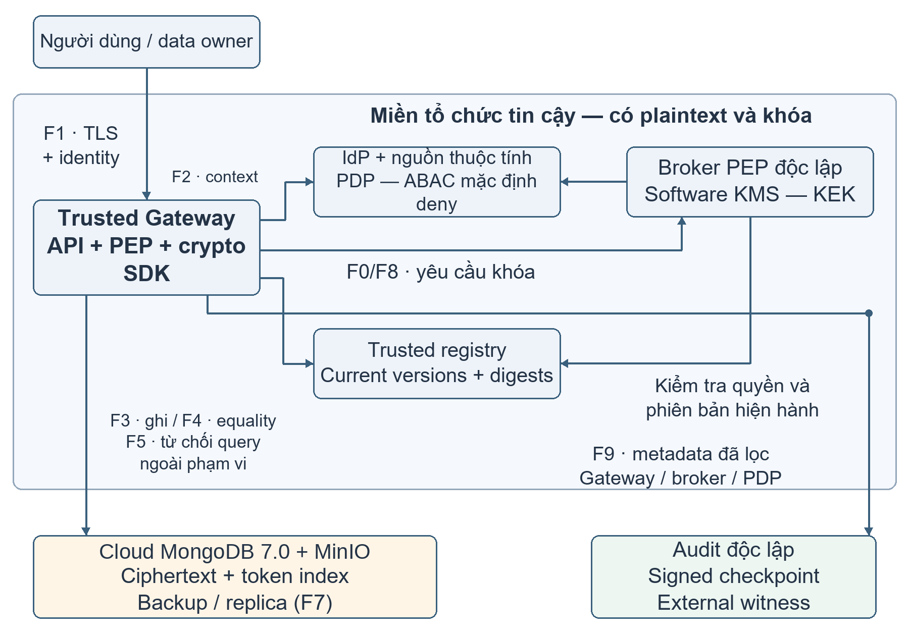
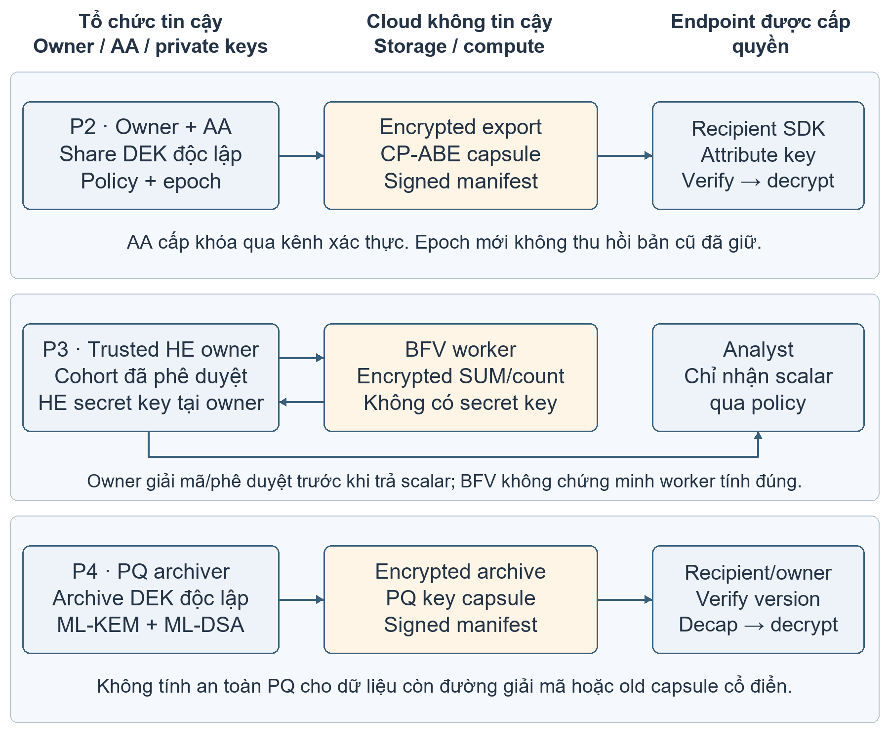

# Project Proposal

## Bảo vệ hồ sơ y tế đa tenant trên Cloud DBMS: kiến trúc phân lớp, kiểm soát truy cập và bằng chứng an toàn

**Đề tài đăng ký:** Topic 18 — Cryptographic Data Protection, Fine-Grained Access Control and Post-Quantum Secure Query Architecture for Cloud DBMS.

**Môn học:** Mật mã học và ứng dụng — NT2205.11.CH.

**Trình độ:** Thạc sĩ An toàn thông tin. **Thời lượng dự kiến:** 12 tuần.

**Thành viên:** Nguyễn Đạo Ga Đô — 26848038; Đào Võ Hữu Hiệp — 26848065.

**Phiên bản:** 1.2 — cập nhật ngày 23/11/2026 theo các quyết định kỹ thuật sau feasibility và triển khai (bản đăng ký 1.1 ngày 16/09/2026). Danh sách thay đổi tại Phụ lục B.

**Tính chất:** Nghiên cứu thực nghiệm kết hợp xây dựng prototype; không xây dựng DBMS mới, không đề xuất primitive mật mã mới.

Đây là proposal đăng ký: mục tiêu, kiểm thử và sản phẩm dưới đây là kế hoạch và phạm vi cam kết, không phải báo cáo kết quả. Phạm vi đề nghị phê duyệt là các cấu hình E1–E5, E7–E9 tại mục 8; phân công cụ thể được quản lý trong kế hoạch triển khai riêng. Bản 1.2 điều chỉnh nền tảng lưu trữ, scheme CP-ABE, KMS và lịch; các điều chỉnh làm thay đổi nghĩa vụ Master được nêu rõ để giảng viên phê duyệt.

## Tóm tắt đề xuất

Các cơ sở y tế sử dụng Cloud DBMS cần vừa khai thác hồ sơ, vừa hạn chế việc đọc dữ liệu ngoài thẩm quyền. Mã hóa lưu trữ thông thường chỉ giải quyết một phần bài toán: DBMS đang hoạt động vẫn có thể trả plaintext cho tài khoản đặc quyền; kiểm soát ở ứng dụng có thể bị bỏ qua bởi truy vấn trực tiếp; tìm kiếm trên dữ liệu mã hóa có thể làm lộ phân bố và mẫu truy cập. Chia sẻ dữ liệu cho nhiều người nhận, thu hồi quyền và bảo vệ bí mật dài hạn làm phát sinh thêm yêu cầu về khóa và chính sách.

Đề tài chọn hệ thống hồ sơ y tế đa tenant dùng dữ liệu tổng hợp làm trường hợp nghiên cứu. Bắt đầu từ nghiệp vụ và truy vấn, đề tài xác định tài sản, threat model và yêu cầu bảo mật; đặt ranh giới tin cậy và cơ chế kiểm soát; sau đó mới suy ra yêu cầu mật mã, lựa chọn cơ chế và thực nghiệm. Prototype dùng MongoDB 7.0 cho hồ sơ dạng document và MinIO (S3) cho tệp y tế nhị phân, cùng một mô hình dữ liệu logic, workload và bộ đo; so sánh SQL/NoSQL được thực hiện ở mức phân tích kiến trúc (mục 8.1). Phần lõi bảo vệ field ở miền tổ chức tin cậy, quản lý khóa ngoài DB và kiểm soát truy cập thuộc tính. Các nhánh thực nghiệm độc lập đánh giá tìm kiếm equality với explicit leakage profile, chia sẻ CP-ABE, phép tổng BFV và chuyển đổi key/signature path theo chuẩn PQC.

Kết quả kỳ vọng không phải tuyên bố một hệ thống “an toàn tuyệt đối”, mà là bộ bằng chứng cho biết cấu hình nào bảo vệ tài sản nào, trước đối thủ nào, với giả định, rò rỉ, chi phí và giới hạn nào.

Các chữ viết tắt và mã SR/CR/TC/E/A1–A10 được giải thích tại Phụ lục A để proposal có thể đọc độc lập với tài liệu triển khai.

## 1. System Analysis — Phân tích hệ thống

### 1.1 Bài toán và nghiệp vụ

Mỗi tenant đại diện một cơ sở y tế. Bác sĩ được đọc các trường lâm sàng thuộc phạm vi phân công; nhân viên hành chính chỉ thấy trường hành chính; nhà phân tích chỉ được yêu cầu các thống kê đã duyệt; DBA vận hành DB nhưng không mặc nhiên có quyền giải mã hồ sơ. Có luồng chia sẻ gói dữ liệu cho nhóm chuyên môn bên ngoài và quy trình break-glass có phê duyệt, thời hạn và audit.

Nghiệp vụ gồm tạo/cập nhật hồ sơ, tra cứu theo mã bản ghi, lọc equality trên một số trường được chấp thuận, đọc field theo quyền, xuất tập dữ liệu, thống kê tổng, backup/restore, rotation và thu hồi. Nhu cầu range, join nhạy cảm và text search được liệt kê trước khi chọn công nghệ; prototype chính không hỗ trợ chúng trên ciphertext và phải từ chối rõ ràng.

### 1.2 Thành phần và giả định tin cậy

- Miền tổ chức tin cậy: Identity Provider, nguồn thuộc tính, Trusted Crypto Gateway, PDP, key broker/KMS, registry phiên bản, data owner. Gateway nhìn thấy plaintext; đây là service-side encryption ở ngoài miền quản trị Cloud DB, không phải end-to-end encryption chống gateway.

- Miền cloud: MongoDB 7.0, MinIO object storage, chỉ mục tìm kiếm, backup/replica và worker tính tổng. Đối thủ có thể đọc/sửa/copy dữ liệu trong miền này; không mặc nhiên có khóa tại miền tổ chức.

- Miền người nhận: endpoint giữ attribute key hoặc private key; được tin cậy bảo vệ khóa. Không thể thu hồi plaintext đã được người nhận hợp lệ lưu lại.

- Miền audit độc lập: checkpoint và phiên bản hiện hành không nằm trong quyền rollback của DBA cloud.

- Giả định lab: Ubuntu Server trên VM hoặc máy lab riêng; container chỉ mô phỏng sự phân tách quản trị. Root/hypervisor kiểm soát toàn bộ host có thể phá vỡ giả định. Không coi Docker hoặc software KMS là ranh giới bảo vệ trước host administrator hay tương đương HSM.

Phạm vi luồng F0–F9 theo [T]: F0 cấp phát danh tính/khóa; F1 xác thực; F2 cấp quyền; F3 ghi; F4 point/equality query; F5 từ chối range/text ngoài phạm vi; F6 aggregate; F7 backup/replica; F8 rotation/revocation; F9 audit. Hình 1–2 thể hiện các ranh giới chính; F5 và nhánh join trong F6 không có triển khai truy vấn ciphertext tổng quát.

## 2. Assets — Tài sản cần bảo vệ

| Nhóm tài sản | Tác động khi bị xâm phạm | Thuộc tính cần bảo vệ |
|---|---|---|
| PII, diagnosis, notes, chi phí | Lộ hồ sơ, liên kết danh tính, sửa nội dung | Bí mật, toàn vẹn, phân quyền field |
| Tenant, record ID, nhãn phân loại | Tráo tenant, cấp quyền sai, liên kết metadata | Toàn vẹn, tenant binding; chấp nhận một phần metadata leakage |
| Identity, attribute, policy bundle | Giả danh hoặc tự nâng quyền | Xác thực nguồn, integrity, phiên bản, expiry |
| DEK, KEK, search key, AA secret, PQ/HE private key | Mất bảo vệ một field, tenant hoặc cả miền chia sẻ | Phân tách khóa, least privilege, lifecycle, backup bảo vệ |
| Nonce, data/capsule/policy version, manifest | Reuse nonce, rollback, downgrade | Tính duy nhất, freshness state, integrity |
| Audit và benchmark evidence | Không truy vết hoặc kết luận sai | Provenance, integrity, retention, không chứa secret |

Phân tích phụ thuộc sẽ chỉ ra các đường lan truyền: lộ tenant KEK → các DEK còn truy cập được → dữ liệu tương ứng; lộ AA master secret → khả năng sinh attribute key; sửa nguồn thuộc tính → quyết định PDP sai; rollback registry cùng DB → mất phát hiện bản cũ.

### 2.1 Ma trận dữ liệu — truy vấn — bảo vệ

| Trường / nhóm dữ liệu | Nhu cầu trong prototype | Bảo vệ và giới hạn đề xuất |
|---|---|---|
| tenant_id, record_id | Định tuyến tenant; tra cứu bản ghi | ID giả danh/UUID; metadata clear được ràng buộc AAD và registry. Chấp nhận lộ nhóm tenant và liên kết bản ghi. |
| external_patient_id | Một equality query chính, đúng tenant | AES-GCM + HMAC token tách khóa theo tenant/field; gateway lọc ứng viên và kiểm tra lại ngữ cảnh. |
| name/email, note | Đọc field theo quyền | AES-GCM; không index hoặc prefix/full-text trong core. Email equality chỉ là mở rộng nếu được chốt riêng. |
| diagnosis_code | Đọc lâm sàng; fixture leakage | AES-GCM. Chỉ bật blind index trong thí nghiệm leakage riêng với dữ liệu tổng hợp, không coi là cấu hình khuyến nghị mặc định. |
| amount_units | SUM/count trên cohort đã duyệt | P1 lưu AES-GCM; P3 tạo snapshot BFV riêng. Không cung cấp encrypted WHERE/range/join. |
| policy/crypto metadata | Cấp quyền, version, suite/key ID | Nguồn thuộc tính tin cậy, chữ ký/registry và AAD phù hợp; không tin label từ DB đơn độc. |

Không đưa PII hoặc tên bệnh vào AAD, tên khóa, log hay nhãn chính sách công khai. Schema logic và query semantics được cố định trước khi đo; tệp nhị phân được mã hóa chunked AES-256-GCM trước khi lưu MinIO, MongoDB chỉ giữ metadata. Khóa mật mã sinh ngẫu nhiên độc lập với seed của dữ liệu tổng hợp.

## 3. Threat Model — Đối thủ và kịch bản

| Đối thủ | Năng lực/tri thức giả định | Kịch bản ưu tiên |
|---|---|---|
| Kẻ lấy snapshot | Copy file/backup, biết schema và phần mềm; không có KMS key | Đọc hồ sơ từ bản sao offline |
| Người dùng trái quyền | Có tài khoản, điều khiển request và context tự khai | Sai tenant/role/purpose, export trái phép, tự bật emergency |
| DBA/cloud operator | Query trực tiếp, đọc/sửa ciphertext/index, có thể bỏ qua DB policy | Bypass API/DB role, tráo field/tenant, sửa metadata |
| Đối thủ active network/storage | Nghe lén, sửa, replay, thay khóa công khai, đưa input lỗi | MITM, forged policy, replay capsule, downgrade |
| Người nhận bị thu hồi/cấu kết | Giữ ciphertext cũ, khóa riêng của từng người không đủ quyền | Ghép thành phần ABE key, tiếp tục đọc sau revocation |
| Quan sát viên truy vấn | Biết phân bố từ nguồn phụ, thấy token và access trace | Suy luận giá trị từ frequency/search/access pattern |
| Đối thủ tương lai lượng tử | Lưu ciphertext hôm nay, có năng lực phá RSA/ECC/pairing về sau | Harvest-now-decrypt-later qua đường wrap cổ điển |

Ngoài phạm vi bảo đảm của prototype: compromise toàn bộ gateway/KMS/AA, endpoint đã nhiễm mã độc, chống DoS tuyệt đối, TEE side-channel, private information retrieval, query completeness trước DB ác ý và formal verification toàn bộ protocol. Các giả định này được ghi nhận như residual risk; không được dùng kết quả thử nghiệm để tuyên bố đã giải quyết chúng.

Vẫn kiểm thử để minh họa giới hạn: DBA đọc plaintext ở B1, bản sao cũ còn giải mã được sau thu hồi, inference từ blind index và BFV worker trả tổng sai. Đây là kết quả giới hạn theo thiết kế, không phải mục tiêu bảo vệ được xem là đã đạt.

## 4. Security Requirements — Yêu cầu bảo mật

Bảng sau trình bày các yêu cầu cấp hệ thống SR-01–SR-18 ở mức đăng ký. Các nhóm mã được gộp để giữ proposal ngắn; mỗi yêu cầu sẽ được tách thành test và evidence riêng khi triển khai.

| Mã | Yêu cầu ở cấp hệ thống | Tiêu chí kiểm chứng dự kiến |
|---|---|---|
| SR-01 | Cloud DB/snapshot không đọc được field nhạy cảm trong cấu hình field encryption nếu không có quyền khóa | Direct query và restore độc lập chỉ thấy ciphertext; client không có quyền khóa không giải mã được |
| SR-02–SR-04 | Cấp quyền đúng tenant, row/field, action và context từ nguồn tin cậy | Không false permit trong bộ test; bác bỏ sai tenant/role/purpose/time và emergency tự khai |
| SR-05 | Không chấp nhận dữ liệu bị sửa hoặc đặt sai ngữ cảnh | Tráo tenant/field/record/version hoặc sửa tag/ciphertext bị từ chối |
| SR-06–SR-07 | Phát hiện bản cũ và thực thi thu hồi online theo trạng thái hiện hành | Replay bản hợp lệ cũ bị từ chối online; báo cáo riêng khả năng đọc offline dữ liệu cũ |
| SR-08 | Một người không đủ thuộc tính không giải mã được share capsule; union của nhiều khóa riêng không được coi là một khóa hợp lệ | Authorized decrypt thành công; unauthorized/key-component mixing không phục hồi share DEK |
| SR-09 | Equality query đúng trong mô hình server tuân thủ thực thi, với leakage profile tường minh | Kết quả so oracle, trace và inference trên synthetic data; không cam kết zero leakage |
| SR-10 | Worker thực hiện aggregate trên ciphertext, không giữ khóa giải mã | BFV SUM đúng số nguyên trong miền đã định; sửa kết quả được phân tích, không gán HE tính xác thực |
| SR-11–SR-12 | Khóa/chính sách có lifecycle và migration không fallback âm thầm | Crash/restart rotation, old/new compatibility, unknown/retired suite rejection |
| SR-13–SR-16 | Audit, lỗi, secure channel và backup có kiểm soát | Không secret trong artifact; policy giả bị chặn; outage fail closed; recovery theo manifest |
| SR-17–SR-18 | Benchmark tái lập và phụ thuộc được kiểm kê | Raw data, phiên bản, seed, tham số, CI và thông tin build liên kết kết luận |

## 5. Security Architecture — Kiến trúc bảo mật

PDP thực hiện ABAC; PEP tại gateway kiểm soát query và field projection, PEP tại broker kiểm tra độc lập quyền nhận khóa. DB chỉ giữ ciphertext, capsule và metadata đã được giới hạn. Khóa nằm ngoài quyền quản trị DB. Registry tin cậy giữ phiên bản và digest hiện hành để phát hiện rollback; audit có checkpoint ngoài miền DB. ABAC được đặt theo mô hình subject–object–action–environment [1]; policy plane không thay cho confidentiality bằng mã hóa [12].

*Hình 1. Core P1: gateway, ABAC, broker/KMS và registry nằm ngoài quyền quản trị Cloud DB; audit có checkpoint độc lập.*

F3/F4 chỉ chuyển ciphertext, token và metadata đã được chấp thuận tới DB; F9 chỉ ghi metadata đã lọc. Broker kiểm tra quyền nhận khóa độc lập với gateway. Registry giữ phiên bản/digest hiện hành; chữ ký hoặc AEAD không tự phát hiện replay bản cũ hợp lệ.

*Hình 2. P2/P3/P4 là các nhánh hẹp, có dữ liệu và khóa độc lập; không xếp CP-ABE, BFV và PQC nối tiếp trên mọi request.*

Trong kiến trúc đề xuất trên, CP-ABE share, HE aggregate và PQC archive là những profile riêng, không bắt tất cả primitive tham gia mọi request. Bản sao giải mã được qua cơ chế cổ điển không được tính là dữ liệu đã bảo vệ hậu lượng tử chỉ vì có thêm PQ wrapper.

P2 chia sẻ export đã được ABAC phê duyệt; AA cấp attribute key qua kênh xác thực. P3 do trusted owner chọn cohort và giải mã kết quả trước khi cấp scalar cho analyst. P4 bảo vệ archive/key capsule riêng; đường xác thực descriptor và phiên bản phải được kiểm kê cùng đường giải mã.

## 6. Cryptographic Requirements — Suy ra yêu cầu mật mã

| SR nguồn | Thuộc tính mật mã cần thiết | Điều kiện/giới hạn |
|---|---|---|
| SR-01, SR-05 | Authenticated confidentiality, ciphertext integrity và context binding | Nonce không lặp với cùng key; trusted expected AAD |
| SR-02–SR-04, SR-15 | Xác thực entity và nguồn policy/public key | KEM không tự xác thực đối tác; ABAC không được thay bằng AES |
| SR-06, SR-07, SR-12 | Integrity của version + kiểm tra freshness bằng trạng thái | AEAD/signature đơn lẻ không chống replay bản hợp lệ |
| SR-08 | Policy-based key confidentiality và collusion resistance theo scheme | CP-ABE cổ điển có giả định pairing, không PQ-safe; test không thay chứng minh |
| SR-09 | Token PRF và key separation; leakage function được công bố | Equality/frequency/search/access leakage được chấp nhận có điều kiện |
| SR-10 | Homomorphic correctness và semantic confidentiality theo tham số HE | Không tự có integrity hoặc verifiable computation |
| SR-11, SR-12 | KEM security, domain-separated KDF, signature unforgeability, suite binding | Profile PQ chỉ bảo vệ key/signature path đã kiểm kê |
| SR-13, SR-16 | Authentic manifest/checkpoint và chain continuity | Cần independent witness để phát hiện truncate/replay |

Mục tiêu cho primitive chuẩn: bảo mật cổ điển tối thiểu khoảng 128-bit theo cấu hình thư viện hợp lệ; AES-256 cho dữ liệu dài hạn; ML-KEM/ML-DSA chọn parameter set category 3. Prototype CP-ABE có mức bảo mật và giả định riêng, không suy ra mức chung 128-bit từ tên group ví dụ. Cơ sở lựa chọn AEAD và PQC là [2], [6]–[8]; tham số và giới hạn của từng implementation được xác nhận sau feasibility spike, không cộng dồn mức bảo mật giữa các lớp.

## 7. Cryptographic Mechanisms — Lựa chọn sau khi có yêu cầu

### 7.1 Cơ chế và vai trò

| Cơ chế đề xuất | Vai trò cụ thể và lý do | Không tuyên bố |
|---|---|---|
| Encrypted volume baseline | So sánh stolen-volume threat với DB đang chạy | Không chống DBA; không gọi volume là TDE engine |
| AES-256-GCM + envelope + KMS [2] | Bảo vệ field, DEK tách tenant/context; key lifecycle | Không tự thực thi ABAC hoặc searchable SQL |
| ABAC/PDP/PEP, MongoDB scoped role bổ trợ [1], [13] | Ngữ nghĩa subject/object/action/environment và kiểm tra bypass | DB role không chống DBA có quyền root |
| HMAC-SHA-256 blind index [4] | Equality search tái lập được trên SQL lẫn NoSQL, đo leakage rõ | Không phải MongoDB QE, không forward-private SSE |
| CP-ABE AC17 KEM/DEM [3], [11], [16] | Chia sẻ một-nhiều bằng thuộc tính, bọc share DEK | Không mã hóa bulk bằng pairing; không tự thu hồi dữ liệu cũ |
| SEAL BFV [5] | Một phép SUM/count trên số nguyên, không cần TEE hardware | Không phải arbitrary encrypted SQL, không proof of correct computation |
| ML-KEM-768 + HKDF + AEAD; ML-DSA-65 [6]–[8] | Archive/key capsule và policy/checkpoint có xác thực; đo migration | Không phải production-certified module hay toàn hệ thống PQ-safe |

### 7.2 Nghiên cứu liên quan và lý do chọn phạm vi

| Hướng liên quan | Điểm đối chiếu | Lựa chọn trong đề tài |
|---|---|---|
| ABAC/NGAC và CP-ABE [1], [3], [12], [13], [15] | Quyết định online theo context khác điều kiện giải mã bằng attribute key; vị trí enforcement ảnh hưởng bypass. | ABAC tại gateway/broker; CP-ABE cho export có thuộc tính tương đối ổn định. NGAC/m-NGAC là phương án đối chiếu, không triển khai thêm engine. |
| SSE/QE và secure enclave [4], [9], [10] | Chức năng truy vấn, leakage và trust assumptions khác nhau; một thiết kế equality không đại diện mọi SSE/QE. | E5 equality blind index có leakage contract riêng; không nhận là MongoDB QE. Không mở rộng range/text hoặc TEE trong prototype chính. |
| CP-ABE và thư viện HE [3], [5], [11] | Scheme, backend, tham số và chi phí ngoài primitive đều ảnh hưởng kết quả; không so các mức an toàn khác nhau như tương đương. | Một share capsule CP-ABE và một BFV SUM/count có miền số hữu hạn; đo cả chi phí end-to-end. |
| PQC và crypto-agility [6]–[8], [14] | KEM, chữ ký, inventory và migration giải quyết các phần khác nhau; bản sao/đường cổ điển còn lại giới hạn claim. | P4 key/signature path độc lập; E9 đo tương thích, downgrade, crash và residual decryptability. |

Giá trị nghiên cứu của đồ án nằm ở đối chiếu có kiểm soát trên cùng nghiệp vụ, dữ liệu và mô hình đối thủ, không ở việc khẳng định chưa từng có hệ thống tương tự. Các lựa chọn range encryption, TEE và lattice-based ABE được thảo luận như alternatives theo [T], không phải các nhánh triển khai bổ sung. Chọn crypto-agile PQ migration để đáp ứng nhánh Master thay cho triển khai PQ-ABE.

### 7.3 Chốt phạm vi E5 — equality blind index

E5 được đề nghị đăng ký như một prototype tìm kiếm đối xứng có chỉ mục, giới hạn equality: giá trị chuẩn hóa được ánh xạ thành token HMAC-SHA-256 bằng khóa riêng theo tenant/field; DB tìm ứng viên theo token, gateway cấp quyền và kiểm tra/decrypt kết quả. Không tải toàn bộ bảng về để gọi là tìm kiếm ciphertext. Ngữ nghĩa chuẩn hóa được giữ cố định và versioned.

Server có thể thấy equality/frequency, liên kết truy vấn lặp, tập bản ghi truy cập, kích thước và thời điểm kết quả/cập nhật. Đề tài đo leakage/inference với uniform và skew; adversary view tách khỏi ground truth của oracle. Không cam kết zero leakage, forward/backward privacy, encrypted range/text hoặc tính đầy đủ của kết quả trước server ác ý.

SSE trong [4] là căn cứ về mô hình và tiêu chí đối chiếu, không phải bằng chứng rằng blind index này hiện thực đầy đủ construction hay đạt security theorem của bài báo. Vì E5 trong [T] nêu QE/SSE, nhóm đề nghị giảng viên phê duyệt rõ phạm vi equality có leakage contract này. Tuần 1–2 là mốc chốt phạm vi trước triển khai; nếu cần thay construction thì cập nhật thiết kế và test, không đổi nhãn để tự coi là đã đáp ứng.

### 7.4 Candidate và baseline cần khóa sau feasibility spike

CP-ABE: sau feasibility spike, chốt scheme **AC17** (Agrawal–Chase, FAME [16]) qua Charm-Crypto [11] thay cho candidate BSW07 [3] ban đầu, vì tái sử dụng được mã nguồn đã đánh giá của nhóm và hỗ trợ nhóm ghép cặp Type-3. Đường cong BN254 dùng cho kết quả chính; SS512 (~80-bit) chỉ để so sánh, không dùng làm chứng cứ đạt 128-bit. Prototype bọc share DEK qua KEM/DEM với HKDF-SHA-256 (ngữ cảnh tenant, epoch, policy hash) và AES-256-GCM; test collusion không thay security proof.

BFV: Microsoft SEAL [5], candidate polynomial degree 8192 và security profile 128-bit do thư viện kiểm tra. amount_units là số nguyên 0–1000, cohort tối đa 10.000; chọn plaintext modulus t lớn hơn 10.000.000 và đáp ứng điều kiện batching (đã chốt prime batching 30-bit), đồng thời kiểm tra noise budget. SUM được so với oracle số nguyên; count không được coi là bí mật khi kích thước cohort đã lộ.

PQC: ML-KEM-768 + HKDF + AEAD bảo vệ archive DEK độc lập; ML-DSA-65 ký descriptor/manifest/policy/checkpoint [6]–[8]. Baseline dự kiến là RSA-3072 OAEP/SHA-256 để bọc DEK và Ed25519 cho chữ ký; không gọi RSA-OAEP là KEM tương đương hình thức hoặc coi các parameter set có mức an toàn bằng nhau. Khóa baseline trước benchmark; báo riêng thời gian, raw/wire bytes và giả định an toàn.

Key-only rewrap giữ ciphertext/AAD khi DEK không đổi, nhưng không khắc phục old classical capsule đã bị thu thập. Dữ liệu mới cần khóa độc lập và không còn alternate classical decrypt path mới có thể được xét claim dài hạn mạnh hơn. TLS/IdP/KMS/backup/ABE còn cơ chế cổ điển phải xuất hiện trong inventory; không tuyên bố end-to-end PQ security.

## 8. Implementation — Phạm vi và phương pháp triển khai

### 8.1 Các cấu hình và thí nghiệm

| ID | Cấu hình/thí nghiệm | Bằng chứng chính |
|---|---|---|
| E1 | B0 plaintext vs B1 encrypted lab volume | Latency/QPS, stolen snapshot, restore; phân biệt volume với logical dump |
| E2 | P1 field envelope + Vault KMS trên MongoDB | Round-trip, exposure boundary, key cost/storage overhead |
| E3 | P1 ABAC, broker PEP, break-glass | Permit/deny và direct-query bypass, field projection |
| E4 | P2 CP-ABE share capsule | Policy complexity, key/ciphertext size, collusion tests |
| E5 | P1 equality blind index — phạm vi đề nghị tại mục 7.3 | Correctness, search cost, leakage catalogue và inference |
| E7 | P3 BFV SUM/count | Exact result, compute/storage expansion và trust gap |
| E8 | P4 PQC key/signature path | Đối chiếu baseline cổ điển; sizes/times, auth binding, algorithm negotiation |
| E9 | Cross-cutting rotation/revocation | Downtime, rows touched, stale failure, residual decryptability |

Giữ mã E theo Topic 18; không thực hiện E6 TEE. Có 8 experiments, ít nhất ba hướng bảo vệ khác logic ngoài baseline; E4/E7 đáp ứng nhánh nâng cao và E8/E9 đáp ứng PQC/crypto-agility. So sánh SQL/NoSQL được điều chỉnh thành phân tích kiến trúc có đối chiếu: Pattern A–D theo [T, mục 6] (RLS và Always Encrypted phía SQL [10]; scoped role và Queryable Encryption phía MongoDB [9], [13]) so với giới hạn đã đo được trên MongoDB ở E1–E3; không có số đo hiệu năng PostgreSQL. Đây là điều chỉnh so với yêu cầu Master “comparison SQL vs NoSQL” và cần giảng viên phê duyệt. Theo [T, mục 12], BFV đáp ứng lựa chọn HE/FHE thay TEE, còn E8/E9 đáp ứng lựa chọn crypto-agile PQ migration; đủ số experiment không thay thế nghĩa vụ định tính Master.

### 8.2 Phạm vi dữ liệu và tính khả thi

Dữ liệu tổng hợp 2 tenant (hai bệnh viện, tỷ lệ 60/40); các mức 1.000, 10.000 và 100.000 hồ sơ. Main benchmark dùng 10.000; 100.000 là scale-up nếu RAM hoặc disk cho phép. HE/ABE dùng subset riêng để đo chi phí đúng bản chất, không tạo hàng trăm nghìn ABE/HE ciphertext không cần thiết. Dữ liệu phải có phân bố uniform và skew để nghiên cứu leakage.

Core P1 chạy trên MongoDB 7.0; tệp y tế mẫu (X-quang, CT/MRI, siêu âm, PDF) lấy từ nguồn công khai đã khử định danh và lưu MinIO dưới dạng ciphertext. ABE/HE/PQC là worker hoặc CLI hẹp, không phải ba ứng dụng mới; các profile dùng subset và workload riêng được khai báo để tránh so sánh sai đơn vị đo.

### 8.3 Nguồn lực và mốc khả thi

| Hạng mục | Dự kiến và ràng buộc |
|---|---|
| Nhân lực / thời gian | Nhóm 2 học viên, 12 tuần. Quỹ công sức dự trù cho toàn nhóm khoảng 36–44 giờ/tuần (432–528 giờ); đây là giả định lập kế hoạch, cần chốt trong plan chi tiết, không phải số giờ đã xác nhận. |
| Máy lab | Đề xuất 8 logical CPU, 32 GB RAM và khoảng 60 GB đĩa lab. Với 16 GB RAM: chạy tuần tự, giữ 10.000 record chính; 100.000 chỉ là scale-up tùy chọn. |
| Hệ điều hành / runtime | Ubuntu 22.04/24.04; Docker Compose; MongoDB 7.0 và MinIO; Python 3.12 FastAPI gateway/test harness; PDP ABAC viết bằng Python; HashiCorp Vault Transit làm software KMS (file storage bền vững); container riêng cho CP-ABE (Charm AC17), SEAL BFV và liboqs. |
| Feasibility gate tuần 1–2 | Build và chạy smoke test ABE/HE/PQC; kiểm tra tham số, serialization, round-trip và negative input; chốt E5, baseline E8, dependency versions, tài nguyên và ranh giới lab trước khi tích hợp. |

Không cam kết API hoặc khả năng build chưa thử; phiên bản được pin sau feasibility gate. Không dùng cloud production, dữ liệu y tế thật hoặc khóa production để benchmark. Phân công từng thành viên được bổ sung trong kế hoạch triển khai riêng, không thuộc nội dung proposal này.

## 9. Security Testing — Kiểm thử bảo mật của đồ án

Kế hoạch dự kiến gồm khoảng 30 nhóm test TC-01–TC-30, với oracle độc lập và expected/observed được lưu riêng. Các nhóm mandatory: wrong key/tag/ciphertext/AAD; direct DB query; restore không có quyền KMS; wrong tenant/role/purpose/time/break-glass; policy/public-key substitution; stale capsule/record; CP-ABE unauthorized/collusion/epoch; query leakage/inference; HE malformed/incorrect result; downgrade/migration crash; nonce reuse/malformed input; audit truncation; outage và credential leakage.

Mọi thử nghiệm tấn công chỉ chạy trong lab được phép trên dữ liệu tổng hợp; không dùng credentials hay secret production. Các thử nghiệm tấn công sẽ ghi cả trường hợp hệ thống không bảo vệ được theo thiết kế: DBA đọc plaintext trong B1, người nhận vẫn đọc được bản cũ đã có khóa, blind index lộ frequency, HE worker có thể trả kết quả sai nếu không có chứng minh bổ sung.

Một ví dụ chuỗi lập luận: DBA tráo ciphertext giữa tenant → SR-05 cần toàn vẹn ngữ cảnh → CR-02 cần authenticated binding → AES-GCM AAD + trusted manifest → SDK xác minh expected tenant/record/field/version → TC-05 → evidence cho từng trường bị sửa. Không rút ngắn thành “DBA attack → AES”.

Trong ví dụ trên, CR-02 là yêu cầu ràng buộc ngữ cảnh và tách miền khóa; TC-05 là nhóm mutation/tampering test có positive control. Catalog đầy đủ của các mã nằm trong tài liệu kỹ thuật liên kết tại Phụ lục A; proposal không báo các test này đã PASS.

## 10. Evaluation — Đánh giá và tiêu chí nghiệm thu

### 10.1 Đo lường và câu hỏi nghiên cứu

- RQ1 — Ranh giới bảo vệ: field encryption + broker thay đổi plaintext exposure và bypass outcome thế nào so với volume encryption?

- RQ2 — Quyền truy cập: ABAC online và CP-ABE share khác nhau thế nào về dynamic context, collusion, revocation cost và residual access?

- RQ3 — Khả năng truy vấn: equality index và BFV đáp ứng chức năng nào; rò rỉ/chi phí tăng bao nhiêu so với oracle plaintext?

- RQ4 — Vận hành dài hạn: key-only PQ migration giữ được khả năng đọc trong chuyển đổi đến mức nào; dependency cổ điển nào còn giới hạn claim?

Đo correctness, false permit/deny, plaintext exposure, leakage/inference accuracy, p50/p95/p99, QPS/TPS, error rate, CPU/RAM, storage/index/network expansion, thời gian rotation và recovery. Hardware cycles/op chỉ báo cáo khi có counter phù hợp; không đổi nanosecond ra cycle bằng clock giả định.

Dự kiến chạy tối thiểu 5 lần độc lập mỗi cấu hình chính, 30 giây warm-up và 120 giây đo cho workload đủ ổn định; đảo thứ tự chạy, giữ semantics/dataset/resources nhất quán, báo cáo confidence interval 95% theo các lần chạy. Microbenchmark và HE dùng thiết kế lặp riêng; không gộp mọi operation làm một thống kê duy nhất.

E5 dùng auxiliary knowledge đã định, tách dữ liệu tham chiếu khỏi ground truth của tập đích; báo cáo accuracy so với baseline ngẫu nhiên/majority và sensitivity theo độ lệch phân bố. Không dùng chính plaintext đích để huấn luyện attacker rồi coi đó là inference từ leakage.

### 10.2 Điều kiện hoàn thành đồ án sau triển khai

Các điều kiện dưới đây áp dụng khi nghiệm thu đồ án cuối kỳ, không phải khẳng định implementation/evidence đã có ở thời điểm đăng ký [G], [T].

1. Có đủ A1–A10 của guideline và 10 phase trong báo cáo; từng threat quan trọng có SR → CR/control → implementation → test → evidence.

2. Thực hiện các yêu cầu Master đã chọn: so sánh SQL/NoSQL ở mức phân tích kiến trúc (mục 8.1), CP-ABE/revocation, leakage/inference, BFV và PQ migration; không chỉ đạt ngưỡng số experiment.

3. Không false permit trong bộ test đã công bố; unsupported query bị từ chối; negative tests thuộc claim phải đạt. Test không chứng minh an toàn với mọi input.

4. Benchmark có raw data và điều kiện tái lập; không đặt “overhead dưới X%” làm kết quả định trước. Một cơ chế chậm hoặc leakage cao vẫn là kết quả nghiên cứu hợp lệ nếu được đo và giải thích đúng.

5. Mỗi SR có trạng thái verified/partial/not verified; failure chưa sửa dẫn đến thu hẹp claim và ghi residual risk, không đổi expected result để làm đẹp báo cáo.

6. Demo thể hiện unauthorized denial, secure equality query, CP-ABE share/epoch, BFV SUM và key/policy rotation; đối chiếu kết quả với evidence.

## 11. Lịch thực hiện, sản phẩm và rủi ro

| Tuần | Công việc chính | Mốc nghiệm thu |
|---|---|---|
| 1–2 | System/assets/threat/SR; thử build ABE/HE/PQC; schema và oracle | Scope/E5/baseline E8, trust model, dependency feasibility và parameter profile chốt |
| 3 | B0/B1, dữ liệu synthetic, benchmark harness | E1 chạy tái lập, baseline semantics thống nhất |
| 4–5 | Field envelope, KMS/broker, manifest/nonce/lifecycle; MinIO cho tệp nhị phân | E2, tampering/backup tests; P1 trên MongoDB |
| 6 | ABAC, context source, break-glass, direct bypass | E3 và quyền field đúng |
| 7 | Equality index và leakage/inference | E5, support/leakage matrix |
| 8 | BFV SUM/count | E7 exactness và trust-gap evidence |
| 9 | CP-ABE share, collusion và epoch | E4, phần ABE của E9 |
| 10 | Web portal demo đa vai trò (TLS, đăng nhập, ABAC field projection, CP-ABE export, BFV SUM, DBA ciphertext view) | Luồng end-to-end chạy được trên dữ liệu synthetic |
| 11 | ML-KEM/ML-DSA, versioned migration; re-test, fault injection, thống kê | E8/E9, downgrade/crash tests; raw data/CI, traceability cập nhật |
| 12 | Report, review claim, demo và gói tái lập | A1–A10, report, slides, video hoặc live demo |

Rủi ro lớn nhất là build thư viện nghiên cứu, độ rộng đề tài và khác biệt môi trường DB. Biện pháp đề xuất: spike sớm; giữ một query equality và một aggregate; tách worker/runtime; không làm Kubernetes/TEE; web portal chỉ là lớp demo mỏng trên gateway, không mở rộng thành EHR đầy đủ; giảm kích thước và số mức scale trước khi giảm nghĩa vụ Master. Việc dồn E8/E9 cùng re-test vào tuần 11 là rủi ro lịch chính của bản 1.2. Nếu một nhánh bắt buộc không khả thi, ghi mốc chặn và điều chỉnh phạm vi với giảng viên trong quá trình thực hiện, không gọi mock là implementation hoàn chỉnh.

Thứ tự giảm tải: tính năng portal ngoài luồng demo và hạ tầng ngoài lab; scale-up 100.000; nhiều biến thể policy/query; hybrid KEM tùy chọn. Giữ bộ tối thiểu đã chọn cho Master: core P1, phân tích SQL/NoSQL, CP-ABE/revocation, E5 leakage/inference, BFV và PQ migration. Nhánh bắt buộc không vượt feasibility gate phải được điều chỉnh phạm vi với giảng viên, không thay bằng mock rồi tính là hoàn thành.

Sản phẩm cuối: source/config tái lập; architecture/DFD; asset/threat/SR/CR; policy và key lifecycle; test suite; raw CSV/JSON và biểu đồ; bảng leakage; báo cáo PQ readiness; traceability matrix; báo cáo kỹ thuật và slide/demo.

## 12. Đóng góp kỳ vọng và nguyên tắc kết luận của đồ án

Đóng góp của đồ án môn học này là một nghiên cứu thiết kế và đánh giá có kiểm soát, không phải một thuật toán mới: mô hình hóa các ranh giới bảo vệ của Cloud DBMS; đối chiếu logical authorization với cryptographic sharing; đo trade-off query/leakage; và chứng minh khả năng vận hành versioned key migration trong scope xác định.

Kết luận sẽ theo mẫu: “Trong mô hình đối thủ T và dưới các giả định A, bằng chứng E hỗ trợ các yêu cầu R trên cấu hình C; các giới hạn L vẫn tồn tại.” Không tuyên bố hệ thống hoàn toàn an toàn, không rò rỉ, thu hồi tuyệt đối hay end-to-end post-quantum nếu còn đường cổ điển.

Đề xuất tuân theo Core project philosophy và Final principle trong [G]: số lượng thuật toán không là mục tiêu; đóng góp là chuỗi lập luận và bằng chứng từ bài toán hệ thống đến thiết kế, kiểm thử và kết luận có điều kiện.

## 13. Tài liệu tham khảo và căn cứ đăng ký

Tài liệu [G] và [T] là căn cứ học phần; các nguồn còn lại là tiêu chuẩn, công trình gốc hoặc tài liệu chính thức dùng để thiết kế và đối chiếu. Phiên bản/errata, exact scheme và API sẽ được đối chiếu khi khóa cấu hình ở tuần 1–2; việc dẫn nguồn không phải chứng nhận thư viện hay kết quả benchmark.

[G] [Course project guideline — Cryptography and Applications](../requirements/course-guideline.md). Mục 4–8; Core project philosophy; Final principle.

[T] [Topic 18 — Cloud DBMS Cryptographic Data Protection, Fine-Grained Access Control and PQC](../requirements/topic-18.md). Mục 9, 9.1, 12 và 14; bản tài liệu học phần trong project.

[1] [NIST SP 800-162 — Guide to Attribute Based Access Control (ABAC) Definition and Considerations](https://csrc.nist.gov/pubs/sp/800/162/upd2/final).

[2] [NIST SP 800-38D — Recommendation for Block Cipher Modes of Operation: GCM and GMAC](https://csrc.nist.gov/pubs/sp/800/38/d/final).

[3] [J. Bethencourt, A. Sahai, B. Waters — Ciphertext-Policy Attribute-Based Encryption](https://doi.org/10.1109/SP.2007.11). IEEE Symposium on Security and Privacy, 2007.

[4] [R. Curtmola, J. Garay, S. Kamara, R. Ostrovsky — Searchable Symmetric Encryption: Improved Definitions and Efficient Constructions](https://doi.org/10.1145/1180405.1180417). ACM CCS, 2006.

[5] [Microsoft SEAL — Homomorphic encryption library: source and documentation](https://github.com/microsoft/SEAL).

[6] [NIST FIPS 203 — Module-Lattice-Based Key-Encapsulation Mechanism Standard](https://csrc.nist.gov/pubs/fips/203/final). 2024.

[7] [NIST FIPS 204 — Module-Lattice-Based Digital Signature Standard](https://csrc.nist.gov/pubs/fips/204/final). 2024.

[8] [NIST SP 800-227 — Recommendations for Key-Encapsulation Mechanisms](https://csrc.nist.gov/pubs/sp/800/227/final).

[9] [MongoDB Documentation — Queryable Encryption](https://www.mongodb.com/docs/manual/core/queryable-encryption/). Đối chiếu khả năng theo phiên bản, không đồng nhất với blind index của đề tài.

[10] [Microsoft Learn — Always Encrypted with secure enclaves](https://learn.microsoft.com/en-us/sql/relational-databases/security/encryption/always-encrypted-enclaves). Phương án đối chiếu; không triển khai TEE trong phạm vi chính.

[11] [Charm-Crypto — Documentation and scheme implementations](https://jhuisi.github.io/charm/). Dùng implementation AC17 với đường cong BN254 và SS512.

[12] [NIST IR 8450 — Overview and Considerations of Access Control Based on Attribute Encryption](https://csrc.nist.gov/pubs/ir/8450/final).

[13] [NIST IR 8504 — Access Control on NoSQL Databases](https://csrc.nist.gov/pubs/ir/8504/final).

[14] [NIST CSWP 39 update 1 — Considerations for Achieving Crypto Agility: Strategies and Practices](https://csrc.nist.gov/pubs/cswp/39/upd1/considerations-for-achieving-crypto-agility/final).

[15] [NIST IR 8611 — m-NGAC: Transcending Traditional Database Security Models](https://csrc.nist.gov/pubs/ir/8611/final). Nguồn đối chiếu NGAC/m-NGAC được nêu trong Topic 18.

[16] [S. Agrawal, M. Chase — FAME: Fast Attribute-based Message Encryption](https://doi.org/10.1145/3133956.3134014). ACM CCS, 2017. Scheme AC17 dùng cho P2.

## Phụ lục A. Thuật ngữ, mã truy vết và tài liệu kỹ thuật

Tenant: miền tổ chức/cơ sở y tế; plaintext/ciphertext: bản rõ/bản mã; cohort: tập bản ghi được phê duyệt cho thống kê; oracle: kết quả đối chiếu độc lập trong kiểm thử, không phải cơ chế bảo vệ của deployment.

ABAC: kiểm soát truy cập dựa trên thuộc tính; PDP: điểm ra quyết định; PEP: điểm thực thi; KMS: dịch vụ quản lý khóa; DEK/KEK: khóa mã hóa dữ liệu/khóa bảo vệ khóa; AA: cơ quan cấp khóa thuộc tính; AEAD/AAD: mã hóa có xác thực/dữ liệu liên kết được xác thực.

CP-ABE: mã hóa theo chính sách gắn với bản mã; KEM/DEM: cơ chế đóng gói khóa/mã hóa dữ liệu đối xứng; BFV: scheme đồng cấu số nguyên được dùng trong P3; PQC: mật mã hậu lượng tử; RLS: kiểm soát truy cập mức hàng; SSE/QE: searchable symmetric encryption/queryable encryption; CI: khoảng tin cậy.

RQ: câu hỏi nghiên cứu; SR: yêu cầu bảo mật cấp hệ thống; CR: yêu cầu mật mã; TC: nhóm kiểm thử; E: thí nghiệm; F: luồng nghiệp vụ/dữ liệu. B0/B1: plaintext/volume baseline; P1: field envelope + ABAC + equality index; P2: CP-ABE share; P3: BFV aggregate; P4: PQ archive/key-signature path.

| Mã sản phẩm theo guideline | Nội dung nghiệm thu cuối kỳ |
|---|---|
| A1–A3 | Mô hình hệ thống và luồng; inventory tài sản; threat model và giả định. |
| A4–A7 | Yêu cầu bảo mật; kiến trúc; yêu cầu mật mã; thiết kế/cấu hình/cơ chế và rationale. |
| A8 | Source code, cấu hình và hướng dẫn chạy tái lập. |
| A9 | Positive, negative và adversarial tests kèm evidence. |
| A10 | Đánh giá, traceability, kết quả, residual risks, limitations và kết luận. |

Tài liệu kỹ thuật dùng khi triển khai: [Detailed project implementation](../planning/implementation-plan.md), [crypto and protocol design](../design/crypto-and-protocol-design.md), [experiments and validation](../testing/experiments-and-validation.md), [traceability matrix](../testing/traceability-matrix.md). Phạm vi và nguồn lực thực hiện tuân theo proposal được phê duyệt; kế hoạch chi tiết sẽ cụ thể hóa công việc cho nhóm hai học viên.

Nguồn sơ đồ: [core overview](../diagrams/proposal-overview.mmd), [independent profiles](../diagrams/proposal-profiles.mmd); kiến trúc triển khai đầy đủ và DFD: [architecture](../diagrams/architecture.mmd), [data flows](../diagrams/data-flows.mmd). Hình trong proposal là bản trình bày rút gọn để đọc trên A4, không thay đặc tả protocol.

## Phụ lục B. Thay đổi so với bản đăng ký 1.1

| Hạng mục | Bản 1.1 (16/09/2026) | Bản 1.2 (23/11/2026) | Lý do và ảnh hưởng |
|---|---|---|---|
| Nền tảng lưu trữ | PostgreSQL và MongoDB, P1 trên cả hai | MongoDB 7.0 cho document; MinIO cho tệp nhị phân | Tập trung công sức vào câu hỏi DBA đọc được gì; hồ sơ y tế cần lưu ảnh/PDF. Mất số đo SQL và RLS; SQL/NoSQL chuyển thành phân tích kiến trúc, cần phê duyệt |
| Scheme CP-ABE | Candidate BSW07 | AC17 (FAME) trên BN254, SS512 chỉ để so sánh | Tái sử dụng mã đã đánh giá của nhóm; nhóm ghép cặp Type-3. Không claim CCA, 128-bit cho SS512 hay PQ |
| PDP | OPA hoặc tương đương | Engine ABAC Python, deny-by-default | Đơn giản hóa phụ thuộc; giữ bảng chân lý độc lập để kiểm thử |
| Software KMS | Software KMS, chưa chốt | Vault Transit, khóa dẫn xuất theo ngữ cảnh, file storage bền vững | Vault dev mode mất toàn bộ KEK khi khởi động lại. Unseal key lưu cùng volume là giới hạn của lab |
| Tenant dữ liệu | 3 tenant | 2 tenant (60/40) | Đủ kiểm thử tách tenant; giảm kích thước fixture |
| Lịch | Tuần 10 PQC; không làm UI | Tuần 10 web portal demo; PQC E8/E9 dời sang tuần 11 | Portal phục vụ demo luồng bảo mật end-to-end; tăng rủi ro lịch tuần 11 |

Chi tiết từng quyết định được ghi trong Architecture Decision Records của repository (ADR-0001 đến ADR-0003). Các phần khác của bản 1.1 giữ nguyên.
