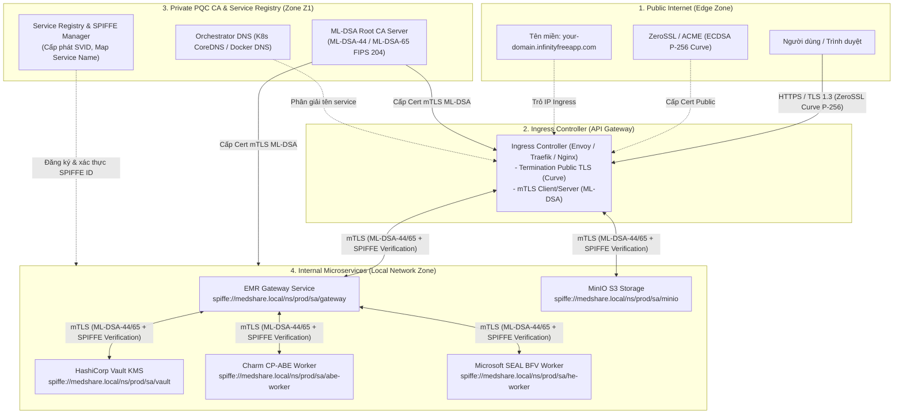

> **[ĐÁNH GIÁ 23/11/2026] Trạng thái: ĐỀ XUẤT – CHƯA TRIỂN KHAI.** Bản kế hoạch này có một số điểm chặn triển khai: OpenSSL host 3.0.2 chưa có ML-DSA; Vault/MinIO (Go) không dùng được chứng chỉ ML-DSA; InfinityFree không cấp DNS cho máy chủ riêng. Ngoài ra có lỗi nội dung (chữ ký ML-DSA-65 là 3.309 bytes; thiếu hybrid KEM; Ingress không được nối thẳng MinIO). Xem đánh giá đầy đủ và phạm vi rút gọn tại [`TIEN_DO_HIEN_TAI.md` – mục 7](TIEN_DO_HIEN_TAI.md).

Dưới đây là **Kế hoạch Thiết kế & Triển khai Toàn diện** theo đúng các yêu cầu kỹ thuật của bạn:
1. **Public Edge TLS:** Ingress Controller sử dụng chứng chỉ ECDSA (Elliptic Curve) từ ZeroSSL / InfinityFree.
2. **Internal Zero-Trust mTLS:** Toàn bộ kết nối giữa Ingress Controller và các Docker Services chạy mTLS nội bộ.
3. **Định danh SPIFFE:** Sử dụng SPIFFE ID nhúng vào X.509 SVID SAN URI.
4. **Service Registry & Local DNS:** Quản lý tên miền nội bộ qua Orchestrator (K8s CoreDNS hoặc Docker DNS).
5. **Private Post-Quantum PKI:** Tự dựng Root CA Server cấp phát chứng chỉ thuật toán chữ ký hậu lượng tử NIST FIPS 204 (**ML-DSA-44** hoặc **ML-DSA-65**).

---

### Mô hình Kiến trúc Tổng thể (Dual-Tier Security Architecture)



---

### Phần 1: Public Ingress TLS (InfinityFree + ZeroSSL Curve)

* **Mục tiêu:** Cung cấp kết nối HTTPS an toàn, được các trình duyệt phổ thông tin cậy mà không tốn chi phí mua domain/cert.
* **Quy trình triển khai:**
  1. **Đăng ký Domain miễn phí:**
     * Đăng ký tài khoản trên InfinityFree để nhận subdomain miễn phí (ví dụ: `medshare-lab.infinityfreeapp.com` hoặc dùng FreeDNS / DuckDNS trỏ CNAME/A về IP máy chủ).
  2. **Khởi tạo chứng chỉ ZeroSSL với thuật toán Elliptic Curve:**
     * Không dùng RSA 2048 truyền thống; cấu hình ACME client (như `certbot` hoặc `acme.sh`) chỉ định khóa Elliptic Curve:
       ```bash
       acme.sh --issue -d medshare-lab.infinityfreeapp.com \
         --server zerossl \
         --keylength ec-256 \
         --dns dns_infinityfree  # hoặc qua HTTP-01 Webroot
       ```
     * *Kết quả:* Cặp khóa bí mật và chứng chỉ số `fullchain.pem` dựa trên đường cong chuẩn **ECDSA P-256 (prime256v1)** hoặc **Ed25519**.
  3. **Cấu hình trên Ingress Controller:**
     * Ingress Controller đảm nhiệm việc Terminate (giải mã) kết nối TLS 1.3 công cộng từ người dùng, kiểm tra HTTP header, sau đó chuẩn bị đóng gói mTLS vào mạng nội bộ.

---

### Phần 2: Orchestrator Service Registry & Chuẩn Định danh SPIFFE

* **Service Registry & Local DNS:**
  * **Nếu dùng Kubernetes (K8s / K3s):**
    * Tận dụng Kubernetes Services và **CoreDNS**: mỗi service tự động có DNS FQDN nội bộ: `<service-name>.<namespace>.svc.cluster.local` (ví dụ: `gateway-svc.medshare.svc.cluster.local`, `minio-svc.medshare.svc.cluster.local`).
  * **Nếu dùng Docker Compose / Docker Swarm:**
    * Sử dụng mạng nội bộ do người dùng định nghĩa (`networks: [medshare-net]`): Docker Embedded DNS Engine (`127.0.0.11`) tự động phân giải tên service thành IP container tương ứng (`http://gateway:8000`, `http://minio:9000`).
* **Chuẩn Định danh SPIFFE (Secure Production Identity Framework for Everyone):**
  * Định dạng URI định danh SPIFFE ID:
    $$\text{spiffe://medshare.local/ns/}\{namespace\}\text{/sa/}\{service-name\}$$
  * Bảng phân bổ SPIFFE ID cho hệ thống:

| Service Name | Local DNS | SPIFFE ID (URI SAN trong Cert) | Vai trò trong hệ thống |
|---|---|---|---|
| **Ingress Controller** | `ingress.medshare.local` | `spiffe://medshare.local/ns/ingress/sa/ingress-proxy` | Reverse Proxy / API Gateway |
| **EMR Gateway** | `gateway.medshare.local` | `spiffe://medshare.local/ns/prod/sa/gateway` | Zone Z1 PEP Gateway & EMR API |
| **Vault KMS** | `vault.medshare.local` | `spiffe://medshare.local/ns/prod/sa/vault` | HashiCorp Vault Transit Engine |
| **MinIO S3** | `minio.medshare.local` | `spiffe://medshare.local/ns/prod/sa/minio` | Lưu trữ S3 Ciphertext PACS |
| **CP-ABE Worker** | `abe-worker.medshare.local` | `spiffe://medshare.local/ns/prod/sa/abe-worker` | Thuật toán mã hóa thuộc tính AC17 |
| **SEAL BFV Worker** | `he-worker.medshare.local` | `spiffe://medshare.local/ns/prod/sa/he-worker` | Tính toán đồng cấu viện phí BFV |

* **Quy chuẩn nhúng vào Chứng chỉ:**
  * SPIFFE ID được nhúng bắt buộc vào trường **Subject Alternative Name (SAN)** dưới dạng `URI:spiffe://...`.
  * Tên Service DNS được nhúng vào trường `DNS:gateway.medshare.local`.

---

### Phần 3: Xây dựng Private PQC Root CA Server (NIST ML-DSA-44 / ML-DSA-65)

Đây là thành phần cốt lõi để đưa thuật toán **Hậu lượng tử (Post-Quantum)** vào bảo vệ giao tiếp mTLS cục bộ:

* **Lựa chọn thuật toán NIST FIPS 204:**
  * **ML-DSA-44 (trước đây là Dilithium2):**
    * Mức an ninh: NIST Category 2 (tương đương phá vỡ AES-128 / SHA-256).
    * Kích thước khóa công khai: $1.312\text{ bytes}$, Chữ ký: $2.420\text{ bytes}$.
    * *Đặc tính:* Tốc độ ký và xác thực cực nhanh, phù hợp vi dịch vụ tần suất giao tiếp cao.
  * **ML-DSA-65 (trước đây là Dilithium3):**
    * Mức an ninh: NIST Category 3 (tương đương phá vỡ AES-192 / SHA-384).
    * Kích thước khóa công khai: $1.952\text{ bytes}$, Chữ ký: $3.293\text{ bytes}$.
    * *Đặc tính:* Độ an toàn cao hơn, phù hợp cho Root CA và các dịch vụ lưu trữ nhạy cảm (KMS, EMR Gateway).

* **Công nghệ triển khai CA Engine:**
  * Sử dụng thư viện **OpenSSL 3.x kết hợp OQS-Provider (Open Quantum Safe)** hoặc module Python tự viết dựa trên `liboqs-python` và thư viện chuẩn `cryptography`:
  ```bash
  # 1. Tạo Root CA Key bằng thuật toán ML-DSA-65
  openssl req -x509 -new -newkey mldsa65 -nodes \
    -keyout pqc_root_ca.key \
    -out pqc_root_ca.crt \
    -days 3650 \
    -subj "/CN=MedShare PQC Root CA/O=MedShare Lab/OU=Security"

  # 2. Tạo khóa cho Service (ví dụ: gateway) bằng ML-DSA-44 hoặc ML-DSA-65
  openssl req -new -newkey mldsa44 -nodes \
    -keyout gateway.key \
    -out gateway.csr \
    -subj "/CN=gateway.medshare.local/O=MedShare Lab"

  # 3. Ký chứng chỉ có gắn kèm SPIFFE URI SAN và Service DNS
  openssl x509 -req -in gateway.csr \
    -CA pqc_root_ca.crt -CAkey pqc_root_ca.key -CAcreateserial \
    -out gateway.crt -days 90 \
    -extfile <(echo "subjectAltName=DNS:gateway.medshare.local,URI:spiffe://medshare.local/ns/prod/sa/gateway")
  ```

* **Module Quản lý Dịch vụ & Cấp phát Cert (Service Certificate Agent Module):**
  * Xây dựng một module gọn nhẹ `pqc-cert-manager`:
    1. Tiếp nhận đăng ký từ container mới (thông qua Docker socket hoặc API nội bộ).
    2. Xác thực định danh service thông qua Orchestrator metadata (Service Account, Container Name).
    3. Tự động sinh cặp khóa ML-DSA và yêu cầu CA Server cấp phát X.509 SVID (Cert).
    4. Gắn certificate và private key vào volume bí mật của container (`/etc/ssl/mtls/`).
    5. Định kỳ xoay vòng chứng chỉ (Automated Certificate Rotation).

---

### Phần 4: Thiết lập mTLS giữa Ingress Controller và Docker Services

* **Nguyên lý hoạt động của mTLS nội bộ:**
  1. Khi Ingress Controller nhận request từ Internet (sau khi giải mã TLS ZeroSSL), nó tạo một kết nối mTLS mới tới service đích (ví dụ `gateway.medshare.local:8000`).
  2. **Service Authentication (Kiểm tra phía Server):** Service gửi chứng chỉ ML-DSA của nó cho Ingress. Ingress đối soát với `pqc_root_ca.crt` và kiểm tra SAN DNS có khớp `gateway.medshare.local` hay không.
  3. **Client Authentication (Kiểm tra phía Client):** Service yêu cầu Ingress gửi chứng chỉ client. Ingress gửi chứng chỉ ML-DSA của mình. Service xác minh chứng chỉ do `pqc_root_ca.crt` ký và kiểm tra trường SPIFFE ID:
     $$\text{SAN URI} == \text{"spiffe://medshare.local/ns/ingress/sa/ingress-proxy"}$$
  4. Hai bên thương lượng session key an toàn và bắt đầu trao đổi dữ liệu. Bất kỳ kẻ tấn công nào đứng trong mạng Docker cũng không thể nghe lén hoặc giả mạo request vì không có chứng chỉ do PQC Root CA cấp.

* **Cấu hình mẫu Ingress Controller (Ví dụ Envoy Proxy hỗ trợ PQC/mTLS):**
  ```yaml
  clusters:
  - name: ehr_gateway_service
    connect_timeout: 0.5s
    type: STRICT_DNS
    lb_policy: ROUND_ROBIN
    load_assignment:
      cluster_name: ehr_gateway_service
      endpoints:
      - lb_endpoints:
        - endpoint:
            address:
              socket_address:
                address: gateway.medshare.local
                port_value: 8000
    transport_socket:
      name: envoy.transport_sockets.tls
      typed_config:
        "@type": type.googleapis.com/envoy.extensions.transport_sockets.tls.v3.UpstreamTlsContext
        common_tls_context:
          tls_certificates:
          - certificate_chain: { filename: "/etc/ssl/mtls/ingress.crt" }
            private_key: { filename: "/etc/ssl/mtls/ingress.key" }
          validation_context:
            trusted_ca: { filename: "/etc/ssl/mtls/pqc_root_ca.crt" }
            match_typed_subject_alt_names:
            - matcher:
                exact: "spiffe://medshare.local/ns/prod/sa/gateway"
  ```

---

### Phần 5: Kế hoạch Triển khai Chi tiết (5 Bước Thực hiện)

| Bước | Hạng mục công việc | Deliverables (Sản phẩm bàn giao) | Công cụ / Công nghệ |
|:---:|---|---|---|
| **B1** | **Thiết lập Public Edge TLS** | - Tên miền phụ InfinityFree / FreeDNS.<br>- Chứng chỉ ZeroSSL Curve P-256 qua ACME.<br>- Cấu hình TLS 1.3 Terminate trên Ingress. | `acme.sh` / `certbot`, ZeroSSL API, Nginx / Traefik / Envoy. |
| **B2** | **Cấu hình Orchestrator & DNS Nội bộ** | - Khởi tạo Network Docker / K8s namespace.<br>- Đặt Service Name chuẩn xác (`gateway`, `minio`, `vault`, `abe-worker`, `he-worker`).<br>- Kiểm tra phân giải DNS nội bộ. | Docker Compose network bridge hoặc K8s CoreDNS. |
| **B3** | **Xây dựng PQC Root CA Server** | - Script sinh khóa gốc & Root CA `pqc_root_ca.crt` bằng **ML-DSA-65**.<br>- Module cấp phát cert nội bộ hỗ trợ nhúng **SPIFFE ID** và **DNS SAN**.<br>- Cơ chế ký CSR bằng **ML-DSA-44** cho vi dịch vụ. | OpenSSL 3 + `oqs-provider` (hoặc `liboqs-python`). |
| **B4** | **Triển khai mTLS cho các Services** | - Cấu hình Ingress Controller gửi client cert ML-DSA và xác minh SPIFFE.<br>- Cấu hình Uvicorn FastAPI & các worker kích hoạt chế độ `ssl_cert_reqs=CERT_REQUIRED`.<br>- Tích hợp middleware kiểm tra SPIFFE ID trên từng request. | FastAPI / Uvicorn SSL Context, Envoy Upstream / Downstream TLS. |
| **B5** | **Kiểm thử An ninh & Đo lường Hiệu năng** | - Test case xác minh bắt buộc có chứng chỉ client hợp lệ.<br>- Test case chặn client mạo danh (sai SPIFFE ID hoặc sai CA).<br>- Đo độ trễ bắt tay mTLS (Handshake Latency) giữa ML-DSA-44 vs ML-DSA-65 vs RSA/ECC cổ điển. | `pytest`, `curl --cert --key`, Wireshark / `tcpdump`. |

---

### Kịch bản Kiểm thử & Thẩm định Tiêu chí Nghiệm thu

1. **TC-PQC-01: Kiểm tra Public Edge TLS:**
   * Truy cập `https://your-domain.infinityfreeapp.com`: Trình duyệt hiển thị ổ khóa xanh hợp lệ, Cipher suite sử dụng `TLS_AES_256_GCM_SHA384` hoặc `ECDHE-ECDSA-AES256-GCM-SHA384`.
2. **TC-PQC-02: Kiểm tra Thuật toán Chứng chỉ Nội bộ:**
   * Chạy lệnh kiểm tra chứng chỉ:
     ```bash
     openssl x509 -in gateway.crt -text -noout | grep "Signature Algorithm"
     ```
   * *Kết quả mong đợi:* Thuật toán hiển thị `mldsa44` hoặc `mldsa65` (FIPS 204).
3. **TC-PQC-03: Kiểm tra SPIFFE ID trong SAN:**
   * Trích xuất trường SAN:
     ```bash
     openssl x509 -in gateway.crt -text -noout | grep -A 2 "Subject Alternative Name"
     ```
   * *Kết quả mong đợi:* Chứa cả `DNS:gateway.medshare.local` và `URI:spiffe://medshare.local/ns/prod/sa/gateway`.
4. **TC-PQC-04: Kiểm tra Chặn mTLS khi không có Client Certificate:**
   * Gửi request trực tiếp từ một container lạ vào Gateway mà không kèm cert:
     ```bash
     curl -k https://gateway.medshare.local:8000/api/v1/patients
     ```
   * *Kết quả mong đợi:* Bị từ chối ngay tại tầng TLS Handshake (`SSL: PEER_DID_NOT_RETURN_A_CERTIFICATE` / HTTP 403).
5. **TC-PQC-05: Kiểm tra Xác thực Đúng SPIFFE ID:**
   * Ingress Controller gửi đúng Client Cert mang SPIFFE ID `spiffe://medshare.local/ns/ingress/sa/ingress-proxy` $\rightarrow$ Handshake thành công và xử lý request bình thường.

Kế hoạch này đảm bảo phân tách rõ ràng giữa **giao tiếp công cộng bên ngoài** (thuận tiện cho người dùng bằng chuẩn web quốc tế) và **giao tiếp Zero-Trust bên trong** (bảo vệ tuyệt đối trước mối đe dọa máy tính lượng tử tương lai bằng NIST ML-DSA và SPIFFE). Bạn có muốn bắt đầu triển khai ngay từ **Bước 3: Khởi tạo module PQC Root CA Server (ML-DSA)** không?